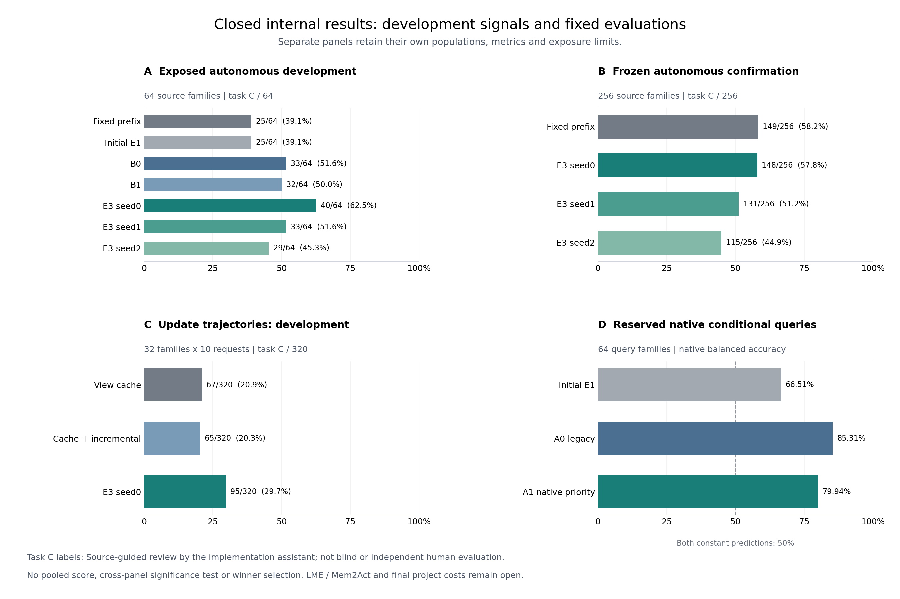

# MiLAi A100：已关闭内部结果总览

这张图汇集已关闭的内部任务与条件评测，供最终论文整合使用。完整计划仍在执行：
LME/Mem2Act全量结果、全项目成本与最终逐项审计未关闭。



[PDF](figures/a100-closed-internal-overview-20261107-v1.pdf) ·
[数值与来源](../data/manifests/a100-closed-internal-overview-20261107-v1.json) ·
[绘图入口](../tools/plot_a100_closed_internal_overview.py)

| 面板 | 分母与指标 | 必须保留的解释范围 |
|---|---|---|
| A：自主Host开发 | 每方法64个来源族；完整任务C/64 | 全部已暴露DEVELOPMENT；展示原五方法及两套追加E3训练seed，不重新选择胜者。E3与B训练配方、u32/u33切点不同，不能当作单一训练因素对照。 |
| B：冻结自主Host确认 | 每方法256个来源族；完整任务C/256 | seed0仍是预先固定的主参考，三个保存拟合全部展示。原生DEV185/TRAIN71与研究CONFIRMATION角色分开；三seed共享E1初始化，并非完整训练链独立复现。 |
| C：更新轨迹开发 | 每方法32族×10请求；完整任务C/320 | 独立聚合单位是32族；首HTTP输入未全部逐dict相同，比较为条件描述性结果。E3本面板实际未接收View，不能将收益归因于View复用或增量组合。 |
| D：旧64保留条件query | 64 query族的原生宏均衡准确率 | 共享语料；不是64个新Source历史或Host成功率。4066 known格计分，267 unjudged保留，零已判定change对；两种constant均为50%。三固定模型与评分合同先冻结，未新拟合或重选。 |

A/B/C的C标签来自本次实施助手按Source进行的实现作者审阅，没有独立人类、盲审或
多评审一致性证据。B的Source范围、共同122敏感性掩码及指南82/101/231时序限制，
按[256结果报告](MILAI_A100_CONFIRMATION256_RESULTS_20261107.md)原样保留；图只展示主C，
未删除失败或unknown，也未用敏感性标签替换主标签。D使用原生数据集标签与原生评分。

条形是各面板的原始完整分母统计；没有跨面板合并平均、差值检验或独立样本数相加。
不同面板的绝对百分比不能解释为同一难度下的性能变化。配对差和家族bootstrap区间见
[256结果](MILAI_A100_CONFIRMATION256_RESULTS_20261107.md)、
[D更新综合](MILAI_A100_D_SOURCE_VIEW_OPERATIONS_20261107.md)与
[旧64原生结果](MILAI_A100_RESERVED64_NATIVE_RESULTS_20261107.md)。本图不替代各报告的
配对统计、材料充分性、原生F1、操作与成本结果，也不支持部署采用或普遍优势主张。

绘图入口从原逐项开发/确认/更新审阅记录重新统计C，并与既有关闭汇总核对；
原生条件面板从已独立复算的原生分族评分读取，并核对64族平均和constant参考。
完整首结果、标签、掩码、冻结代码与模型保持原状；没有新增模型、HTTP或账本操作，
不使用SHA或内容指纹校验。已实际检查PNG的标签与布局；PDF由同一图面导出，
未另行渲染复查。

在仓库根目录运行，输出摘要需使用尚不存在的新路径：

```bash
python3 tools/plot_a100_closed_internal_overview.py \
  artifacts/a100-development-20261104 \
  /tmp/a100-overview-reproduction.json \
  /tmp/a100-overview-reproduction
```
