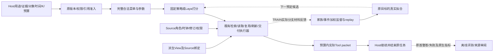

# MiLAi A100开发实验：内部阶段研究结果草案

这份草案整合已闭合的内部实验，尚不是完整计划的最终论文。LME两方法各451例已闭合，
未评分首失败保留；Mem2Act全量实验、全项目成本和最终图表/审计仍在进行。
旧64保留query已完成三固定模型的原生条件评测、全量审计与独立复算。

## 摘要

在原生Host需求、完整动作绑定和有限交付额度下，我们比较了条件负例覆盖、完整
参数反馈、已读材料选择以及更新轨迹中的复用/增量读取。负例修复显著改变了实际
训练暴露，但没有在已执行任务面板上产生相对原组成的成功率提升。扩大动作监督
覆盖也未形成明确的配对优势。更新开发面板出现学习策略的局部信号，但在冻结方法、
checkpoint、预算与256来源族后的完整自主Host确认中，主seed相对fixed-prefix的
完整成功率差为−0.39pp，家族配对95%区间[−7.42，6.64]；三seed族内均值差为
−6.90pp，区间[−12.50，−1.17]。主seed还使用更多Host tokens和本地计算。
当前证据支持功能与机制诊断，未支持采用学习策略的质量优势。作者标签、Source
范围、指南/敏感性掩码时序和外部暴露限制均需保留。

[内部结果总体图](MILAI_A100_CLOSED_INTERNAL_OVERVIEW_20261107.md)并列展示自主Host开发、
冻结256确认、更新开发与旧64原生条件评测，各自保留原分母、评分和暴露边界。
这份PNG/PDF已整合关闭的内部结果，不代表外部全量或完整计划已完成。

## 研究问题与执行合同

核心问题是：在Host已知证据、原生用途/对象/时间和有限预算下，哪些完整取证动作
及材料组合带来增量任务价值。MiLAi沿原Host工具边界工作；Source、View、已观察、
已读取和实际交付分别记录。来源存在、NN选择合法或材料更长均不自动等于任务成功。

训练对照继承实际原始初始化、目标、窗口与数据权重；两臂仅改变声明的处理。
正式比较保留同请求、原始Source、合法完整菜单和预算，不用裁K、截断状态或量化
来强行通过容量。首失败保留，原生unknown保持unknown；一次早期A重复调用导致的
更好随机答案已撤出主结果，恢复更早首结果，两次调用及成本均保留。

内部最终确认复用每个paper的同一真实pre-first-Host Store/Saver、context与catalog，
三学习方法仅覆盖policy/checkpoint。全256首Provider请求逐完整dict相同；实际后续
交互自然分化。全部原始Source/状态、角色、时钟、应用与未截断的有限NN投影另有
全量审计。采集时钟不作为事实发生时间；编码上限或成功执行不代表有效16k上下文。

## 方法、执行层与来源分母

Host表达当前用途、证据要求、对象/时间、已知材料和预算；记忆工具在原公开边界内构造
合法完整取证菜单。Laya对实际可见state和完整动作参数打分，策略按当次合法菜单选择SEARCH、READ、
USE_VIEW、REFRESH_VIEW或HANDOFF。合法是执行准入，不是正确性标签。Source完整bank可用、控制器
实际观察、已经读取、实际交付和Host最终收到的材料分别记录，不能以其中一层代替另一层。

图中TRAIN反馈与评测路径分开：已关闭拟合和候选构造不接收确认/外部答案或评分标签。
Source作者材料与整答判断不等于独立人类真值，后来评测不回填已关闭训练。共享的实际
baseline分支或预first-Host快照仅按发生的一次执行计量；不同state/seed/生成不增加独立来源。

单次有限决策的完整投影包括原Host条件、实际before及全部合法完整绑定，head ID与目标
随选项置换同步变化。无单独为显存裁掉K/菜单、静默截断或量化。配置max16384/head2048
表示构造上限与原生guard，不证明encoder在超过原8192配置时有有效长上下文语义能力。
记录的“完整输入”仅指该次真实可见控制器投影，不表示全部bank原文都进入NN或送达Host。

已知证据K只取真实之前交付的locator/修订，并经原生查验；不能用更晚cache修订替换旧K。
引用/Source身份与role/clock忠实不认证底层事实，旧Host输出继续归属assistant。Scope匹配、
pending、新到达、重复/询问/撤销/历史查询与当前事实更正不混同，不将所有新Source一律刷新。

离线条件诊断评估条件标签/unknown和完整argmax；同before短程及handoff-only评估实际局部
干预。显式given-readout只适用原host_request_generated=False且K空的捕获，输入为公开任务
加实际packet；full host-readout保留完整原post-tool frame。二者都不冒充完整自主Host轨迹。
自主比较则由真实pre-first-Host Store/Saver/context/catalog开始，Host自行请求证据和结束任务；
只覆盖预定policy/checkpoint，后续检索参数和实际轨迹允许分化，不强塞同一动作串。

### 数据角色、实验层与不能相加的分母

各行的实际来源与冻结配置见[方法及暴露机器表](../data/manifests/a100-paper-methods-exposure-20261109-v1.json)。

| 队列 | 分组单位 | 实际或明确计划规模 | 研究层/用途 | 暴露与边界 |
|---|---|---|---|---|
| P0 | 合法TRAIN行/完整条件pair | 每精度512行、32更新 | 性能/数值/导出诊断 | TRAIN；profile模型不进入正式初始化 |
| A-10k | 原生query家族、其所有条件整体归属 | 每臂39982条件＋4886已知操作replay | TRAIN组成处理 | 共享语料/原生标签与unknown保持 |
| A新128 | query家族 | 每模型8744矩阵格、三模型26232保存首输出 | 条件诊断/候选选择 | 与TRAIN/旧32/保留64 query家族不交叉，语料可共享 |
| 旧32任务 | 论文来源族 | 条件readout/完整绑定研究面板 | 开发筛选 | 给定任务＋实际packet，不当作新来源自主Host确认 |
| B64 | 新增TRAIN论文来源族/实际reached state | 384首绑定＝358新执行＋26原终止READ复用 | TRAIN监督支持比较 | B0/B1监督来自相同实际分支；非等采集槽位效率实验 |
| B修复/C | 旧TRAIN实际状态/已获得材料池 | 旧57READ覆盖补齐，集合保守18池/47新readout | 条件机制定位 | 全部原首失败/unknown保持，不以工具成功代替整答 |
| 自主DEV64 | 论文来源族 | 每方法64首轨迹；实际pre-first-Host快照配对 | 方法/checkpoint选择 | 已曝光，不是独立确认 |
| D更新 | 来源演进链，2流程×5请求同簇 | 3方法×(80＋320)＝1200首轮，含baseline80复用 | 自主更新开发 | 生成benchmark对话、实施者Source合同；非自然观察/40新确认 |
| D条件控制 | 固定已知View/旧输出的真实before | 9与42首格；旧输出原48inventory中6不具备干预资格 | 同信息条件机制 | 共同Host历史保持，Host随机生成未配对；非51个独立用户 |
| 冻结确认256 | 整篇论文来源族 | 4方法各256首轨迹；原生DEV185/TRAIN71另列 | 预冻结后的新研究来源确认 | 固定E1初始化；共享容器字节/预训练与Source作者非盲限制保留 |
| 保留64条件 | 共享语料上的query家族 | 127原行→4333格/模型，三模型12999首输出 | 预冻结原生条件次级评测 | 4066known/267unjudged，0已判change对，语料并非未见 |
| LME | 已曝光Small查询/共享历史 | 两方法各451，Reader后原生Judge | 外部给定query检索＋固定Reader复验 | Known development-exposed Small:451 public queries sharing200 histories across two Source pools; not451 independent users, unseen Small/Medium or original-paper model reproduction. |
| Mem2Act | 公有GivenTool任务/一个完整common bank | 两方法各400；每例同完整429session/16843turn bank | 外部自主记忆调用与适配指标复验 | 缺失引用/schema异常全保留；共享bank可跨引用检索 |

表中13行是不同协议的来源/执行说明，不是13个独立数据集，数量不跨表合并。
源分区native train/dev与研究TRAIN/DEVELOPMENT/CONFIRMATION分别记录；同paper、会话
或演进链及同query所有变体整体归属。数据新于某个研究阶段不等于语料未见、自然观察、
独立用户或公共预训练隔离。Mem2Act一行仍在执行，未由本方法表新增任何任务结果。

### 固定运行配置、训练与评分语义

自主内部Host使用既有Qwen3.6-35B-A3B-FP8、thinking=True、temperature=1，
上下文65536、输出8192，单消息24共享generation admission、每检索8控制步/策略reads4，
额外reads8、返回2048。共享admission包括本地policy等依赖生成，不直接称24次HTTP。
LME和Mem2Act沿各自冻结原生适配器/每任务额度，不将不同协议的预算抹平为同一矩阵。
后续冻结推理为GPU2/cuda0、FP32、4线程，reference compile/MHA fastpath/TF32关闭；
Host服务GPU0/1与模型/thinking未改动。

新单卡训练P0/A/B保持FP32参数和优化器状态；BF16臂用autocast做声明的forward、关键损失
归约FP32，P0还保留FP32对照。完整条件pair留在同一次micro2 forward，窗口16原分母保持。A按真实E2配方，
conditional单目标set与CE等价，operation replay仍是accepted-set；B按真实E3纯delivery/
quality-tie/component-sum与replay .25。额外E3 seed1/2保持其原FP32两GPU配方及同一E1
初始化、128更新/固定u32评测，不与新BF16两臂混称纯数据效果或完整训练链三seed。

Host主C是Source支持的整任务完整成功；Q/I/W/F/U不给C，U不自动宣布事实错误。材料充分/
部分/不足/未知独立，原生COMPLETED仅为执行状态。QASPER native answer F1保留完整原字符串，
首失败按原生空预测计分，不抽取修复片段。LME native Reader/Judge的UNKNOWN、未评分失败
与完整分母保持；Mem2Act适配strict intent、completed strict、value-F1及JSON-BLEU1分列，
不借原作者TA/leaderboard命名。正确intent不修复失败Host，多个提议不挑最好一个。

内部确认按来源族宏平均、配对增减/差值和20,000次seed0家族bootstrap报告，三seed先族内
均值再抽样，来源N仍256。D每来源10请求同簇，旧8与新32分开；保留64是query家族条件
重采样，不是文档历史泛化。LME共同已评分子集与全451缺失界分开。Mem2Act共享bank及
引用图不提供400用户或341组件独立性，不计算IID或组件独立性CI。

公共Source作者知道其他方法答案，既有122共同敏感性掩码/82、101、231补充的披露时序
不追认为预注册。所有原标签、首失败、指南和范围限制保持；CI不估计作者标注误差、公共
预训练接触或完整训练链/Host总体随机性。primary、checkpoint、预算和N均未用确认/外部
结果重选。+5pp是规划目标，不能替代区间支持的优势或自动采用条件。

CPU报告native与whole/residual/parent的包含关系，已付一次的成本不因复核或共享数据
重复加账。GPU job区间包含准备/加载/IO/Host等待，不等kernel忙时；原SDK缺失padding、
reserved或分阶段计时及未观察父/清理保持未知。最终全项目成本要等Mem2Act与post137
普通/失败计时在实际idle后闭合，不能从目前已知截止量声称实用成本优势。

## P0与条件负例路线A

两精度各512条合法TRAIN行、32次更新，前4次仍计成本，后28次测稳态。
FP32/BF16稳态平均更新时间之比为2.344645；输出文件重载记录保留一次近tie翻转。
这是运行时测量，非方法质量收益或超过8192的有效语义能力证明。
[训练计算工作表](MILAI_A100_CLOSED_TRAINING_COMPUTE_20261107.md)补齐八个实际新增
拟合/短测的完整draw与tokens、显存及计时边界；原生/完整子进程开销分别列示，
缺失E3 padding/reserved峰值/分阶段时间不填零，不与已付成本再次相加。

A0/A1各39,982条件行＋4,886 replay、2,805次更新。原生负例条件实际覆盖从5增至
9,540，训练输入tokens分别37,502,475与37,318,166，不能称为等tokens或等FLOPs。
旧32族的条件readout主C均15/32，原始初始化14/32；A1−A0没有任务增益。
该readout不是独立新来源自主Host确认。新128条件族保留原生及有依据的标签，
未确认的交叉条件不补成负例。依据原停止条件，没有扩20k、补A额外seeds或运行A→B。

[A路线逐项审计与图](MILAI_A100_PLAN_A_AUDIT_20261109.md)重放原始两种采样器并核对全部槽位及实际抽取。
在相同39982条件行预算下，完整stable-negative关系由9968降到433，stable-positive80和change6保持；
不能将组成处理解释为仅增加native negative。原混合mixture0.8/0.2与scale1.25、每槽家族/事件权重、
正例/replay/共同DEV及选项RNG保持；真实CLI使用set，条件singleton与CE等价，操作replay沿原accepted-set。
26232个新增128族保存首输出及两标签视图已复核，32族中62个实际NN绑定与最早答案重新核对；
历史一次更好重跑仍排除在主比较之外，两次成本保留。补充证据保持原不采用和停止扩量决定。

## 完整参数反馈B与已读材料选择C

B64在64个新TRAIN来源族取得128状态，三个完整互异绑定形成384个实际分支并集：
358新执行、26复用更早终止READ，373原生完成、11首失败保留。B0/B1使用同一完整
菜单与共享baseline实际结果，仅改变比较监督；每臂528 slots、1,056 draws、66更新。
旧32条件readout均13/32；新DEVELOPMENT64自主Host为33/64与32/64，覆盖提名监督
未胜过匹配对照，未触发B192/B256扩量。

[B64逐项证据与图](MILAI_A100_PLAN_B64_AUDIT_20261109.md)核对全部384个原分支、128个完整before/NN菜单、
原文role/origin/range及实际Reader请求；新128反馈均按原Source材料等级在成本之前编译。
两面板新增tie/方向/unknown分别117/9/2与103/23/2，97个state双tie；B1的21/23材料方向支持baseline。
旧400共享slot实际为200旧反馈＋200操作replay，总528的每slot各抽2次已核对。关闭拟合时256个新answer目标均unknown。
后审虽在粗材料tie内见23/25个答案方向，仍未回填训练；literal相同packet也可有不同首答案，不用来挑最好答案。
两臂u33按原规则复算保持，DEV64差−1.56pp/族区间[−17.19,+14.06]，不构成监督覆盖或采集效率优势。

原57 TRAIN状态的直接observed-Source READ覆盖已补齐；新增52个首READ的材料与
Host使用分开审阅。新增成功数15/52，原保留结果18/52，未支持扩大该训练路线。
C保留原已读池和原HANDOFF菜单；在C8与补充7池中，已有rules常能选择更好的材料，
没有足够证据把失败归为菜单表达缺口。没有追加菜单、伪造材料组合或为凑配额新拟合。

[B修复与C逐项证据和图](MILAI_A100_PLAN_B_REPAIR_C_AUDIT_20261109.md)补齐早期功能8/旧57状态与C8/7池合同。
旧139首结果保留，新增52个READ全部打开并交付范围，57/57执行覆盖仍未带来任务优势：新15/52对保留18/52，
差−5.77pp/族区间[-13.46,0]。C8原fixed_context/rules各4/8，四个保存模型各1/8；32个保存NN完整输入/
原菜单与相同绑定最早generation-request结果一致。补7池rules3/7、E3 2/7，heading敏感性各2/7。
保守集合预算含functional3＋原24＋保存6＋补14＝47/48，池为11＋7＝18/24；不填剩余槽位。
104个互不重复新首分支的7233次完整Source值比较/259原文piece/真实Reader wire均复核，95完成/9失败，
已付HTTP104/已知tokens387713不重计。实施者Source审阅、失败/歧义unknown及旧判断保持；无新拟合/菜单扩展/采用。

## 更新轨迹D：开发信号与可解释范围

新32来源族各2流程×5请求，三方法各320首结果。每族10个相关请求按族聚合，
不是320个独立来源；旧8族只作开发诊断。原声明Source正文、role及到达顺序保持，
实际首次Provider请求在三个方法对中均64/64完整dict相同，首次检索参数则均0/64匹配；
Source身份/捕获钟和之后内生历史分化。以下区间描述当前开发队列，不能隔离全部reached-state控制器作用或Host随机生成。

| 方法 | 完整成功 | 32族宏平均 | 材料完整 | 成功且材料完整 |
|---|---:|---:|---:|---:|
| view_cache | 67/320 | 20.94% | 84/320 | 53/320 |
| view_cache_incremental | 65/320 | 20.31% | 76/320 | 48/320 |
| e3-aggregate-u32 | 95/320 | 29.69% | 133/320 | 80/320 |

e3-aggregate-u32相对view_cache为+8.75pp，描述性95%区间[+2.50, +15.31]；
e3-aggregate-u32相对view_cache_incremental为+9.38pp，描述性95%区间[+2.50, +16.25]。
增量简单路径相对旧cache没有改善；E3的开发面板信号不能直接外推为独立泛化。
全960项的Source/View/操作综合进一步显示：cache收到42个View引用（含K共163次），
增量路径25个（117次），E3为零；实际USE_VIEW为0/3/0、REFRESH_VIEW为59/54/0。
因此不能把E3的这组开发收益归因于View复用或View＋增量组合，也不能由零选择反推
菜单一定提供了这种动作。忠实旧View可仍然过时，内生问题/旧回答不因role或可检索性成为外生事实。
known-View与旧输出可检索性通过各自原生控制单列；不将旧回答的可检索性等同其内容
被原始证据确认。旧输出控制的父exec观察缺失按未知退出/成本边界报告，未重跑挑选。

[D逐项合同与机制图](MILAI_A100_PLAN_D_AUDIT_20261109.md)已核对18项具体要求：含复用baseline80的全部1200首轮、1086既有NN完整输入、
known-View9和旧输出42及原配对/已付成本。240个实际首次Provider输入按preHost边界核对，初始信息匹配；后续检索参数均不同。
21362次完整Source值比较、1996原文/805View作者锚点与419次Host已收View（含历史K）保留角色/时钟/修订，忠实不等当前充分或事实真值。
初始功能7/8缺B30保留，post-generated-View9跨5背景均READ+HANDOFF，无新Host答案。一次构造无关会话不升级为多规模增长曲线；
E3 REFRESH实际可选779但未选、自身无USE菜单，无View复用学习结论。unknown_not_zero父CPU/清理和退出码None、首失败和结构容量失败均保持。

## 冻结256来源族与训练随机性

旧DEVELOPMENT64的E3三seed完整成功为40/33/29，seed间变动明显。原seed0在追加
seed结果前已固定为主参考，三者均用预定u32切点对全256评测。三个训练随机性拟合共享同一E1
初始化，并非完整训练链的三次独立复现。确认未用来重选checkpoint、seed、任务子集、
预算或scorer。原生DEV185/TRAIN71与研究CONFIRMATION角色分别报告。

| 方法 | 主C | 固定122项敏感性C | 材料S | 已知Host总tokens | 完整子CPU＋已测父CPU秒 |
|---|---:|---:|---:|---:|---:|
| Fixed prefix | 149/256 | 71/256 | 150/256 | 1,985,393 | 816.987 |
| E3 seed0（主） | 148/256 | 79/256 | 149/256 | 2,214,052 | 2635.303 |
| E3 seed1 | 131/256 | 62/256 | 139/256 | 2,136,058 | 2546.707 |
| E3 seed2 | 115/256 | 57/256 | 103/256 | 2,187,880 | 2398.157 |

主C表示整任务Source支持的完整成功，适用时允许精确Source范围限制回答；材料S
独立计分。U不给C，也不自动等同已确认事实错误。三seed先在每个来源族内均值，
再进行20,000次固定seed0家族bootstrap；来源数始终256。主seed有40个C增益族、
41个损失族；三seed均值主C下降的区间不支持学习策略优越性。

共同敏感性固定标记122族，四方法均暂不给这些位置C信用，但保留全256分母。
主seed敏感性差+3.125pp，区间[−1.17，7.42]；三seed均值−1.953pp，
区间[−5.34，1.43]。该分析不改写原主标签或原生F1，也不作为挑选有利子集的工具。

原生完整字符串Answer F1分别0.09819093/0.08804209/0.08179026/0.08255054，
40/52/51/61个原生首失败以空预测计零。F1不是整任务C或独立事实性真值，不提取、
修复答案或改写unanswerable以提高分数。

## 获取、交付与成本的分离

完整原生普查显示，主seed选择1,675次READ，其中1,572 opened、96次材料预算拒绝；
最终/失败最后输入绑定1,513个原文范围，作者审阅材料S为149/256。基线相应为1,012个
READ/opened/范围，材料S为150/256。更多读取和更大交付字符量没有直接转化为
更高材料充分率或完整成功率；这是诊断关联，不是按材料中介分组证明因果。

原生操作返回与每个响应过的Provider输入共有的Tool packet逐dict相同。额外15条
wire Tool错误全部逐项保留：5条参数枚举拒绝，10条控制循环前读取额度拒绝。
它们没有检索结果事件，但不是丢失的成功packet，也不能补造READ或重跑调用。

表中完整子CPU包含NN、加载、复制与客户端工作，不再叠加这些嵌套计时；父CPU仅
记录到实际计量边界。GPU2作业区间含HTTP/IO等待，不等于kernel忙时；Host GPU
计算和未计量作者/启动/清理成本不假定为零。准备、反馈采集、训练、筛选、分析、
存储和仍在进行的外部成本将另行全项目汇总，不能只凭HTTP tokens宣称实用优势。

为保留完整输入而避免重复控制快照耗尽存储，关闭案例使用不可变base、复制范围与
压缩差异保存；重建全部原始字节相同后才移除相应原文件，并保留原路径恢复协议。
它不修改Source/SQLite、活跃文件、NN输入或首结果，不计作策略质量收益，也不使用SHA门禁。

[LME六阶段关闭后的已付截止量](MILAI_A100_KNOWN_COST_THROUGH_LME_20261109.md)已从启动前静态快照
逐项复核：当前目标已测已付156,772.304695CPU秒（43.547862CPU小时）及30,712,462已知Host tokens。
较原LME007前新增295具名phases，由99原生client、101离线付款、95独立存储互斥解释，另核对两项
通用NN/加载增量；失败及既有成本只计实际一次。当前Mem2Act与快照后离线/报告费用、作者/丢失父监测/
Host GPU忙时等未知仍单列，这不是完整真实项目成本，也不是GPU小时或货币费用。

## 暴露、评分与尚未完成的工作

Source与整答的逐项作者审阅由本次实施助手完成，没有独立人类复评或多评审一致性证据。
这些作者标签与原生数据集标签、完整字符串F1及外部原生Reader/Judge结果分别列示。

作者知道Source及其他方法答案，不是盲审或独立评审。共同122掩码在baseline80/
主seed16项语义复核后形成；指南82/101/231各有披露的答案接触时序。CI条件于这些
固定作者标签和掩码，不能消除Source范围、作者标签或曝光不确定性；native分层及
多指标区间均未作多重比较校正。新旧语义、模型预训练和字节接触边界不能混称。

LME的200个Small历史、451个公有query及图像已存在开发接触；给定检索请求→固定
Reader/Judge不属于自主Host或未见Small/Medium确认。两方法全451首预测、Source/
输入/SDK/Reader与原生评分/Judge请求审计均关闭：固定前缀正确75/401、主方法73/401，
各50个首次失败保持未评分；完整451点估计均不可用。全451缺失边界分别[16.63%,27.72%]
与[16.19%,27.27%]。共同已评分369条正确70与67，主方法gains14/losses17/ties338，
差−0.81pp仅适用于共同完成子集；全451差值边界[−11.53pp,+10.64pp]，没有优越性证据。
[两方法原生结果、操作和调用成本](MILAI_A100_LME_NATIVE_COMPARISON_20261109.md)进一步核对
主方法3060个READ选择只有2017个opened、1021次材料预算拒绝；437个完整packet以预算
耗尽结束。主方法583次实际HTTP/3,070,973已知tokens，固定前缀581次/3,040,745。
主方法3594NN/25,070,604完整输入tokens及51次加载的真实开销全部保留；不把更多选择
或Source忠实等同更好答案。早期1..9物理逐步快照缺口和第9条旧READ字段实际为SEARCH
的元数据更正明确披露。两方法归档已闭合，全项目成本继续；调用小计不替代全部成本。
Mem2Act完整429会话/16,843轮Source和公有400任务投影已验证，但实际两方法全量
尚未闭合，固定前缀全400条已按冻结协议启动；GivenTool、适配strict-call/value-F1等也不能称为原作者TA或leaderboard复现。
不把组件I/O/模型探针当作451×2或400×2任务结果。

旧64保留query与新128条件DEV无交集；已在三套预选模型与原生评分合同冻结后，
将127原始行投影为4333条件×候选格，4066 known、267 unjudged完整保留。
原生1884 stable对、267 unknown对、零已判定change对，不能据此报告变化准确率。
实际三模型各4333首预测现已关闭/计量/全量审计并独立复算：族宏均衡准确率
初始66.51%、A0 85.31%、A1 79.94%；预定A1−A0差−5.37pp，95%区间[−7.76，−3.16]。
两者均高于初始，但不支持覆盖组成改进优于legacy；原停止扩量决定保持。这些辅助
条件指标不等同Host成功，也不增加新文档或Source历史数。
外部两方法全预测、原生/适配评分、审计、归档、完整成本和最终论文图表都完成后，
才能关闭整个计划；当前不作部署采用或学习策略普遍优势的结论。

## 证据入口

- [256质量与配对结果](MILAI_A100_CONFIRMATION256_RESULTS_20261107.md)
- [256操作、Source交付与推理成本](MILAI_A100_CONFIRMATION256_OPERATIONS_COST_20261107.md)
- [原763行要求初审](MILAI_A100_PLAN_REQUIREMENT_AUDIT_20261107.md)
- [旧64保留query元数据范围](MILAI_A100_RESERVED64_QUERY_SCOPE_20261107.md)
- [执行进度与原生artifact入口](MILAI_A100_DEVELOPMENT_EXECUTION_20261104.md)
