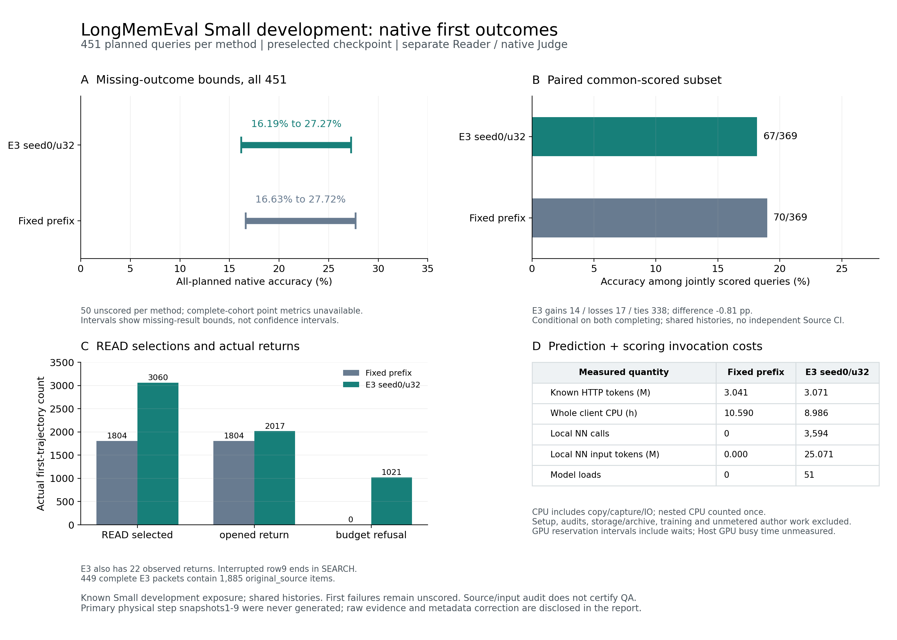

# A100 LME Small：两方法原生首结果、实际操作与调用成本

预定主模型seed0/u32与固定前缀均已关闭全451首预测、Source/输入/SDK/Reader审计、
原生评分及完整Judge请求/评分审计。主方法401个已评分位置正确73个，固定前缀401个
已评分位置正确75个；两组缺失位置不同，共同已评分369条的正确数为67与70。
这些条件结果没有支持学习策略优于固定前缀。全451完整准确率仍不可用，不能用
子集点差或输入忠实审计替代答案正确性证明。

两方法归档与六阶段定稿凭据均已关闭；Mem2Act固定前缀全400条已启动，400×2、全项目成本及最终论文完成审计仍未关闭。
本文比较预测/评分的真实首结果、操作和调用小计，不代表整个计划完成。



[同图PDF](figures/a100-lme-native-comparison-20261109-v1.pdf)。图中区间是缺失结果边界，
共同完成子集与调用成本小计分别列示，不合并为完整组点估计或全项目成本结论。

## 原生评分与完整分母

| 方法 | 计划位置 | 完成评分 | 正确 | 已评分子集准确率 | 合法UNKNOWN | 全451缺失边界 |
|---|---:|---:|---:|---:|---:|---:|
| 固定前缀 | 451 | 401 | 75 | 18.7032% | 250 | 16.6297%–27.7162% |
| 主方法seed0/u32 | 451 | 401 | 73 | 18.2045% | 254 | 16.1863%–27.2727% |

固定前缀50条Reader首失败；主方法2条检索首失败、48条Reader首失败。原生score
保持空值，`native_complete_cohort_metrics`均为null；不把程序失败补成UNKNOWN或
负gold。主方法非abstention已评分子集62/292＝21.2329%，abstention11/109＝10.0917%。
UNKNOWN是有效模型输出，仍按原benchmark规则计分；它与执行失败不同。

两方法369条共同已评分，另各有32条单方已评分、18条双方未评分。共同子集主方法
67/369、固定前缀70/369，配对gains14/losses17/ties338，差−0.8130pp；其分母条件于
双方都完成，缺失不一定随机。全451差值的缺失结果边界为[−52/451,48/451]，即
[−11.5299pp,+10.6430pp]，仍覆盖正负方向。没有用逐query重采样冒充独立Source族区间。

451个公有query共享已接触的200个Small历史及图像，不能视为451个独立用户，
也不是未见Small/Medium确认。协议是给定query取证后使用固定的独立Reader/Judge，
不等同自主Host，职责分开也不等同独立人类评审或原论文模型复现。

## 实际操作：选中、执行与交付分开

| 计数 | 固定前缀 | 主方法 |
|---|---:|---:|
| SEARCH选择 | 902 | 522 |
| SEARCH实际searched返回 | 902 | 521 |
| READ选择 | 1804 | 3060 |
| READ实际opened返回 | 1804 | 2017 |
| READ实际observed返回 | 0 | 22 |
| READ材料预算拒绝 | 0 | 1021 |
| HANDOFF选择 | 451 | 12 |
| HANDOFF实际delivery_selected返回 | 0 | 11 |
| 无operation_result的直接HANDOFF | 451 | 1 |
| 全部实际控制决策 | 3157 | 3594 |
| 全部实际operation_result | 2706 | 3592 |
| 完整返回的检索packet | 451 | 449 |
| 返回packet的original_source材料项 | 1804 | 1885 |

主方法3060次READ选择中1021次因材料预算耗尽返回，约33.37%；不能将选择数称为
成功打开数。449个完整packet中437次budget_exhausted结束、12次policy_handoff结束，
并未观察到更多READ选择带来更好的原生答题结果。opened和最终交付材料数也不同，
不据此认定来源覆盖、事实数或材料正确使用率；这些计数含重复Source/范围。

第9条保留中断的原始trace中，先有一次SEARCH和两次成功opened READ，最后一步
选中SEARCH但没有操作返回。因此522个SEARCH选择只有521个searched返回。
旧冻结审计字段`last_selected_READ_without_result_is_not_success`中的READ措辞不受
原始trace支持，本文以真实SEARCH更正。旧审计、原始绑定/模型输入/首结果保持原样；
新字段和反思凭据明确记录这项元数据偏差，没有把未返回动作补成成功。

主方法12次HANDOFF中11次带实际delivery_selected返回，只有1次直接退出；不能
套用固定前缀全部无操作返回的HANDOFF统计方式。所有动作参数与实际结果保留在私有普查。

## 实际HTTP、已知用量和失败

| 方法/调用 | HTTP次数 | prompt tokens | completion tokens | 总tokens |
|---|---:|---:|---:|---:|
| 固定前缀Reader | 451 | 1,683,622 | 1,182,893 | 2,866,515 |
| 固定前缀Judge | 130 | 64,731 | 109,499 | 174,230 |
| 主方法Reader | 449 | 1,714,211 | 1,180,332 | 2,894,543 |
| 主方法Judge | 134 | 66,985 | 109,445 | 176,430 |

固定前缀合计581次实际HTTP/3,040,745已知tokens，
主方法583次/3,070,973已知tokens，没有HTTP tokens节省。
对应owner准入差值、call usage与原始response usage全部核对；本批新增generation/
embedding未知用量均为零，历史未知仍保留。

主方法48个Reader首失败全为一次实际HTTP、输出8192且length结束，已知总tokens
642,411已包含在Reader总量中，不再次相加。其中47份无final、
第258条保留10字符截断final，仍未评分。固定前缀对应49份无final和1份501字符截断final。
所有已完成评分的Judge均stop；没有FAILED_SCORING，也未重生成任何Reader答案。
失败Reader最大总预留16060小于65536、prompt估算误差为零，不能将其称为输入溢出。
没有根据这些失败改变thinking、输出上限、Source或方法，也未重跑失败/完成位置。

## 完整调用CPU与本地模型

| 方法/阶段 | 实际串行段 | 完整子CPU＋已测父CPU秒 | 各owner实际wall之和秒 |
|---|---:|---:|---:|
| 固定前缀预测 | 51 | 38088.242489 | 48909.668 |
| 固定前缀评分 | 1 | 35.873309 | 762.029 |
| 主方法预测 | 51 | 32309.461796 | 41546.905 |
| 主方法评分 | 1 | 40.002333 | 766.856 |

主方法3594次实际NN、25,070,604个完整输入tokens、173,923个决策head候选标量，
完整head顺序、finite argmax、16k编码上限和未截断输入通过审计。实际51次加载包括
首次CPU/8192条件不匹配失败与之后50次已验证cuda:0/16384加载。NN原生CPU
4139.538284秒和加载335.776375秒已在完整子CPU内，不能再叠加。固定前缀NN/加载为零。

50次已验证CUDA模型调用区间合计11.529465小时；
原owner声明的GPU2区间和为11.540807小时，后者还含初始实际CPU加载的
失败阶段。这些是调用/占用区间，包含复制、捕获、IO及Reader等待，不是GPU忙碌时间，
也不是纯encoder延迟。Host GPU0/1计算时间和货币成本未测，不填零。

两方法都保留所有51段首次失败与显式NOT_RUN续行，最终整首记录等于最早祖先。
上述CPU/wall是预测与评分调用小计，包含对应客户端/Source状态复制/捕获/IO与已付
native部分；不含Source准备、离线审计/分析/报告、存储/归档、训练及未测作者/启动/
检查/清理。不同服务时刻、捕获路径和中断史也使wall之和不是受控延迟比较。
全项目成本仍待实测归并，不能把该小计作为完整质量—成本胜负结论。

## Source与输入证据的范围

主方法机械审计核对10,285,695次原始Source值、3536次before恢复、449份完整SDK
交付与Reader请求、3594个完整NN输入。第0条保留加载前失败证据；第1–9条依实际
完整Source/Store/trace/SDK/Reader证据核对，但当时真实逐步Store/Saver物理快照没有
生成，仍明确不可用。后来的case归档只保留已存在文件，不能补造缺失快照。第10–450条
通过原完整物理快照路径，441个存储病例/3085个控制检查点逐字节比对凭据保留。
固定前缀全451物理路径与9,364,144次Source值比较分别见其既有报告。
这证明声明范围内的Source/状态/输入忠实，不替代语义QA评分或独立来源泛化。

离线普查的三次失败也保留计时：系统Python3.10导入StrEnum失败，继承“全部HANDOFF
无返回”的错误假设，以及继承第9条READ字段措辞的错误假设。改用既有Python3.11，
并按完整实际trace修正统计；没有重跑实验，失败CPU等待下一实际空闲窗口支付。

## 复核入口

- [主方法紧凑原生结果与操作/调用成本](../data/manifests/a100-lme-primary-native-results-20261109-v1.json)
- [全451缺失边界、配对覆盖与成本比较](../data/manifests/a100-lme-native-comparison-20261109-v1.json)
- [主方法逐位置普查代码](../tools/analyze_a100_lme_primary_native_operations_cost.py)
- [两方法配对比较代码](../tools/analyze_a100_lme_native_comparison.py)
- [固定前缀原始报告](MILAI_A100_LME_FIXED_NATIVE_RESULTS_20261108.md)
- [整体执行状态](MILAI_A100_DEVELOPMENT_EXECUTION_20261104.md)

完整逐位置绑定、调用usage、原始archive member与owner链位于ignored artifacts的
`lme-primary-native-operations-cost-census-v1.json`及`lme-native-comparison-v1.json`。
向不存在的新输出重现；不读取原始预算、不调用模型/HTTP、不改Source/首结果、不用SHA。
主方法普查需项目既有Python3.11环境；比较脚本只依赖标准库。

```bash
# 从MiLAi-Lab工作目录运行下列命令
/cra/memory/mx_memory/MiLAi-worktrees/jev-read-decisions-20261016/MiLAi-Lab/artifacts/jev-reader/http-env/bin/python \
  tools/analyze_a100_lme_primary_native_operations_cost.py \
  artifacts/a100-development-20261104 \
  artifacts/a100-development-20261104/lme-primary-native-operations-cost-census-new-output.json
python3 tools/analyze_a100_lme_native_comparison.py \
  artifacts/a100-development-20261104 \
  artifacts/a100-development-20261104/lme-native-comparison-new-output.json
python3 tools/plot_a100_lme_native_comparison.py .
```

绘图使用既有系统matplotlib；HTTP环境没有该包，首次绘图导入失败计时保留，未安装新包。
PNG已逐图查看，底部注释重叠已修复；PDF由同一figure导出并核对单页结构，未另行渲染PDF。
