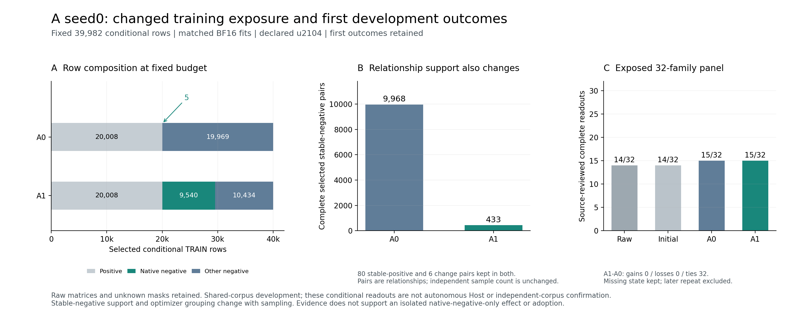

# 原计划A路线：采样、匹配训练、首结果与停止规则审计

已按原始保存数据/输出核对A路线16项具体要求：两种采样器重放与原面板逐字一致，
原生指令负例实际覆盖及draws从5升至9540，正例/replay、预算、权重和共同开发数据保持。
这种处理同时把完整stable-negative关系从9968降至433，不能解释为只增加一种负例。
真实任务首结果A0/A1均15/32，新增开发条件响应未支持A1优于A0；原不扩量、不补A
seeds、不运行J、不采用的停止决定保持。本审计未重新训练或调用模型。

这是[原763行计划](/cra/memory/mx_memory/MiLAi-worktrees/jev-read-decisions-20261016/MiLAi-Lab/docs/MILAI_DEVELOPMENT_EXPERIMENT_PLAN_2XA100_40GB_20261104.md)中A相关要求的具体证据，不关闭仍在运行的Mem2Act400×2
或整个计划。[紧凑凭据](../data/manifests/a100-plan-A-audit-20261109-v1.json)保存原文行与原始路径。

[同图PDF](figures/a100-plan-A-evidence-20261109-v1.pdf)。图中关系数不当作新增独立样本，
任务栏保留已曝光32族条件readout范围和最早首结果。

## 具体要求与证据范围

| 编号 | 原计划行号 | 已核对内容 |
|---|---|---|
| A-01 | 235, 237, 239 | 实际新增显式negative-selection模式，默认legacy保留；按准备提交原代码重放两臂 |
| A-02 | 202, 206, 245, 216 | 合法TRAIN、已知标签/未知mask、家族与条件身份及原始Source输入保持 |
| A-03 | 241, 246, 247 | 保留原20,008正例和6个change pair端点；19,974负例/19,968条件/6额外槽 |
| A-04 | 248, 249 | 同实际条件替换9,535负例，原生new_negatives覆盖实测5→9,540 |
| A-05 | 251, 253 | 不把native覆盖作为唯一变化；稳定负例关系与实际派生pair分别记录 |
| A-06 | 247, 260, 261, 584 | 同槽state ID、正例/replay/DEV内容、家族事件权重与选项RNG保持 |
| A-07 | 259, 264, 271, 584 | 同真实E2原初始化、单卡/BF16/full参数、同超参，两臂均真实重训 |
| A-08 | 262, 263, 269, 584 | 如实记录set flag；条件singleton与CE等价、操作replay原accepted-set及relative0保持 |
| A-09 | 265, 266, 267, 427 | 每臂44,868真实draw/2,805更新/末4行，真实tokens/padding与预定切点完整记录 |
| A-10 | 275, 277, 446 | 完整曲线与2pp操作guard重算，u2104提名遵循预定开发规则，不以最终确认重选 |
| A-11 | 275, 277, 459 | 新128开发家族/原生与作者标签分开、26,232保存首输出完整输入/head核对 |
| A-12 | 275, 277, 216 | 旧8只作已曝光回归；新128原生change0/作者change2如实报告，不凑标签 |
| A-13 | 275, 459, 645 | 两臂62完整before/全菜单/真实NN绑定与31实际state按family连回32分母 |
| A-14 | 323, 489, 499 | 最早首结果保留；历史一次多余重跑和两次成本保留、较好后答不进主比较 |
| A-15 | 275, 477, 481 | 已曝光32族条件readout保留失败/缺state，A0/A1同15/32、配对g0/l0/t32 |
| A-16 | 279, 516, 517, 421 | 无可解释任务响应增益，不扩20k/额外Aseed/J，不部署采用 |

## 固定行预算下实际改变了什么

读取原683,408个TRAIN矩阵cell与341,209个关系，按数据准备提交
`b3d7cbef`的实际采样器源码、seed0分别重放legacy/native-priority。
全部输出rows、pairs、slots、missing-label清单、native覆盖、counts及groups/query-units
复制内容均与原文件一致。默认legacy保留，新增选择必须显式声明；不修改全局默认。

源矩阵含20,020个已知正cell、620,573个已知负cell、42,815个unjudged cell。保留的是
**原面板全部20,008正例**，不是声称选择源矩阵所有正cell。两臂均39982条件行：
20,008正例＋19,974负例，覆盖10,000家族/query、19,968个实际条件。负例相对每条件
一个仅多6槽，未加行来制造覆盖；全部6个已知change pair及其端点、80个stable-positive
pair均保持，55个既有Source作者TRAIN标签也原样保留。

| 实际采样量 | A0 legacy | A1 native-priority |
|---|---:|---:|
| 条件训练行 | 39982 | 39982 |
| 原生new_negatives已知可用cell | 23029 | 23029 |
| 可覆盖实际条件 | 9540 | 9540 |
| 选入且实际抽到的原生负例 | 5 | 9540 |
| 原生负例已覆盖条件 | 5 | 9540 |
| 完整stable-negative pair | 9968 | 433 |
| 完整stable-positive pair | 80 | 80 |
| 完整已知change pair | 6 | 6 |

9535个替换都发生在同一实际条件的已知负例层内，未伪造另一条件的标签。原始
unjudged masks保留在源矩阵，未补负例。全部样本的输入、目标与native身份逐完整
dict等于采样器对应原cell（仅声明的state_id赋值）；没有按Host答案、最终确认或
题目错误措辞造规则。源数据准备和行预算不是新标签的独立语义验证。

稳定负例关系减少及派生分组变化属于这次组成处理，不能把所有效果单独归因于
native-negative数量。预算/关系支持的交换是可核对事实；因果拆分需要另立明确
对照，当前结果不据此触发额外拟合。

## 匹配面板、实际权重和训练

原混合输入每臂47,866行，其中44,868有训练目标：39,982条件行＋4,886已知操作replay。
另外2998条原始无目标replay仍保留。A0混合文件逐行等于原E2控制数据；两臂正例、
全部7884条raw replay及共同DEV逐字保持。A1替换槽沿原state_id，条件/标签计数相同，
实际选项置换数组一致。原生sampling文件的44868个event和权重逐槽核对一致。

权重使用原family/event归一化、mixture条件0.8/操作0.2与原mixture_loss_scale1.25，
实际质量为1.0/0.25。未漏掉共同scale，也未把权重和数据行数当成同一个概念。
两臂训练计划数组是否相同：`False`；关系支持与完整pair分组允许随组成改变，
但同槽权重、seed、真实draw预算和选项RNG身份保持，不能声称所有pair信号完全一样。

实际CLI沿原E2使用`objective=set`、conditional relative weight0。全部39982个条件目标
都是二分类singleton，set likelihood在这些行与普通CE等价；原操作replay保留其
accepted-set目标。报告真实set flag，不将它改写为soft-ce。原E2初始化、encoder LR
5e-6、head LR1e-4、max_len16384/head2048及共享投影均从实际run继承，模板示例值
不能取代原配方。两臂均真实单卡/BF16重训full encoder/head，参数/关键损失FP32，
同seed0、micro2、窗口16、同TF32/backend，未拿旧FP32双卡结果冒充匹配对照。

| 完整训练实测 | A0 | A1 |
|---|---:|---:|
| 真实draws/更新 | 44868 / 2805 | 44868 / 2805 |
| 最后窗口行数 | 4 | 4 |
| 输入tokens | 37,502,475 | 37,318,166 |
| padded tokens | 61,754,792 | 63,310,836 |
| native CPU秒 | 11110.194332 | 11333.849932 |
| native wall秒 | 8434.878320 | 8571.690697 |
| 单卡native job区间小时 | 2.343021756 | 2.381025194 |

逐窗口/逐更新核对恰好一次完整遍历44868行、2805更新，全部长度记录无state/head
裁掉，未因一臂先完成增加训练。A1输入比A0少184309 tokens、padding多1556044，
不能声称等tokens或等FLOPs。完整0/702/1403/2104/2805曲线均保留；这些原生费用
已计实际一次，分析重放没有新训练，不再加到其原生计量中。

## 保存模型、完整绑定和首结果

原预定提名规则是32开发家族内正/负均衡平均、最早tie、操作接受率下降不超2pp；
逐个读取原曲线预测重算后，两臂都仍为u2104。该提名不是以最终确认换checkpoint。

新增128 DEVELOPMENT query家族与A TRAIN、旧32和预留64无交集，但仍共享语料，
不称未见文档泛化。实际三套保存模型各8744首输出，26232份完整输入、全head ID
顺序、finite argmax与无截断核对通过；同一预测复用于原生/Source作者两种标签视图，
没有另发模型调用。native已知gold逐字保持，原生change pair为0；补充Source作者
视图change pair为2，来源锚点与输入逐字核对。作者标签不是独立人类盲评或原作者gold。

| 保存模型 | 新128原生族宏均衡准确率 | Source作者change联合正确 |
|---|---:|---:|
| initial | 66.1798% | 1/2 |
| a0 | 88.3766% | 0/2 |
| a1 | 83.8801% | 0/2 |

初始模型在两个作者change中1/2，两训练模型均0/2；不拿辅助分类改善代替条件响应。
旧8关系的Source支持回归也重新计算，范围保持已曝光诊断，不承担确认。

实际31个pre-handoff state与32族完整面板分开：缺失state仍占分母。两臂62份
完整before/全合法菜单/真实NN输入及最终完整绑定均核对；无参数HANDOFF显式复用
原raw已关闭结果，其他分支沿真实绑定复用/执行。保留原模型选择与实际答案文本。

| 原32族条件readout | 完整成功 |
|---|---:|
| raw delivery | 14/32 |
| 原E1初始化 | 14/32 |
| A0 | 15/32 |
| A1 | 15/32 |

A1−A0的gains0/losses0/ties32，已曝光族bootstrap差值为0。这只描述此固定开发面板，
不证明总体零作用，也不是自主Host/独立新来源确认。标签由实施助手作Source支持
审阅，允许多条正确路径；未重新标注旧答或将missing/unknown补成成功。

历史A复用索引曾漏22个已关闭E3绑定，导致一次不必要重跑获得更好随机答案。
本审计重读两次实际intervention和完整返回packet，除PID及不同计量快照之外结果
逐字段相等；主比较实际引用较早E3结果，较晚答案、原文件和两次费用保留。
不能声称整个历史从未重复，也不能选择较好后答把A提升为16/32。

## 停止规则与剩余工作

原生覆盖修复确已进入训练，但A1相对A0没有条件/任务优势证据，故原不扩A20k、不补
额外A seeds、不将A自动用于B初始化、不运行J及不部署采用的决定保持。
数据/权重/真实结果均保留，不通过加epochs/新loss追同一面板。

本轮数据审计两次失败分别来自漏乘原scale1.25、错把run/profile的padded字段当compute
字段；评测审计的Unicode拆行、31/32编号及含独立计量的结果信封比较也先后失败。
失败计时全部保留，按实际源码/字段/身份及完整内容修正审计，没有修改原始实验。
只有CPU数据重放与数值复算；本轮费用待下一实际idle138，不在活动Mem2Act阶段写账本。

Mem2Act400×2、最终全项目成本/论文/图表及原763行其余要求的完成审计仍未关闭。
复核代码：

- [原采样器/原混合槽位/真实训练合同](../tools/audit_a100_plan_a_sampling_training.py)
- [曲线提名/保存输出/标签与最早结果](../tools/audit_a100_plan_a_evaluation_stop.py)
- [整体执行进度](MILAI_A100_DEVELOPMENT_EXECUTION_20261104.md)
