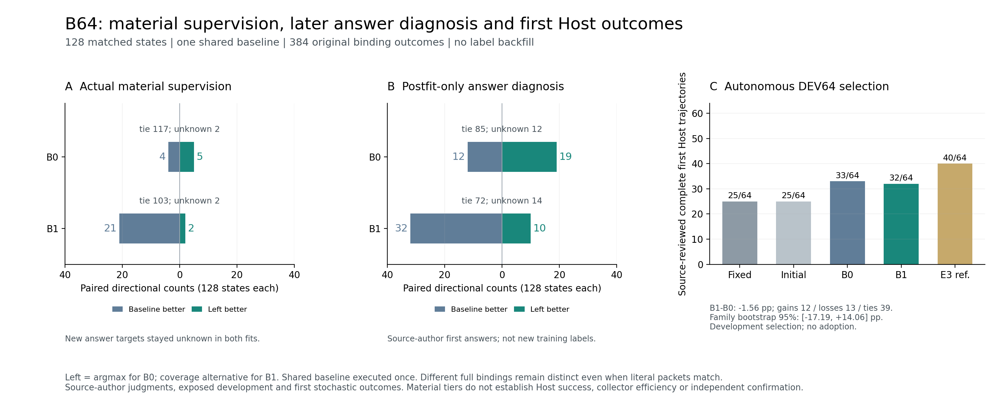

# 原计划B64：共享分支监督、匹配拟合与真实首结果审计

B64相关16项具体要求已按实际源文件/首结果核对：64个TRAIN来源族、128个真实
reached state、384个完整绑定；B0/B1输入/全菜单/旧数据和预算相同，仅监督比较
argmax↔baseline与alternative↔同baseline。原曲线提名均u33；旧32条件读出均13/32，
新64自主Host完整成功B0 33/64、B1 32/64，不支持覆盖提名监督优于匹配对照。
原不扩192/256、额外Bseed、目标重训或部署采用的决定保持。

本报告只关闭B64这一范围；早期功能8、57状态READ修复、C/D和全763行审计仍需
各自证据。当前Mem2Act400×2未由本报告完成，没有重跑模型或修改原始数据。
[机器凭据](../data/manifests/a100-plan-B64-audit-20261109-v1.json)保存具体要求、原文与原始路径。

[同图PDF](figures/a100-plan-B64-evidence-20261109-v1.pdf)。方向计数的left在B0代表argmax、
在B1代表alternative；三个面板的数据时序与成功口径分别保留。

## 原文要求与核对范围

| 编号 | 原计划行号 | 已核对内容 |
|---|---|---|
| B64-01 | 223, 285, 287, 303 | 64合法TRAIN家族/128实际state、3个完整互异合法绑定及执行前资格 |
| B64-02 | 295, 309, 311 | 同真实before/请求/完整菜单、前缀不重做、有界共同续行实际核对 |
| B64-03 | 287, 295, 299 | 128完整NN输入/head/argmax与baseline规则重算，不以gold构造候选 |
| B64-04 | 297, 298, 299 | B0 argmax↔baseline、B1 alternative↔同baseline，模型输入全菜单相同 |
| B64-05 | 227, 300, 301, 499 | 384实际分支=358新执行+26原终止READ复用，128baseline只执行一次、前缀成本不免费 |
| B64-06 | 317, 318, 319, 320, 321, 323 | Source作者材料方向/tie/unknown在资源之前，失败首结果和答案unknown保留 |
| B64-07 | 303, 323, 350 | 128新反馈逐字重编译、旧400原样、family/event真实权重与未知状态保留 |
| B64-08 | 340, 342, 588, 610 | 同原E3起点/目标/argv、delivery quality-tie/component-sum/replay .25及set继承 |
| B64-09 | 264, 340, 419 | 两臂同单卡/BF16/full参数、同完整输入/预算/seed而非旧历史直接对照 |
| B64-10 | 347, 350, 352, 437 | 528slot/1056实际draw/66更新，逐槽实际两次、相同窗口/选项RNG及tokens |
| B64-11 | 427, 444, 446 | 原0/17/33/66真实曲线、预定纯delivery与2ppguard重算u33，非最终确认重选 |
| B64-12 | 311, 340, 459, 477, 479 | 31实际菜单与32分母、5新首绑定和64自主Host另行计分；材料不替代完整成功 |
| B64-13 | 323, 489, 499 | 最早原绑定答案沿用、较好A重复不使用、预算/失败/unknown不删 |
| B64-14 | 317, 320, 321, 354 | 384答案后审只作材料/目标诊断，不回填关闭拟合或把成本方向当质量 |
| B64-15 | 477, 481, 518 | 64族配对差值/区间、97双tie及答案随机性按实际保留，不声称采集效率 |
| B64-16 | 224, 225, 354, 508, 518 | B1无任务优势，不扩192/256、额外Bseed/改目标拟合或部署采用 |

## 实际三分支、完整参数与共享成本

128组均有三个执行前确定的完整互异合法绑定，六个实际输出/家族，共384。
每组实际closed collector的NN输入展开后等于完整before与全菜单；所有head ID顺序、
有限argmax、未截断与baseline策略选择核对。真实first-action trace、已执行前缀字节、
保留的控制边界和共同fixed_context/read4/有限续行逐项复核，未把远处旧最终答案
伪装为较早动作的局部效果。alternative实际90个READ/38个HANDOFF。

读取原冻结分支运行时的reached_outcomes；384份原文packet与角色/origin/字符范围
都逐字绑定到原fixture。共1613个Source piece核对；同一state的Reader
完整请求只允许实际packet不同，其他字段逐dict相同。它证明这里声明的Source范围/
完整before/菜单/续行和wire路径，不替代独立语义判断或全部项目Source审计。

| 实际执行范围 | 数量 |
|---|---:|
| 全部完整绑定首结果 | 384 |
| 新分支执行/新HTTP | 358 |
| 原collection终止单槽READ结果复用 | 26 |
| 实际baseline结果 | 128 |
| 原生完成Reader | 373 |
| 首失败Reader | 11 |

128个baseline只执行一次，同时用于两种监督面板；26个复用也只验证原终止单槽
READ，未向较早state回填远处结果。pilot8新45HTTP/157021已知tokens，remaining56
新313HTTP/1100678已知tokens，合计358/1257699；新unknown0，11个Reader失败保留。
原64来源采集前缀另有真实HTTP/NN/CPU，用量在原collection回执中保留，不能当免费；
已支付原生/整child不因本次报告重计。该三分支并集比较回答监督支持范围，不是两个
collector相同槽位预算下的采集效率实验。

## 原材料监督、未知与关闭拟合

Source作者逐六个实际packet作I/P/S/U材料等级，训练比较在资源tiebreak之前导出；
同等级保留tie，不因更便宜变成质量方向。等级与引用锚点不自动等于独立事实真值。

| 新128 state监督 | B0 argmax左 | B1 alternative左 |
|---|---:|---:|
| left更好 | 5 | 2 |
| 共同baseline/right更好 | 4 | 21 |
| quality tie | 117 | 103 |
| unknown | 2 | 2 |

97个state在两种比较中都tie。更多参数类型没有自动带来更好材料；B1新增方向中
21/23反而支持baseline。每个新row的完整state/questions/gold/metadata保持，区别
在比较的完整动作和反馈；128新反馈用原编译器逐字重建。256个新answer比较在实际
关闭拟合中全部unknown，Reader失败不补负gold，材料可以独立有已知判断。

旧400个共享slot逐字保留，其中**200旧feedback＋200操作replay**；加入128新反馈后
总528＝328feedback＋200操作replay，不把400都称操作replay或新增信息。
两个面板实际family/event权重逐槽一致，component-sum反馈质量1.0/replay0.25，
unknown状态仍保留采样槽位。继承原E3实际argv/初始化，delivery/quality-tie、replay set、
label相关选项与pair-mass-mode均按真实参数，未用新默认值猜配方。

| 真实训练量 | B0 | B1 |
|---|---:|---:|
| slot / draw / 更新 | 528 / 1056 / 66 | 528 / 1056 / 66 |
| 每slot实际抽取 | 2 | 2 |
| 输入tokens | 5,756,552 | 5,756,552 |
| padded tokens | 6,878,474 | 6,878,474 |
| native CPU秒 | 3053.692198 | 3078.924362 |
| native wall秒 | 1917.526480 | 1937.863394 |

本N=528及66更新恰好两个完整pass，每slot2次已经实际plan/counter核对；不将一般
ceil(E×N/16)预算一概宣称精确E遍。普通B路径没有A式training-windows副本，冻结
执行循环直接消费原training-plan；逐更新行数/tokens、sampled quality计数及两pass
实际option-order数组交叉一致。输入/全菜单、采样窗口和选项RNG相同，无截断、同
BF16/full参数/预算/seed，只有指定监督处理不同。实际sampled feedback656/replay400，
unknown比较76次、cost-only质量方向0；没有删除unknown来改善训练或凑128标签。

## 提名、答案后审和任务结果

逐个重读860 DEV与64 feedback-dev的0/17/33/66输出；原操作接受率及完整reviewed
pair诊断、纯delivery方向分数均复算一致。初始924个输入长度、完整logits和argmax
在两GPU逐字一致。预定规则为非零点纯delivery族宏方向分数最高、最早tie、相对
update0操作接受率下降不超2pp，重算后两臂仍u33；未按最终确认换点或选最好seed。

实际384首答案后审得到C107/I199/F11/Q60/W1/U6，与原失败11个对应。后审发生在
关闭拟合之后，未回填训练；它诊断粗材料目标与完整答案差异：

| 后审比较 | B0 | B1 |
|---|---:|---:|
| answer left/right/tie/unknown | 19 / 12 / 85 / 12 | 10 / 32 / 72 / 14 |
| 材料tie内部出现答案方向 | 23 | 25 |
| 已知材料方向与答案方向相反 | 0 | 0 |
| 完整literal packet相同的原比较 | 4 | 13 |

完整packet相同但首答案/等级可不同，反映生成变化；这些full bindings不同，仍是
原不同分支，不从同packet中挑最好答案。27个完整C位于粗材料S以下，需区分native
材料inventory目标、Source支持的范围回答和随机首输出，不能据此自动归因为loss。
answer-first本是已有功能；该后审不是新机制发现，也不自动启动新目标拟合。

旧32族完整菜单选择三个保存模型各31实际NN输入/绑定已核对，缺state保留32分母。
原首绑定答案、5个实际新首答案和后来A更好重复的排除都保持；B0/B1各13/32，
raw/initial各14/32。这是已曝光条件readout，不能代替自主Host。

| 新64族自主Host开发 | 完整成功 |
|---|---:|
| fixed-prefix | 25/64 |
| 原E1研究参考 | 25/64 |
| B0-u33 | 33/64 |
| B1-u33 | 32/64 |
| 既有E3-u32研究参考 | 40/64 |

B1−B0 gains12/losses13/ties39，差−1/64＝−1.5625pp，
20,000次seed0来源族bootstrap区间[-17.1875,14.0625]pp。
失败和未解U保留64分母、U不给C也不自动视为已证实错误。Source作者是实施助手，
不是独立人类或盲审；这是开发选择，不是独立确认或已采用效果。

原保持B64规模、不扩192/256、不补B seeds或自动改目标/采用的决定与实际证据一致。
本轮两次审计失败分别来自误找不存在的条件windows副本、漏算原pair-objective
历史dev中的reviewed_branch_pairs；已按真实源码/文件修正，没有改历史Source、
输入、label或首结果，失败计时保留。本报告与审计CPU等待实际idle138，不在活动
Mem2Act原生owner期间离线读写账本，也不重新收取原生训练/采集费用。

复核代码：

- [实际三分支/前缀/Source/Reader wire](../tools/audit_a100_plan_b_branches.py)
- [原监督重编译/完整输入与真实训练](../tools/audit_a100_plan_b_labels_training.py)
- [提名/后审/最早任务与停止规则](../tools/audit_a100_plan_b_evaluation_stop.py)
- [原计划A逐项审计](MILAI_A100_PLAN_A_AUDIT_20261109.md)
- [整体执行状态](MILAI_A100_DEVELOPMENT_EXECUTION_20261104.md)

Mem2Act400×2、早期B修复/C/D等其余具体要求、最终全项目成本/论文图表与全763行
逐项完成审计仍未关闭；不能从本B64局部通过推断整个目标完成。
