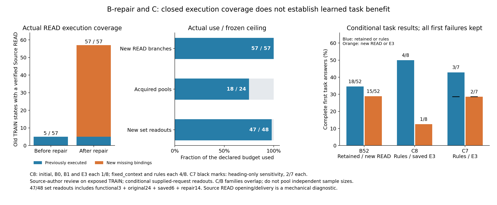

# 原计划B修复与C：实际取证、材料选择和首次任务结果

早期B功能8、旧57状态READ修复和C材料选择的16项具体要求已核对。旧57状态均已有真实
observed-Source READ结果，新增52个READ全部打开并交付选择范围；质量仍为新增完整成功
15/52、原保留比较18/52。C8的rules为4/8、四个保存模型各1/8；补7池为rules3/7、E3 2/7。
没有证据支持扩大训练、扩菜单或采用学习选择器；本报告不关闭整个763行计划。

[机器摘要](../data/manifests/a100-plan-B-repair-C-audit-20261109-v1.json)记录原文行、实际证据与复核入口。
这些是已曝光TRAIN状态、原 supplied-request 条件读出和实施者Source审阅，非独立人类/盲审或自主Host确认。

[同图PDF](figures/a100-plan-B-repair-C-evidence-20261109-v1.pdf)；PNG实际查看，PDF单页结构核对而未另行渲染。

## 原文与实际证据

| 编号 | 原计划行号 | 已核对内容 |
|---|---|---|
| BC-01 | 287, 289, 506 | 8个真实功能首绑定：5 READ/3 HANDOFF，原文范围/实际交付/Host wire核对 |
| BC-02 | 222, 285, 287 | 旧57状态139原结果和functional8按真实before/合法完整菜单/seed0复现，B64/C8不冒充补缺 |
| BC-03 | 222, 287, 309, 506 | 52个未覆盖READ首绑定实际打开并交付全部选择范围，覆盖5到57状态 |
| BC-04 | 309, 311 | 实际首动作、原执行前缀、control boundary及共同有界续行保留 |
| BC-05 | 376, 697 | 104个新分支完整Source角色/时钟/正文与应用前后不变，259真实原文piece绑定 |
| BC-06 | 295, 309, 376 | 实际原请求/receipt/Provider wire核对，同state只允许真实packet改变 |
| BC-07 | 317, 318, 319, 320, 321 | 材料与答案方向在资源比较前独立，tie/unknown/失败首结果保持 |
| BC-08 | 222, 323, 499 | 52个保留旧判断逐字不变，原139与functional8/C8首结果不重试或重收成本 |
| BC-09 | 360, 362 | C8同真实已读池比较fixed_context/rules/learned，原24首结果和原菜单保持 |
| BC-10 | 360, 362, 368 | 保存initial/B0/B1/E3共32完整输入/原HANDOFF子菜单/head顺序/finite argmax/无截断核对 |
| BC-11 | 320, 323, 374 | 六个新增完整绑定仅执行一次；32保存选择按实际generation-request时序复用最早结果 |
| BC-12 | 222, 360, 362 | 补7已读池14 HANDOFF/7完整NN输入/1222 Source值，禁止新增获取与原菜单变更 |
| BC-13 | 222, 227, 499 | 新READ57/57；已读池18/24、集合readout47/48，functional3+原24+保存6+补14合计 |
| BC-14 | 374, 376, 477 | 取得/交付/主体时间条件否定/Host使用分开；B52与C7质量及heading敏感性保留 |
| BC-15 | 495, 499, 672, 685 | 104真实新HTTP/387713已知tokens、失败9保留，原生/整child/父CPU只计一次 |
| BC-16 | 346, 364, 366, 368, 370, 519, 520, 699 | 已有合法材料集未胜rules；无已证菜单表达缺口，不扩菜单/新拟合/凑配额或采用 |

## 从功能8到旧57状态的真实覆盖

功能8执行5个READ和3个HANDOFF，原文piece16、完整Source值前后比较445次，8次真实HTTP/
30879已知Host tokens，Reader全部完成。原完整before/菜单/首干预/已执行前缀与有界续行、
实际Tool packet和Reader wire核对；没有伪造Host已知引用，也未把执行完成当质量完成。

原覆盖验证器重新读取139个更早结果与functional8，完整复现旧57状态/56来源族清单及seed0
保守预留。原始结果只覆盖1个observed-Source READ状态，functional5个READ又覆盖4个不同状态，
故补采前是5个状态。B64/C8的实际before与这57个没有交集，不能代替余52个缺口。
原52个新READ完整绑定依原菜单选择，35range/17full；全部打开并交付选择范围。
159个Source piece、3829次完整Source值前后比较、应用表不变、原比较不重做；48个Reader
完成、4个失败，52次HTTP/194966已知tokens，新unknown0。完整覆盖是57/57状态，
新增READ额度为functional5＋剩余52＝57/57，不把不同参数或同族状态当新独立来源。

本次B52/C7原验证器仅重定向输出位置，所有原检查执行后报告逐字相同；old57的主清单与
两个辅助预留报告也逐字复现。C8原验证器除动态cpu_seconds_pending外逐字相同，
原报告保持不变。没有执行模型、tokenizer、GPU、HTTP或原始账本操作。

## C8：同一真实已读池与完整菜单

原8个已读池各运行fixed_context/rules/learned，共24次HANDOFF；原菜单与材料池保持，
不重新获取材料或重做前缀。Reader22完成/2失败，62个原文piece，24次HTTP/71109已知tokens。
原策略的8份完整NN输入共40047 tokens、完整HANDOFF子菜单/head ID顺序/有限logits和
argmax已核对；声明的handoff-only限制发生于编码之前，原执行器菜单未被悄然裁剪。

保存initial/B0/B1/E3各8份输入与完整before/原HANDOFF菜单投影重新核对，共32个真实
保存输出。六个不同新绑定通过原first-action intervention/continuation0各执行一次，
它们没有F1策略输入事件；按实际完整菜单/干预/receipt/首Reader协议核对。五完成、一首失败。
全部30个C8新结果共1737次完整Source值前后比较、66个原文piece、103792已知tokens，
应用/Source均未修改。原24与新6的Reader同state除实际packet外完整dict相同。

| C8方法 | 完整成功/8 |
|---|---:|
| fixed_context | 4/8 |
| rules | 4/8 |
| 原learned / 保存initial / B0 / B1 / E3 | 各1/8 |

32个保存选择均按完整kind/target/parameters匹配首次实际结果，并以原readout中的
generation_requests时序核对最早者。历史initial/B0/B1的mtime选择在此逐条用真实时序
复核一致；E3使用包含全部30个实际结果的注册表，8个均复用、不新增Reader。
不选择较好后答案，不把32次NN保存选择当32个新材料池或独立任务。

## 补7池、预算与质量判断

预算从实际早期执行保守计算：functional的3个HANDOFF池＋原C8的8个池＝11个，
不是只算C8的8个。另补7个原57中的未用池，共18/24；新集合readout是
functional3＋C8原24＋保存6＋补14＝47/48。剩余1个readout额度不是必须填满的任务。
选择由真实已获得材料至少2、合法HANDOFF至少3和seed0决定，无gold/答案选择。

补7池每池rules/E3两方法、14个HANDOFF，没有新增获取或前缀重做。7个完整NN输入共
32401 tokens，最短3837、最长5127，无截断、完整原before/子菜单/head顺序/finite值一致。
18个原文piece、1222次完整Source值比较、实际7对Reader除packet外相同；12完成/2失败，
14次HTTP/58076已知tokens、新unknown0，实际1次模型加载。完整成功rules3/7、E3 2/7；
对唯一heading-only Boolean存在性答案保守扣分的独立敏感性为2/7对2/7，全部7族保留。

66个补采首答案/packet与完整Source指南输入由原准备器重新构建，结果逐字相同。
52个旧保留判断完整复制保持，没有重新评分或迁移到新答案；原Source作者逐条notes/依据、
范围限定和歧义掩码维持，未导出训练新标签。以下是原判断与配对统计的复算，不是新独立审阅。

| B52新答案 | 数量 |
|---|---:|
| 完整/部分合格/不完整/错误/首失败 | 15 / 9 / 23 / 1 / 4 |
| 材料充分/不足/unknown | 17 / 34 / 1 |
| 答案left/right/tie/unknown | 2 / 5 / 39 / 6 |

两项left是部分答案增益；完整成功无gain、3loss，差−5.7692pp，52个不同来源族20,000次
seed0 bootstrap区间[-13.4615,0]pp。六个答案比较unknown包括本次/旧首次失败及FSE术语歧义；
unknown不补成负gold。C7的E3−rules为−14.2857pp，7族区间[-42.8571,0]pp。
首次Reader失败保留完整成功分母，材料可另有已知判断；这种处理不使answer比较变成已知失败方向。
C与B来源族重叠，66只是新增分支结果数，不能合并为66个独立确认样本。

## 成本、失败反思与停止边界

| 互不重复的新增分支 | HTTP | 已知Host tokens | 完成/失败 |
|---|---:|---:|---:|
| functional8 | 8 | 30879 | 8 / 0 |
| B52 | 52 | 194966 | 48 / 4 |
| C8原24＋保存6 | 30 | 103792 | 27 / 3 |
| C7 | 14 | 58076 | 12 / 2 |
| 合计 | 104 | 387713 | 95 / 9 |

这是原已支付执行范围，非本轮新增调用或整个项目当前总成本。共7233次完整Source值比较、
259个原文piece；B52/C7已付整child CPU172.541765秒＋已测父CPU0.305818484秒，
内含原生NN/load，不再次相加。C7 GPU job interval0.102402小时包括加载/IO/HTTP等待，
不等于GPU busy/编码延迟；其他早期成本仍在原闭合凭据与全项目成本汇总中。

本轮新C8补充审计首版把六个首动作干预错误送入要求F1策略输入事件的验证器，实际失败
后改为分别核对24个F1和6个原完整菜单首干预；没有伪造事件、跳过Source或重跑模型/Reader。
失败GNU计时保留。图v1的legend/footer重叠实际查看后修为v2，再次查看通过。
新审计/失败/图表/报告CPU均待实际idle138统一差额支付；Mem2Act原生owner存活时不离线
读写原账本，不重计原已付执行、NN/load、child或父CPU。未计作者/launch CPU为unknown_not_zero。

已有合法材料集合未胜rules，没有证明菜单表达能力不足，故不扩菜单、不追加拟合、
不凑配额或采用学习策略。原数据与负结果保持；完整计划仍需D具体要求、Mem2Act两方法全400、
其全量Source/Store/Saver/SDK/Host/评分/归档、最终全项目成本与论文图表/全763行完成审计。

复核代码：

- [原验证器只读重放](../tools/audit_a100_plan_repair_mechanics.py)
- [functional8与C8实际Source/完整输入/最早结果](../tools/audit_a100_plan_b_repair_c_handoff.py)
- [质量掩码/原判断/统计/预算与停止](../tools/audit_a100_plan_repair_quality_stop.py)
- [共享B64面板及匹配拟合](MILAI_A100_PLAN_B64_AUDIT_20261109.md)
- [整体执行状态](MILAI_A100_DEVELOPMENT_EXECUTION_20261104.md)
