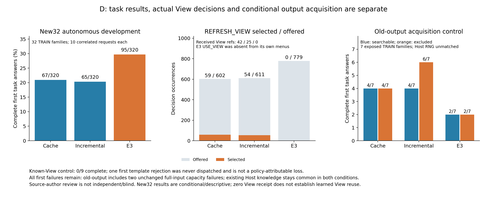

# 原计划D：更新轨迹、View与旧输出控制的具体要求审计

D相关18项要求已核对到真实执行与原始源文件。旧8族三方法完整成功19/11/19（各80），
新32族为67/65/95（各320）；后一面板的E3开发信号没有收到或使用View，不能归因于学会
View复用。known-View9无完整成功；旧输出42格保留原首次容量/HTTP失败，不能据七个相关
TRAIN来源和未匹配Host随机生成判断一般性旧回答利弊。原不采用/不扩历史矩阵决定保持。

[机器凭据](../data/manifests/a100-plan-D-audit-20261109-v1.json)绑定18项原文与八组实际审计。
这里关闭D这一具体范围；Mem2Act400×2、最终全项目成本/论文图表/全部763行完成审计仍未完成。

[同图PDF](figures/a100-plan-D-evidence-20261109-v1.pdf)；最终3000×1240 PNG实际查看，PDF同图单页结构核对、未另行渲染。

## 原文与证据范围

| 编号 | 原计划行号 | 已核对内容 |
|---|---|---|
| D-01 | 382, 384, 388 | 原cache类/范围函数保持；立即HANDOFF限制与已有后续READ执行能力分开验证 |
| D-02 | 388, 390, 402 | 可选一次增量读取路径、同原执行器/材料/预算，无第二运行缓存/账本/审核Agent |
| D-03 | 390, 402 | 旧8初始功能切片按最早真实capture执行7/8，缺B30保留、不换后轮或别流程 |
| D-04 | 382, 390, 392 | 9个post-generated-View真实READ+HANDOFF、5背景、原前缀/Source/缓存View投影保持；无新Host答案 |
| D-05 | 200, 202, 229, 402 | 新增D32为既有TRAIN，29旧合同+3作者合同，native角色正文/用户cut与无未来支持逐字复现 |
| D-06 | 398, 404 | 无关因素最小0→1构造会话变更，query/相关支持/答案范围固定；未声称多规模历史增长曲线 |
| D-07 | 392, 399 | 相关到达与无关/不变阶段分开；更正/范围/计划/撤销保留，不将所有到达当当前值翻转 |
| D-08 | 388, 402, 456, 461 | 原8与新32各2流程×5请求/3方法/2048同Host，240首次Provider请求实际逐dict匹配 |
| D-09 | 388, 392, 479 | E3 REFRESH实际可选779而未选；自身无USE菜单/收到View，不把开发信号归因学会View复用 |
| D-10 | 390, 392 | 增量3次USE均initial无new/pending后HANDOFF、无补读；实际known-View控制另报 |
| D-11 | 388, 455, 459, 479 | 1086既有NN完整before/全菜单/有限head/无截断，2个完整K容量失败不裁剪保留 |
| D-12 | 392, 479, 697 | 1200轮不可变Store/Source/Saver/应用，641控制Source比较及16工具探针，合计21362完整值比较 |
| D-13 | 392, 479, 681 | 原1200首判断/1996原文锚点/805View锚点和所有收到的View角色时钟修订绑定，忠实不等事实或当前充分 |
| D-14 | 402, 477, 481 | 旧8与新32按族/10相关请求统计，原配对区间及首失败保留，初始匹配不外推后续reached-state因果 |
| D-15 | 392, 455, 459 | known-View9真实K准入/全frame与原首模板失败，2族完整三方法匹配、A05仅增量/E3匹配 |
| D-16 | 400, 459, 489 | 旧输出48inventory/42可识别首格，改变额外检索而保留已知Host消息；七族/未匹配HostRNG边界保留 |
| D-17 | 227, 495, 499 | 原1200/两控制/前缀共享成本只计一次，冻结旧预算复现关闭凭据，丢失父CPU未知/child下界保留 |
| D-18 | 384, 402, 520, 521, 699 | 不将cache早停当全部失败原因，不因拒绝计数自动扩1024/历史矩阵或采用；后续冻结确认另报 |

## 原cache、功能切片与数据时序

冻结runtime中的CacheMemoryPolicy及原范围/相关性函数与原E5代码相同；原策略在最近成功
USE_VIEW/REFRESH且不要求原文时立即HANDOFF。执行器能力和策略决策分开验证：

- 旧8族最早真实initial/content捕获可用7个，B30没有捕获，保留缺格、不用后轮或另流程替换。
  可选增量路径原生工具执行7个，3个View＋raw包、9个原文piece；0个新Host答案。
- 9个保存的post-generated-View状态来自5个背景，各一次真实原菜单READ＋HANDOFF，
  前缀与control step不重做，9个View＋raw包。原缓存结构、Source角色/时钟、locator与
  factored metadata逐字核对。它证明已有执行器可组合材料，不证明生成View事实正确或任务收益。

两个切片共16个实际工具结果的原Source/应用不变；generation_calls保留原捕获共享计数，
不是把前缀调用重算为新增，也没有重置成零。逐历史预算快照/当前trace验证无新增模型或HTTP。

D32与旧8无来源交叉，是既有TRAIN分配中新于D的32来源，非32个独立未曝光确认。
原768个native对话Source对象逐字重建，29旧Source作者合同＋3当时新合同，64流程×5请求。
公开histories只含真实来源与任务，不含期望答案、operation或scoring字段；指南支持止于真实
user cut，未知发生时钟保持null。两流程中的128请求按预定时序明确要求原话。

| 每方法实际阶段 | 位置数 | 固定与变化 |
|---|---:|---|
| initial | 64 | 第一真实native用户cut |
| same-sources | 64 | 无新增外生来源；实际内生Host/Tool历史可变化 |
| additional-arrival | 64 | query/相关支持/答案范围保持，仅增一条构造无关会话Source |
| intermediate-arrivals | 64 | 新native用户cut，含补充/更正/范围/状态变化 |
| final-arrivals | 64 | 第三cut，含计划、撤销、旧叙述和不确定性 |

无关因素是最小0→1会话变更；没有做多规模历史增长曲线，也不声称历史规模泛化。
自然middle并非全部无关或同一种当前值翻转；A02中间到达对目标无关，另行标记。
五个实际新任务配置与input-freeze逐字相同，三方法共同extractive builder/Host/2048额度。
原baseline80复用一次；另有旧8两方法160轮＋新32三方法960轮，共1120个新增自主首轮。

## 实际输入、操作、Source与View

1200轮（含复用baseline80）各自不可变before/closed-after Store、Source、Saver、world和
应用已核对，包含失败轮的真实状态。控制与探针另有原文/应用比较，共21362次完整Source值
比较；这是比较次数，非不同Source数。完成的Host输出继续保持assistant来源，未将可检索性
或user角色本身当外生事实。控制SDK用SQLite mode=ro/query_only读取已有schema，跳过setup
DDL；锁文件在新审计输出，全部Store读取前后相同，实际DBchanges为0。

旧8 E3有185个NN输出、1051651输入tokens；新32有784/4604680；K与旧输出控制另有24/287238
和93/643723。合计1086份既有完整before/全合法菜单/有限head/真实argmax/未截断输入核对，
没有模型、tokenizer或GPU重跑。旧finite审计器历史formal_planned_positions=320保留，旧8
实际bound80在当前摘要正确报告。两个A05七K完整输入20096/19335 state tokens无法进入
16384容量，0forward/0工具/0Host，保留42分母；没有裁K、菜单或改变预算来通过。

| 新32实际操作 | view_cache | incremental | E3 |
|---|---:|---:|---:|
| READ选择 | 372 | 369 | 653 |
| REFRESH_VIEW选择 | 59 | 54 | 0 |
| REFRESH_VIEW可选决策次数 | 602 | 611 | 779 |
| USE_VIEW选择 | 0 | 3 | 0 |
| 收到的不同View引用 | 42 | 25 | 0 |
| 含历史K的View出现 | 163 | 117 | 0 |

E3的REFRESH可选却未选，USE_VIEW在其自身轨迹没有进入菜单；这个队列不能支持学习了View
复用的结论。增量3次USE均initial、无new/pending后直接HANDOFF，追加READ为0；不是旧K加
后来相关到达的完整任务测试。实际原文获取、View复用、刷新、选材和Host使用分别报告。

## 首次Provider输入与任务质量

240个实际首次Provider请求按预Host trace前缀/结果路径绑定，234个decoded输出ID还与回调/
native AI消息一致，6个首不完整响应没有decoded回调，未补造。三个方法两两比较：旧8均
16/16、新32均64/64首次Provider请求完整dict相同；**首次检索参数则均0匹配**。
早期摘要把初始Provider请求和后来工具请求混说为“未全部相同”，现据原始数字明确更正。
原比较报告的数值、Source/首结果没有变化。运行时Source ID/捕获钟、随后检索参数和内生
历史仍会分化；相同首次信息不等于匹配全部reached state、控制器单一因果介入或Host RNG。

1200份原作者判断及闭合record逐字复现，1996个原文锚点、805个View锚点、原话义务和
答案issue quote逐项核对。主轨迹349次已收到View（含历史K）以及控制70次均与真实Source
body/role/clock/revision绑定；历史K出现不增加独立证据或成本。旧baseline的忠实标签措辞
与后来D的role/clock标签不同，均保留原值；没有统一改标签或把literal忠实当当前充分/事实真值。

| 队列 | cache | incremental | E3 |
|---|---:|---:|---:|
| 旧8（每方法80首轮） | 19 | 11 | 19 |
| 新32（每方法320首轮） | 67 | 65 | 95 |

按来源族10个相关请求聚合，旧8与新32不合并为40个新确认。原20,000次seed0家族bootstrap
复现：新32 E3−cache为+8.75pp/[+2.50,+15.3125]，E3−增量为+9.375pp/[+2.50,+16.25]；
增量−cache为−0.625pp/[−5.3125,+4.375]。这是固定开发队列和首次方法特定Host draws的描述性
结果，不能覆盖后来冻结256来源族确认的负结果或启动重新挑seed/checkpoint。

## 两组独立命名的条件控制

known-View3族×3方法9格全部保留，8次HTTP/75003已知tokens；A05baseline首模板预检失败
未发HTTP，已用admission槽保留，不重发或算作策略输给正确frame。A33/B03是完整三方法
匹配frame，A05只有增量/E3两方法匹配。K按真实历史引用/修订准入，165次完整Source比较、
24份完整NN输入。原整答F1/W4/Q4、C0；材料unknown1/partial8，既有View文字忠实仍可能过时。
未发送的component View不获Host可见性信用，0成功也不证明一般零效果。

旧输出第一8族inventory48格中A02原initial未完成，无可识别旧输出，6格资格不足保持inventory；
余7族×3方法×开/关42首格。额外Source检索开/关同时保留**原Host知识/消息/receipts**，
不从已有上下文抹去旧回答。40实际HTTP/343013已知tokens，2个完整K容量失败原样留分母。
476次完整Source比较、93个完整NN输入，所有off控制状态/菜单/新packet均不含被排除旧ref；
旧回答在共同Host上下文仍是精确assistant消息，role不升级为用户事实。

| 旧输出可额外检索 / 排除 | cache | incremental | E3 |
|---|---:|---:|---:|
| 完整成功/7 | 4 / 4 | 4 / 6 | 2 / 2 |

原C22/F9/Q7/W4及材料complete27/partial13/unknown2保持；F含2容量和7首次已知用量HTTP
不完整，completed的空文本/三点仍为Q而非executionF。七族配对差值/区间全部重算相同，
Host生成seed未匹配，不能从随机首完成/length差异推断一般旧输出好坏或独自解释final-arrivals。

## 原成本、反思与停止

原K关闭凭据通过既有idle137后/preMem预算**副本**重建，旧输出关闭与7族配对报告也逐字
复现，没有打开活动原账本。K33次共享admission为24本地调用＋9首readout预留，实际HTTP8；
旧输出133为93本地＋40readout，容量失败2格reserve/forward/HTTP均0。共享计数不是HTTP数。
原native/load/child/residual/parent不重计；全部新普通审计/失败/图表/报告CPU待实际idle138。

K整child144.33048秒含native/load86.856223与残差57.474257，非相加后的三份成本。
旧输出child只知已观察下界199.51秒（含native/load116.483698＋残差下界83.026302），
另有原baseline工具采集47.450370秒单列；丢失父CPU与未观察清理保持unknown_not_zero，
原退出码仍None。GPU job/观察区间含加载/IO/Host等待，不能称active GPU compute或货币成本。

本轮失败均保留：旧View标签用词、系统Python3.10缺StrEnum（改用既有3.11）、未知CPU字段
实际类型、恢复的共享generation计数、首不完整响应缺decoded回调的观察边界。未放宽原数据/
Source/菜单/状态检查或重跑首结果；图v1标注重叠修为v2并再次查看。

2048下材料预算拒绝17/26/2原样报告；计数本身不能建立预算变化导致相对任务差异的机制，
没有自动补1024或恢复历史矩阵，也未主张1024收益。原Source/Host调用缺口、后续选择与
推理边界保持，未将cache早停当全部失败唯一原因。无额外拟合、菜单扩展、seed重选或采用。
Source作者为实施助手，非独立人类、盲审或多评审。完整全局目标仍需Mem2Act800实际首结果、
其Source/评分/归档、最终全成本/论文图表与全部763行完成审计。
