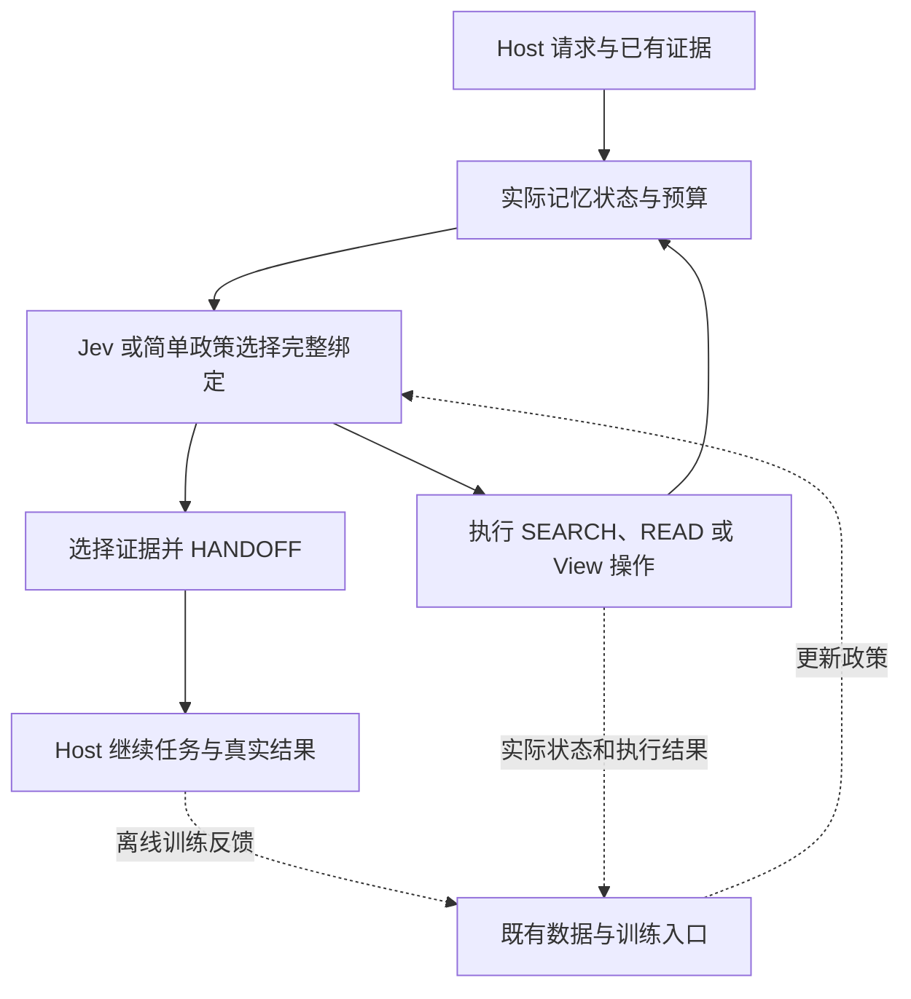

# MiLAi 开发与实验规划

## 2026-10-23 重生成版：围绕 Host 证据缺口，推进可学习的取证与持续记忆

> **研究主线：Host 带着任务目的、已有证据和资源限制请求记忆；MiLAi 学习怎样补齐证据缺口，并在连续使用中选择直接取证、复用或更新 View，使任务质量与完整成本得到可测的改善。**
>
> 创新的判断标准是相对已有工作推进了什么、解决了什么实际不足，以及证据是否充分。相关思路已有先例，可以成为本项目的起点；不要求每个部件都前所未有。功能开发、真实反馈和来源外验证共同推动研究，简单方法始终可以成为最终产品选择。

| 项目 | 本文依据与状态 |
|---|---|
| 仓库 | [minguselandy/MiLAi](https://github.com/minguselandy/MiLAi) |
| 最新研究分支复核 | `feat/training-generalization-20261021`，`b197255d59af9f3fc6d0533421cfb9a08f334de9` |
| 提交时间 | 2026-10-22 20:41:39，UTC+8；提交说明为记录暂停与发布交接 |
| 本次 GitHub 复核时间 | 2026-10-23 10:06，UTC+8；该研究分支未出现更新提交 |
| 实验状态依据 | 2026-10-22 20:40 左右的发布快照；属于历史记录，不能推断开发机当前进程 |
| 本文性质 | 新的开发与实验规划；本次只生成文档，没有启动训练、修改运行代码或服务、推送或合并 |
| 与既有研究的关系 | 保留原始结果、冻结方案及未完成清单；新功能与新增比较单独记录版本，不回填历史结果 |

提交与状态来源：[R0][R1]。外部项目和数据依据前一轮 2026-10-22 的公开实现核验；本轮重点是把这些结论组织为可执行路线，而非重新堆叠文献。

### 阅读顺序

- **开始开发：** 第 3 节的功能工作包，以及第 11 节的首批任务。
- **组织数据和训练：** 第 4–6 节，尤其区分原冻结队列与新轮条件覆盖研究。
- **设计论文实验：** 第 2、7–10 节，按问题逐步增加比较。
- **核查事实：** 第 1 节和文末固定到提交的来源；旧报告继续保留。

## 1. 当前状态：接着已经完成的工作推进

### 1.1 已具备的能力与尚未闭合的结果

| 能力或实验 | 当前已完成 | 下一步实际要做 |
|---|---|---|
| Host 调用 MiLAi | rich request、用途/证据要求/对象时间/known evidence/预算、JSON-action 真实执行、补搜、模型池与显式设备 | 完成真实任务，改善请求到证据交付的效果；复用当前入口 |
| 内部操作与交付 | SEARCH、READ、USE_VIEW、REFRESH_VIEW、HANDOFF；完整参数绑定；已观察材料与已交付材料分离；选择性原文、View-only、组合交付与完整返回包计量 | 改进来源选择、交付组合与预算分配；让策略实际使用已有能力 |
| 输入表示 | `shared_actions` / `shared_actions_request_text` 保留完整动作与绑定；旧 action-head 截断问题已修正 | 在真实长度与实际候选上继续评估；长输入能编码不等于理解正确 |
| Jev 训练 | source256 的旧表示与完整动作表示两次 seed0、524 更新训练均完成 | 落盘模型复核与部署选点；来源规模、反馈、Host、种子等关键比较继续闭合 |
| 反馈机制 | 同请求同 before、实际 post-state、参数分支、pair loss、replay、共同支持集、T2 自身轨迹导出已有入口 | 用真正有区分度的状态和执行结果补充经验，完成训练与任务效果 |
| View | 构建、使用、刷新、来源绑定、条件与时间表达已有实现 | 修复真实输出中的语义偏差，减少无效刷新和原文挤占 |
| 外部评测 | STATE、LongMemEval-V2、InstructIR、Mem2Act 等已有资产或接线 | 按各自协议完成对应结果，不能把资产准备或局部执行称为全量成绩 |

依据：当前执行记录、训练报告与实现。[R2][R3][R8][R9][R10][R11][R12] 原生 E0 的旧失败与已可用的 JSON-action 路径继续分开；本规划不把共享服务 parser 修改列为默认前置工作。

### 1.2 现在确有后段过拟合，但原因不能压缩为“行数太少”

完整动作表示的 source256 / seed0，在同一静态操作 dev 上出现以下曲线。宏平均按来源组计算；这些是训练过程中结果，尚不是保存后部署模型或 Host 成功率。[R3]

| 更新数 | train 操作宏平均 | dev 操作宏平均 | dev 接受数 / 616 |
|---|---:|---:|---:|
| 128 | 86.11% | 74.10% | 442 |
| 262 | 97.14% | 80.78% | 484 |
| 393 | 98.76% | 78.66% | 470 |
| 524 | 99.06% | 77.07% | 457 |

262→524 的 dev 下降约 **3.72 个百分点**，train 继续上升，支持当前训练后段发生过度拟合。晚期丢失的 39 个接受状态中，20 个为 READ→另一 READ，17 个为 HANDOFF→READ；因此，选择哪个来源、范围、版本和交付组合，是与操作类型同等重要的问题。[R3]

应同时处理四个因素：独立来源不足、真实状态覆盖不足、监督与实际效果的距离、参数更新及重复暴露过强。固定未来所有配方在 update262 停止，或只增加相似初始状态，都不能充分解决这些问题。

### 1.3 数据变多了，关键条件仍然稀少

| 操作数据档位 | 注册来源族 | 有标签来源族 | 原始状态 | 有标签状态 | 未知状态 |
|---|---:|---:|---:|---:|---:|
| source64 | 64 | 63 | 2,142 | 1,468 | 674 |
| source128 | 128 | 126 | 4,092 | 2,762 | 1,330 |
| source256 | 256 | 249 | 7,884 | 4,886 | 2,998 |

以上三档是已准备的数据，不代表三档训练比较均已完成。source256 的显式 `known_refs` 全为空；实际 post-state 中的 `observed_materials` 可以非空。已有标签中 REFRESH_VIEW 正例仅 2 个、USE_VIEW 正例仅 1 个，来自两个旧来源族；128→256 没有增加新 View 正例。[R4][R5][R6]

这说明扩张没有充分覆盖 Host 已知 A 但缺 B、实际读取后的剩余缺口、不同预算及 View 生命周期。它不说明所有未标注 View 都无价值，更不支持人为提高 View 的正例标签。

现有 feedback dev 为 **16 个状态、8 个已暴露开发来源族**。操作模型 update32–524 在这 16 个状态上 top-1 均为 SEARCH；旧 delivery-feedback 模型的动作类型排序可由固定 `SEARCH > REFRESH_VIEW > HANDOFF` 复现。SEARCH 不一定在每个状态都错，但当前指标不足以证明已学到随条件变化的决策。[R4][R7]

### 1.4 已有真实 Host 结果必须保留其模型和协议身份

旧 v4-D 实验来自 **8 个已暴露开发来源族**，每臂 16 个冷 bank、64 个请求位置。部分结果如下；C 为完整正确，Q 为带限定的部分正确，W 为错误，F 为未完成。[R2]

| 旧 v4-D 方法 | C / Q / W / F | 证据完整位置 / 64 |
|---|---|---:|
| fixed_context | 21 / 14 / 17 / 12 | 38 |
| rules | 19 / 18 / 22 / 5 | 36 |
| T1 main | 19 / 13 / 19 / 13 | 37 |
| T1 control | 16 / 19 / 20 / 9 | 36 |
| delivery feedback | 21 / 18 / 15 / 10 | 33 |
| view cache | 20 / 19 / 15 / 10 | 31 |

delivery 与 fixed_context 的完整正确数相同，不能据此称为等效，也不能宣称学习政策胜出。上述结果均**不是新 source256 完整动作模型的 Host 结果**；16 个独立存储 bank 也不等于 16 个独立来源族。旧 T0、T1、v4-D 与新泛化训练分别保存，不跨版本拼接胜负故事。

### 1.5 运行语义已经暴露出可直接修的功能问题

STATE 六条训练来源流上的 36 个 View，经作者对照原文审阅，15 个在记录范围内完整、18 个部分完整、3 个需要范围或完成措辞限定；请求交付为 16 完整、20 部分。它们是小样本描述性判断，不是独立 benchmark 准确率。[R8]

实际机制包括：未回答的问题被写成确认、捕获时间被当作事件时间、条件省略、旧 probe 查询占据原文槽位；重复提问形成新 pending Source 后触发刷新；31 次 READ 中 12 次因材料额度不足被拒绝。已有提示已经要求区分问题与事实、捕获时间与事件时间，单纯再加相同提醒不能算修复完成。[R8]

**优先级由此确定：先修清楚来源含义、View 生成和实际交付，再从修复后的真实行为学习。** 来源扩张与训练调整仍要推进，但不能用更多训练掩盖运行时问题。

## 2. 研究方向：一条主线，三个可累积的贡献

### 2.1 架构保持清楚

Host 决定需要什么，Jev/Laya 决定怎样取证。Jev 只在工具内部、根据真实请求与状态选择操作及绑定参数；不自行改写任务目标，不接管 Host 的最终回答或业务行动。

把待学习决策写为 `scoreθ(request, state, action_with_bindings)`：request 包含用途、对象时间、证据要求和 known evidence；state 包含实际候选、已经取得的材料、View 状态与剩余预算。执行结果进入下一状态。证据已足够时可以直接 HANDOFF，单条材料足够时不强制两次 READ。

图中反馈用于离线学习与实验；不新增在线审核 Agent 或独立记忆平台。

### 2.2 新增贡献应落在实际推进上

| 贡献方向 | 可以继承的思想 | MiLAi 的具体推进 | 所需证据 |
|---|---|---|---|
| **按证据缺口连续取证** | 意图检索、工具选择、任务效用 | 把用途、known evidence、执行后观察、预算共同用于操作与具体参数选择，特别处理互补证据和及时交接 | 相同来源在合理条件变化下产生合适的不同选择；未见来源上的交付和 Host 改善 |
| **用有限真实反馈学习取证** | 偏好学习、自身轨迹聚合、小型 scorer | 联合初始状态与实际 post-state，对执行过的绑定提供局部结果监督；解释来源规模与状态覆盖的作用 | 固定抽样预算的来源曲线、同来源状态比较、反馈采集成本及真实任务收益 |
| **按连续任务收益维护 View** | 派生记忆、缓存复用、版本更新 | 将构建、复用、刷新、读原文和交付额度放入有序请求流，解释维护成本何时可以摊销 | 低/高复用、相关/无关更新下的累计质量与完整成本 |

第一项作为论文主问题；第二项解释能力如何获得；第三项扩展到持续使用。三者无需在所有条件同时获胜。当前实现组合仍是候选贡献，实验要证明其新增价值。

### 2.3 核心假设与可修正的解释

- **H1：条件有用。** 在确实存在证据缺口差异的任务中，Host 的用途、known evidence 和预算能改善操作与绑定选择。等信息 request-text 比较检验表示形式；query-only 比较检验额外条件信息，两者回答不同问题。
- **H2：真实状态比相似行数更有价值。** 同来源、同抽样和更新预算下，实际 post-state 与参数级反馈能改善后续取证和泛化。它不预设更复杂损失一定胜过 CE。
- **H3：View 的价值依赖使用过程。** 高复用且语义稳定时可能受益，低复用或频繁相关变化时可能不划算；学会直接读原文或不刷新同样是有效能力。

这些假设支持有意义的增量创新。某个局部实验失败时，先判定是实现、覆盖还是机制本身的问题；在足够可用、充分覆盖的条件下仍无收益，再收缩模块和投入。

## 3. 功能开发主线：五个工作包

开发沿用现有来源、版本、权限、工具、存储与计量。不要增加审核 Agent、第二数据库/账本、通用重试平台、SHA/内容指纹门禁，也不围绕题目 ID、固定措辞或某个失败样例写专用政策。以下文件路径均相对 `MiLAi-Lab/`。

### F1：正确连接请求、来源到达与事实变化

**要解决的问题。** 当前请求可被摄入为新的历史 Source；cache 的 pending 条件又促成刷新。问题有保存价值，但它不自动构成事实更新。另一方面，用户明确的新偏好或决定确实可能是最重要的证据。

**实现内容。**

1. 沿用已有 role、origin、来源引用和时间，在取证与 View 输入中保留“请求、明确陈述、工具观察、派生解释”的可辨含义。
2. 调整 cache 的刷新选择：pending arrivals 是需要考虑的观察，结合用途、对象、时间和来源内容决定刷新；不将计数直接等同于相关事实变化。
3. 改进 `source_relevance()`，使原文选择使用 Host 所需证据及真实来源内容，减少仅凭 View 节点词面重叠选中旧查询的行为。
4. 对召回内容的转述保留原来源身份；不把反复出现当成新增独立支持。真正重复发生的事件仍可保留，不能按文本相同去重。

**落点。** `datasets/state_training.py`、`runners/functional.py` 的 capture 路径、`methods/cache_memory_policy.py`、`methods/evidence_control.py::view_observation/refresh_refs`。[R9][R10][R13]

**实际验收。** 用现有真实来源流分别继续一个重复取证问题、一条明确偏好、一次改变状态的工具回执、一条无关消息。观察实际 View、交付与刷新成本：问题仍是问题，新事实能被使用，真正有价值的用户信息不丢失。再用“总结未解决请求”的用途验证历史问题仍能被正确返回。验收关注证据含义与任务效果，不能把刷新次数减少本身当作成功。

### F2：让 View 真正保留条件、身份与时间

**要解决的问题。** schema 和提示已有 `rules`、`unresolved`、来源绑定、时间、不确定性，但部分真实输出仍省略前提或改变语义。

**实现内容。**

1. 改善现有生成输入和投影，让来源角色、对象、已执行结果、preview、报告时间与捕获时间贯穿生成和交付。
2. 选择更直接的条件表达；来源只支持“若 A 且 B，则 C”时，View 保留 A/B，不先写无条件 C 再附补救说明。
3. 用已观察失败片段改进示例或训练材料，同时保留正常直接事实；无需把普通事实全部转成复杂规则图。
4. 允许局部解释和 unresolved。View 的用途包括帮助后续取证，不要求每次生成完整结论。

**落点。** `methods/query_structure.py::structure_schema/build_query_structure`、`methods/evidence_reading.py`，与 F1 的输入联调。[R11][R14]

**实际验收。** 对真实原文检查：问题没有变成确认，preview 没有变成已执行，规则没有丢前提，没有事件时间时不借用 captured_at，原有对象与适用范围保留。生成文本和原文逐项对应，并检查正常事实的可用性。已有提示不作为完成证据；也不因 schema 合法就判定语义正确。

### F3：在完整返回额度内交付必要证据

**要解决的问题。** 已实现选择性交付，但策略仍可能先占用大 View，再读取低价值原文，挤掉互补证据。

**实现内容。**

1. 让规则/cache 与 Jev 使用现有 `delivery_selection`、`observe_only READ`、`use_view_only`、`handoff_select`；根据已知证据与所缺内容选择交付集。
2. 支持实际替换低价值或重复材料，利用已有 View/原文组合与范围读取；不强制先 View、先原文或交付所有观察结果。
3. 检查 `delivery_actions()` 的有限候选是否覆盖真实任务。现有单项、成对、View＋至多两项原文、全量组合若遗漏必要的三项互补原文，就增加需求相关的有限候选；不枚举全部子集。
4. 继续按整个返回包、引用和适配器 envelope 计 token。范围选择保留关键条件与上下文，不靠机械截断达成预算。

**落点。** 主要为 `methods/evidence_control.py::delivery_actions/execute/fits_delivery`、`methods/intent_retrieval.py::retrieval_packet/_execute_retrieval`；原文投影复用 `methods/evidence_reading.py`。`memory/retrieval.py` 主要负责召回与排名，不是返回额度修复的中心。[R10][R12][R14]

**实际验收。** 同一 before、同一 2,048 token 返回上限，验证真实必要原文可以到达 Host，重复证据可以被替换，完整包没有超限，Host 能基于所交付内容继续对应事实判断。再检查只需摘要、已有足够证据、一次 READ 已经足够的请求，避免形成固定多调用政策。对不足情况保留缺口。

### F4：把完整绑定与真实结果连接起来

**要解决的问题。** 完整动作表示已修好，但现有反馈小、同类绑定覆盖少，政策可能只学到全局 SEARCH 优先。

**实现内容。**

1. 在已存在的分支采样入口中覆盖 SEARCH 的 query/limit，READ 的 source/range/version，View 的 slot/scope，HANDOFF 的交付集合。
2. 同一实际 before 执行不同绑定，复用固定 continuation，并把反馈绑定到实际选项；同类型另一个绑定的结果不能替代它。
3. 将当前 top-1 是否真实执行过作为结果覆盖信息报告。旧冻结主池继续按既定采样；新条件研究可预先规定优先覆盖当前 top-1，而不事后只采失败或手工指定赢家。
4. 保留 T2 的全部实际决策，包括 mask、tie 和没有方向 pair 的状态；不只保留错误例或可训练正例。

**落点。** `tools/prepare_view_feedback_branches.py::parameter_actions`、`tools/prepare_retrieval_feedback.py`、`tools/run_frozen_retrieval_calls.py`、`runners/frozen_host_readout.py`、既有 T2 聚合与 `tools/train_bounded_laya.py`。[R15][R16][R17]

**实际验收。** 同一任务有两个 READ，其中一个重复已有证据、另一个可能补缺。分别执行，检查完整绑定、实际材料、固定续跑结果能对应；改变 Host 已知证据后再次执行。结果可以相同或不同，判断取决于真实任务，不提前规定“第二个 READ 必须好”。

### F5：完成真实 Host 应用闭环

**要解决的问题。** 接口、STATE domain-tool bridge、before/after/diff 与计量已存在，但新模型的真实任务价值尚未闭合；given-request 交付结果也不能代替自主 Host 成功。

**实现内容。**

1. 用固定上下文、规则和可用的已保存 Jev 完成小批真实任务。第一批基线不等待全部新训练结束。
2. 串起原任务、Host 实际请求、完整操作绑定、实际返回材料、Host 后续行动、最终答案/环境变化与成本。
3. 分开统计 Host 是否调用、调用后是否取得必要证据、Host 是否使用证据；避免把 Host 根本没有请求记忆的失败归因给 Jev。
4. 形成 STATE 官方只读接线和 MiLAi 动态 View 本地协议两种明确运行方式，详见第 8 节。

**落点。** `runners/state_bench_adapter.py::StateMemoryHook/make_state_agent/run_with_domain_snapshots`、`tools/run_state_bench_local_pilot.py`、`runners/frozen_host_readout.py`，继续使用现有 Host 工具入口。[R18]

**实际验收。** 给出少量完整可复核轨迹，并明确工具失败、证据不足、答案错误或业务状态未完成发生在哪一步。冻结请求实验只解释该请求条件下的取证价值；原生任务实验才回答完整应用效果。

### 3.1 开发依赖与第一条可用场景

F1、F2、F3 可以围绕同一真实来源流并行开发；F5 先跑简单基线；F4 使用修复后稳定的行为采集新反馈。研究代码继续位于 Lab，Product 通过现有公开契约使用，不把研究/评测依赖引入产品运行时。

建议第一条贯通场景使用“带条件的业务规则＋真实执行回执＋后续请求”。例如，Host 已掌握规则但缺实际执行结果，MiLAi 应能读取相应回执；第二次只询问同一事实时可以复用已有证据；出现相关新回执后再重新取证；无关新消息不自动产生新的事实结论。这是**开发情境示例**，不作为题目模板、固定动作顺序或预置正确标签。

一条场景跑通后，扩到不同对象、来源和表达。功能验收使用真正改变语义的少量场景；不建立额外审核层，也不为简单可逆修改堆积镜像实现的测试。

## 4. 数据建设：扩充独立经验，也扩充能改变决策的条件

### 4.1 三个数据池各司其职

| 数据池 | 学习目标 | 主要原料 | 进入训练前应得到什么 |
|---|---|---|---|
| A：用途与适用性 | 区分“主题相关”与“满足本次要求” | Promptriever、FollowIR 的公开训练数据 | 保留原生 query/instruction/document 身份的适用性样本；单独报告辅助成本 |
| B：可执行操作 | 选择动作、来源、范围、版本和交付集合 | 既有操作历史、MuSiQue train 来源、STATE train 的真实轨迹 | 实际 before、完整候选、执行结果、post-state、可解释的操作监督 |
| C：任务结果反馈 | 判断当前状态下的实际取证收益 | B 的同 before 分支、原始 Host frame 与固定续跑 | delivery 与 answer 两种真实结果、方向 pair、tie/unknown 及成本 |

A 池的大规模文本不是同等数量的记忆操作。B 池来源多不自动意味着 C 池有足够真实反馈。given-request STATE 或 factorial 没有原始 Host frame 时，保留 delivery-only；不能补造 frame 后把旧结果改称 answer feedback。

### 4.2 公开数据的具体安排

| 数据与开放资产 | 当前规模或事实 | 本轮用途 | 开发顺序与限制 |
|---|---|---|---|
| **MuSiQue-Full**，公开代码与 CC BY 4.0 数据 | 原生 train 39,876 行，包含配对的可答/不可答构造；共享段落与子问题较多 | 互补证据、多跳、缺失材料与停止条件；优先复用项目现有来源族 | 第一优先的可执行来源扩张之一；不能把每行当独立来源。上下文内不可答不意味着允许 SEARCH 时必须 HANDOFF |
| **STATE train**，MIT 仓库 | 三领域各 100 条训练轨迹，共 300；官方另有 150 个测试任务 | 已执行/未执行动作、条件规则、真实工具观察、连续状态；主应用材料 | 与 MuSiQue 互补；按任务/来源族分组，训练轨迹的结果只作为实际历史，不能修成理想示范 |
| **Promptriever / msmarco-w-instructions**，公开可获取数据 | 980,250 原料行；有带/不带 instruction 的重复组织；本项目仅准备 3,979 train、961 内部 dev 候选，尚未训练 | 大规模用途适用性与 instruction negatives | 先验证既有小池接入，再建议扩到 10,000→50,000 个 base-query 组；这是建议目标，不是已完成数据。遵守 MS MARCO 研究/非商用及所列附加条款，不能笼统称为宽松商用数据 |
| **FollowIR 过滤训练集**，数据卡 Apache-2.0 | 过滤版本 1,776 行；旧 raw 文件不作为等价替代 | 小规模用途训练与保留能力诊断 | 复用过滤资产；当前项目 349 项分类结果不等于原生排序 benchmark 分数 |
| **LongMemEval-V2**，公开代码/数据 | 当前 Small 451 个问题、200 份历史；项目已有完整页与范围读取准备 | 长证据、时序、更新与检索—Reader 完整回归 | 优先完成已有执行链；当前资产已有项目暴露，不能重新命名为盲测 |
| **MemoryAgentBench**，MIT 仓库与公开数据 | 四个 split 是能力类别，不是天然 train/dev/test | EventQA 的时间链、FactConsolidation 的冲突与修正诊断 | 后续针对具体缺口使用；以整段 context 为分组单位，不把同一 context 的问题随机拆开 |
| **InstructIR**，公开项目 | 1,267 queries、9,906 instruction instances、16,072 documents | 用途泛化的外部补充评价 | 保留评价角色，不为了扩大训练把评测集吞入 A 池 |

来源：[D1][D2][D3][D4][D5][D6][D7][D8]。已有 Mem2Act 等准备资产继续登记在原执行记录；本轮先完成有明确主问题的数据链，不同时展开所有 benchmark。

MuSiQue 的项目原料已有连通来源族组织，历史 444 个候选族不等于 444 个可立即使用的真实反馈族。扩张从现有来源身份、角色清单与已知暴露状态继续，不重新下载、重新造组或重复已完成的来源审阅。[R19][R20]

### 4.3 新采集优先补五类真实状态

| 条件缺口 | 构造方式 | 可观察到的学习问题 |
|---|---|---|
| Host 已知 A，仍缺 B | known evidence 来自 Host 真正持有的材料或此前真实 READ；保持对应引用 | 是否避开重复材料、补上真正缺失的证据 |
| SEARCH/READ 后的实际状态 | 保存真实返回、空返回、候选范围和剩余预算 | 是否根据操作结果改变下一步，而不是一直 SEARCH |
| 同类操作、不同绑定 | 在同一 before 执行两个可执行 READ 或 SEARCH 参数 | 是否选择对的来源、范围、版本或查询约束 |
| 证据已足够与仍不充分 | 使用实际取得的证据及可核对的任务要求 | 及时交接、继续补证、合理表达缺口；不强制多步 |
| View 生命周期 | 实际构建后重复请求、相关更新、无关新增及新用途 | 复用、读原文、刷新或不维护的条件选择 |

预算只使用预先规定、可执行的资源档位；不根据哪个动作能赢反向挑预算。known evidence 不从标准答案推造；View 使用真实生成产物，不提供无代价的完美 View。增加 View 有机会有用的情境，让真实结果决定是否产生正例。

### 4.4 每批至少报告六个不同单位

1. 注册、实际执行、有监督的**独立来源族**。
2. 初始与实际 post-state 的数量，以及每族状态分布。
3. 完整候选绑定、实际执行绑定、当前 top-1 的已执行覆盖。
4. 方向 pair、tie、unknown 和失败；pair 多不等于独立样本多。
5. 训练真实 draws、长度、tokens、各类操作暴露和监督权重。
6. 采集、训练、评估及 Host 的实际成本。

原始行数、训练抽样次数、来源族数与业务任务数分别保留。当前 8,384 次抽样中的操作组成与 loss mass 也不能互相替代；权重不会把一个来源变成多个独立来源。

### 4.5 新轮数据划分的建议目标

原冻结实验保持原划分。F1–F3 完成后，**另立一轮条件覆盖研究**：训练来源先 32 族形成可用数据，再扩到 64/128 族；新开发池目标 32 个与训练分离的来源族，确认池目标 64 个此前未用于该轮选型的来源族。这些是待落实的设计目标，尚未采集完成。

对每个来源使用少量事先规定的条件变化，不机械创建完整 factorial。所有共享材料、子问题、同轨迹派生状态与变体留在同一族。来源不足时报告实际规模，并用开发池的族间变异确定确认规模和可检测差异；不能靠增加同族问题或重复推理冒充增加独立样本。

确认池的题目和结果不参与模型、checkpoint、prompt、预算或假设选择。既有已暴露的 8 族 feedback dev、8 族 lifecycle、LongMemEval 451 题等继续作为开发/回归资产。新来源外测试与跨数据集应用分别报告，二者不是同一种泛化。

## 5. 训练设计：保留现有队列，再做少量有解释力的新增比较

### 5.1 原冻结反馈扩张方案原样保留

`training-generalization-feedback-expansion-plan-v1.json` 已准备但未派发，学习模型绑定待定。以下配置是**既有方案**，不在重写规划时偷偷更换。[R15]

| 项目 | 已冻结配置 |
|---|---|
| 初始化 | 按原操作 dev 规则选出的完整动作 source256 保存模型；所有反馈臂相同；不根据 feedback/最终 Host 反选初始化 |
| collectors | rules、laya、fixed_context，rich interface |
| 来源档位 | 32 / 64 / 128 训练来源族；最大 192 / 384 / 768 实际状态 |
| 状态采样 | 每 collector/来源最多 1 initial＋1 actual post-state；最大 128 族池采集/编译一次，按固定来源前缀形成小档位；缺失保持缺失 |
| 分支 | 初始状态用既有 operation representatives；post-state 抽同类两个可执行不同绑定，加可用控制分支，最多三个；不手工提名主池赢家 |
| continuation | 同一 before；fixed_context reads4，continuation2；具原始 Host frame 的分支做真实 readout |
| 目标 | continued-ce、answer pair、delivery pair |
| 抽样与 replay | feedback:replay 行比例 1:1；replay 相对 loss mass 0.25 |
| 训练量 | 每臂 192 optimizer updates，3,072 draws，cosine 总周期 192；seed0 |
| 评估点 | 0、12、24、48、96、192；包含 update0 的评估，初始化点也是合法选点 |
| 参数 | encoder LR 2.5e-5、head LR 1e-4；effective batch16、microbatch1、gradient checkpointing、选项打乱；`freeze_encoder=false` |
| 输入 | `shared_actions`，max_len16384、head2048；与此前完整动作训练的 max_len12288 区分 |
| feedback dev | 旧 16＋最多新增 48 个状态，仍为 8 个开发来源族；原 16 与新增层分别报告 |
| checkpoint 选择 | 各目标独立 feedback-dev 来源族宏平均 state-pair accuracy 最高，最早并列；CE 分别按预先声明的 answer/delivery 视角选点 |
| 共同报告 | 共同 update192 终点、旧操作 dev 保留能力、实际保存并重载后的选点结果 |

满额时，32/64/128 档约重复 8/4/2 遍对应 feedback＋replay 池。该方案回答**固定抽样预算下扩大反馈来源的作用**，不能改成每档各两遍后仍声称优化预算相同。

既有 600 requests / 8M reserved tokens 是队列容量约束，不是已花成本，也不等同于 768 个状态或三分支执行次数；以实际调度和原计量记录为准。原有未完成的操作规模、request-text、T2、种子和外部结果继续保留在执行清单中。[R2][R15]

### 5.2 第一项新增训练：实际 post-state 是否有用

在 F1–F3 后的新行为版本上，从同一批来源、同一 collector 构成、同一初始化出发，比较：

- **initial-only：** 只有实际初始状态及其真实反馈。
- **initial＋post：** 初始状态加实际到达的操作后状态及其反馈。

保持同一目标、总 draws、更新数、选点 dev 和预算；建议复用 192 更新与 3,072 draws 的短周期，明确这是新轮配置。不同池的实际重复次数、tokens 与成本单列。小池中的重复抽样属于设计的一部分，不伪装为更多独立数据。

该比较直接检验状态覆盖；不能用“旧 CE vs 新 pair”的结果代替，因为后者同时改变状态与监督。先做 seed0 的一个核心比较，看到真实选择与交付差异后，对决定性两臂补 seed1/2；不全交叉所有规模、损失、参数范围与辅助任务。

### 5.3 延用实际 pair 信号，不把未知当失败

当前已有每状态方向 pair 平均的 softplus ranking，形式可简写为：

\[
\mathcal L_{\mathrm{pair}}(s)
=\frac{1}{|P_s|}\sum_{(a^+,a^-)\in P_s}
\operatorname{softplus}\!\left(f_\theta(s,a^-)-f_\theta(s,a^+)\right).
\]

训练继续使用已有来源族/事件归一化和 CE replay。没有方向 pair 的状态保留在数据中，tie/unknown 不产生方向梯度；这不表示模型共享参数更新后，其未知动作分数完全不变。[R16]

**两种质量信号分别保留。** delivery 评价必要证据是否实际交付、来源/范围/条件是否合适；answer 评价固定 Host 继续后的真实任务结果。成本只在已审阅的质量平局后按现有多维支配关系比较，出现成本取舍就保留不可比，不任意折成一个权重分数。默认不用“多 READ”“多 View”作为奖励。

**局部结果的含义。** 同 before、同 continuation 的分支结果估计这项实际干预在当前续跑政策下的价值。它不是无偏的全局 Q 值，也不自动说明在所有未来政策中都最优。保留 continuation 是为了不把需要下一步才能起作用的 SEARCH 错判为无收益；更长后果由生命周期和原生 Host 实验补充。

**共同支持集。** answer/delivery 主比较保留实际覆盖差异；共同支持诊断保留相同 state/replay 池，仅限制到两者都有真实方向的 pair。若方向完全相同，复用相同目标结果，不重复训练来制造“两种信用分配不同”的证据。[R6][R16]

**CE 的位置。** 静态 soft-CE / set loss 的候选分母仍可能压低没有被确认好的合法动作，这是监督定义问题，尚非负迁移的因果证明。当前 continued-ce 用旧标注替代反馈位置，包含状态覆盖和监督差异。只有确实研究损失形式时，再做相同已执行候选支持上的 listwise CE 与 pair 对照；未执行候选仍为 unknown。这不是当前已完成实验。

### 5.4 第二项新增训练：减少不必要的表示过拟合

在选定的一套真实反馈数据上，比较现有 encoder＋head 与 `--freeze-encoder` 只训练头。保持目标、抽样顺序、预算和 dev；报告保存后效果及成本。该能力已在 trainer 中，不需要先写新训练平台。[R17]

冻结不预设更好，长输入前向仍有成本。若明确观察到表示漂移，再增加一个较低 encoder LR 的臂；不同时展开大量 LR、dropout、重加权和损失组合。所有选点使用同一完整优化周期的 checkpoint，不能把 192 周期的中点与独立短周期终点当成相同训练条件。

### 5.5 辅助训练：先验收接入，再扩大到真正有意义的规模

先用已准备 Promptriever 小池验证 instruction 与实际目标对应；通过后再扩到建议的 10,000、50,000 base-query 组。FollowIR 可作补充，不能反复复用少量题目替代数据扩张。

推荐比较为“无辅助初始化”与“用途适用性辅助初始化”，随后两臂使用**同一操作文件、同一 draw 序列、同一选项打乱种子、同一操作优化周期**。辅助训练成本额外报告。该比较回答相同后续操作暴露下辅助是否有用，不是等总 FLOPs。

若另研究固定总资源如何分配辅助与操作预算，单列资源分配实验。旧 T1 主配方与操作对照虽然更新数和总 draws 相同，操作暴露与训练 tokens 不同，不能把旧取舍直接归因于辅助任务负迁移。

### 5.6 模型与算法升级顺序

首选继续使用现有小型 scorer、完整动作绑定、真实状态聚合和 pair/CE 训练。先明确数据和功能瓶颈，再考虑增加模型容量或引入生成式 RL。

PPO/GRPO 可作为后续研究：需要可执行环境中有足够覆盖和区分性的结果，并显示当前 scorer 或训练目标成为实质瓶颈。所有组内分支都失败或未知时，换算法不能补出学习信号。当前 pair 模式要求正且有限的 replay weight，不把 `--replay-weight 0` 写成现成功能。[R16][R17]

## 6. 扩充经验的方法：从真实政策到可学习决策

### 6.1 借鉴 DAgger 式聚合，保留 MiLAi 的边界

训练政策会改变后续到达的状态。继续使用 rules / laya / fixed_context 多 collector，让模型看到不同路径到达的状态；聚合实际返回、候选、预算、View 和结果。公开 DAgger / imitation 提供这种思路，但 MiLAi 没有全知在线专家，不能套用原始理论保证。[O1]

首轮从冻结队列取足够多的真实经验。新轮条件覆盖再处理明显缺失的 known evidence、参数对和 View 使用情境。每轮可运行“采集→实际结果→编译→短训练→真实 Host”一次，是否继续采集由剩余不确定性决定，不把循环次数当目标。

### 6.2 有限分支也能研究参数价值

每状态使用现有至多三个分支机制，控制采集成本。初始类型比较和 post-state 同类绑定比较分工：前者了解当前应继续获取还是交接，后者区分该读什么、怎么查、交付哪些材料。

主池按声明采样保留未知与失败，不专挑困难例。新条件轮可另设有限的主动覆盖规则，例如当前政策 top-1 加另一同类合法绑定与现有控制分支；按状态和可执行候选选择，不读取未来正确答案。它是一项新增采样研究，不追溯修改原冻结采样。

### 6.3 不把一次随机 Host 输出当作无噪声真值

冻结 Host、prompt、工具版本、continuation 和初始状态，保留每次真实结果。对可能影响关键结论的分支，可在新版本开发研究开始前选定一个小的复读子集，估计 readout 变异；不按失败结果临时重跑到成功。这个新增子研究单独计量和报告，原冻结队列仍按每分支一次 readout 编译监督。最终训练 seed、推理重复和独立来源数分开报告。

额外读出是否值得，取决于它能否解决实际标签不确定性。常规训练不新增第二个审核 Agent；现有人工语义审阅只用于建立必要监督和解释关键案例，来源规模与成本如实报告。

## 7. 实验路线：每一轮解决一个主要不确定性

### 7.1 旧实验收尾与新研究分开

| 工作 | 当前身份 | 后续处理 |
|---|---|---|
| 保存后 CPU 评估 | 发布时 u0/u32 已完整落盘评估，u64 为 532/876；部署选点仍为空 | 实际恢复执行时先读取最终产物与当前状态，沿原规则闭合；不重跑或重复计费已完成候选 |
| 操作来源规模与 request-text | 原冻结范围内仍有未完成比较 | 保留原计划、长度和优化周期；新修复用独立行为版本 |
| 32/64/128 反馈扩张 | 方案已准备，checkpoint 绑定待定，未发布该队列最终结果 | 按第 5.1 节执行并报告缺失、成本和 dev 边界 |
| E2、factorial、lifecycle | 入口和方案已准备；部分只有交付/输入验证 | 完成对应层级的结果；不把准备状态改称已验证效果 |
| LongMemEval 完整路径与 Reader | 发布时 CPU 路径检查 405/902；尚无完整 451 题 Reader/原生判分 | 读取实际终态后继续剩余工作；代码路径通过和问答成功分别报告 |

这些计数取自历史发布记录。[R1][R15][R21][R22] 新文档不授权启动旧队列；后续执行授权到位后，按既有资源与串行约束衔接。文档、功能设计等独立工作不必等待某个旧模型“获胜”。

### 7.2 三轮主实验

| 轮次 | 首要问题 | 核心比较与工作 | 本轮需要交付 |
|---|---|---|---|
| **第一轮：实际功能** | 失败发生在来源含义、选择、交付还是 Host 使用？ | F1–F3；固定上下文、规则、当前保存模型的小批真实 Host；利用现有 E2 做局部定位 | 可运行功能、完整任务轨迹、清楚的失效位置和成本；不要求新训练先完成 |
| **第二轮：可学习经验** | 增加独立反馈与真实 post-state 是否改善条件决策？ | 原 32/64/128 反馈曲线；新轮 initial-only vs initial＋post；固定动作排序诊断 | 保存模型、来源外 dev、实际绑定变化、交付效果；核心比较再补 seed1/2 |
| **第三轮：应用与持续收益** | 改善是否转化为真实任务收益，View 何时值得维护？ | 固定模型后的 Host 主比较；完整 View vs no-view；等信息 request-text；有序请求流与外部应用 | 最终任务、累计质量—成本、分条件解释与适用范围 |

冻结编码器和辅助初始化是第二轮后的定向追加。只有相应问题仍未解释时才展开，不把各列做成笛卡尔积。

### 7.3 最小而有判别力的比较集合

| 比较 | 相同条件 | 可以支持的结论 | 不能替代的结论 |
|---|---|---|---|
| fixed_context、rules、Jev | Host、任务、来源、预算、完整工具行为 | 学习政策是否值得引入 | 静态偏好好不等于 Host 好 |
| Jev vs 固定动作排序 | 同候选集合、合法性和预先规定的简单参数绑定 | 超过全局动作先验的状态依赖收益 | 仅动作类型不同不证明参数正确 |
| 反馈 32/64/128 来源 | 同初始化、192 更新、3,072 draws、dev 与编译规则 | 固定抽样预算下的来源扩张效应 | 不等于等 tokens/FLOPs，也不是状态覆盖纯消融 |
| initial-only vs initial＋post | 同来源、collector、目标、抽样和优化预算 | 真实中间状态覆盖的贡献 | 不等于更大独立来源的贡献 |
| encoder＋head vs frozen encoder | 同数据、目标、顺序、更新预算 | 可训练参数范围的收益与代价 | 不预设模型更小一定泛化好 |
| 无辅助 vs 辅助初始化 | 后续全部操作暴露和周期相同 | 用途学习能否迁移到实际操作 | 不等总计算，也不自动证明旧 T1 负迁移 |
| full request vs 等信息 request-text | 相同可见信息、完整动作及比较训练条件 | 请求表示方式的作用 | query-only 不能替代它 |
| View vs no-view | 同有序请求、来源到达、任务与预算 | View 在连续使用中的净价值 | 单次 View 使用率或压缩比不足以证明收益 |

固定动作排序的类型次序和参数策略在开发集选定；确认集不再按结果改变。如果它与 Jev 接近，承认学习收益有限，同时检验预先规定的互补、时序和预算条件；不事后只选择 Jev 获胜的子集。

### 7.4 E2 与 E3 的具体用途

**E2：同请求、同 before 的真实分支。** 用于解释某个绑定为何产生更好的交付或固定 Host readout。保留实际工具反馈、continuation、失败与未知。它回答局部干预问题，不能单独替代自主 Host 的完整任务比较。

**E3：等信息 request-text。** 当要主张结构化 Host 条件优于一般文本表达时，必须使用相同信息、来源与动作绑定。query-only 去掉用途、证据要求、known evidence 等，只能用于“额外条件信息是否有用”的较窄假设。

现有小 factorial 为 4 来源×2 View×2 intent×2 known×2 budget，共每政策 64 cells，只有 2 train＋2 已暴露 dev 来源；它适合检查条件是否进入政策并改变真实结果，不承担来源外泛化证明。[R6]

### 7.5 生命周期实验：沿用入口，补足新来源与使用条件

原 lifecycle 方案为五臂 `fixed_context / rules / jev_full / jev_no_view / jev_request_text`，**8 个已暴露来源族，每臂 16 个独立冷 bank、64 个请求位置，五臂共 320 个位置**。它适合开发期比较；同族请求及 bank 相关，不能按 320 个独立样本计算置信区间。[R21]

新轮生命周期确认使用不同来源，并事先规定四类条件：

- 低复用：少量请求，View 建造成本可能无法摊销。
- 高复用：多次相关请求，事实稳定但用途可以变化。
- 相关更新：对象状态、适用规则或有效时间发生实际变化。
- 无关新增：出现新材料但不改变本次用途所需证据。

先以已有 2,048 token 返回额度运行主要比较，再对确实存在预算交互的少数臂增加低/高预算；不在所有模型、seed、数据上重跑所有额度。各臂冷启动、独立 bank，保留各自真实建造和更新历史。失效或权限不允许的 View 继续按当前合法操作集合处理，不因查询看似无关就重新视为有效。

生命周期主量为：各请求任务质量与证据完整性、累计总成本、每次成功的成本、首次投入多久产生可观察的复用收益。任何“平均成功成本”都与成功率并列，避免靠放弃困难任务显得便宜。

## 8. 应用与 benchmark：先闭合一个应用，再扩大外部验证

### 8.1 主应用选择

优先使用 **带条件业务规则、真实工具观察与连续请求的任务**，因为它同时暴露来源身份、已知证据、互补材料、View 更新时间和最终业务结果。现有 STATE 接线与训练轨迹使这一方向可立即接续开发。[R18][D2]

长期项目/编码协作是第二应用方向：恢复已定约束、区分旧结论与当前版本、查找失败原因与新的变更依据。它与真实产品价值接近，但首轮不新建大型编码 benchmark 平台。演化偏好与例外可作为已有应用中的条件类型，不必再拆成第三套基础设施。

### 8.2 STATE：官方只读轨道与动态 View 研究并列

| 运行方式 | 持久记忆边界 | 回答的问题 | 结果名称 |
|---|---|---|---|
| 官方 Learning Track | 只使用 train 轨迹形成的预构建记忆；测试期 memory hook 只读，不持久摄入测试请求或刷新 View | 学到的经验如何迁移到新业务任务 | 遵循全部协议时才称官方协议成绩 |
| MiLAi 动态本地协议 | 允许按声明摄入实际来源、构建/刷新 View，并计入完整成本 | 连续使用中维护记忆何时有价值 | 明确标注本地动态记忆实验 |

官方文档规定三领域共 300 train 轨迹、150 held-out 任务，GPT-5.4 simulator/judge、top_k=3、每题 5 runs。替换 simulator 或 judge 就报告为修改协议；只换 judge 不能称为全链开源模型运行。官方只读 hook 不允许把持久写入解释成“缓存”来绕过约束。[D2]

对官方只读接线，当前请求与交付引用可留在请求内状态；训练产物保持只读。离线建造成本也由 MiLAi 额外计量。动态 View 研究使用独立本地协议，这是另一项有效问题，不因官方只读要求而放弃。

现有 36 个 View 的语义审阅与待执行 STATE E2 分支不等于原生任务成功。旧局部 pilot 的结果也不替代官方完整运行。第一批开发使用 train 来源和当前已暴露池；最终结果使用事先确定的确认来源及协议。

### 8.3 LongMemEval-V2：优先兑现已准备的完整链

现有完整页摄入、范围读取和共享 Store 已实现；Small 451 题的准备不能再写成“从零加入长文记忆”。先读取 CPU 路径检查的真实终态，再完成 **检索→实际返回证据→Reader 输出→原生判分**，保留每题失败和完整成本。[R1][R22][D5]

当前 451 题/200 历史按回归身份报告。语料正常摄入、query 已用于开发、答案用于选型是不同暴露，应按已有记录分别说明。不能只因一次来源复查就断言所有答案都参与了训练，也不能把已用于开发的题重新包装为未见测试。[R20]

### 8.4 外部诊断的收敛使用

MuSiQue 用于互补证据；InstructIR/FollowIR 用于用途适用性；MemoryAgentBench 的 EventQA/FactConsolidation 用于时间与冲突。先完成对应功能后的一个明确诊断，再决定是否扩大到完整 benchmark。

项目的 MuSiQue protected 49 族中，14 族已有来源审阅、35 族未核实；不能一概声称独立盲测。STATE test 的后续使用遵从事先冻结的协议。现有保护/暴露记录复用，不建立新的第二套名单或内容指纹系统。[R20]

### 8.5 外部系统基线只接一个有必要的

首轮固定上下文、规则、no-view 和固定动作排序足够判断是否值得继续。应用闭环后，如果论文需要系统对照，从 Mem0 OSS 或 Hindsight 选一个，匹配 Host、允许来源和返回额度，报告实际实现支持的功能及成本。不要同时接多个平台，拖延主功能。

MemRL 式“相关性＋历史效用”是另一项有研究价值的简单政策：可以在现有候选与既有数据字段上实现，研究全局经验效用与当前 Host 条件的差异。无需迁入另一套记忆存储或完整 Agent。[O4][A1][A3]

## 9. 评价与成本：分清能力层级，再解释贡献

### 9.1 结果按五层报告

| 层级 | 核心内容 | 典型解释 |
|---|---|---|
| 训练拟合与偏好 | train/dev 来源宏平均、pair accuracy、同类绑定正确性、曲线 | 表明拟合和局部排序，不能直接当任务成功 |
| 工具执行 | 合法操作、绑定执行、返回/拒绝/失败/未知 | 区分政策选择与执行环境问题 |
| 证据交付 | 必要材料是否到达、原文/条件/时间是否正确、重复与遗漏 | 证据完整不必然保证 Host 使用正确 |
| Host 最终任务 | 完整正确、限定部分正确、错误、未完成；业务环境变化 | 原生任务主终点，与冻结 readout 分开 |
| 完整成本 | 采集、训练、建造、刷新、取证、交付、Host、评估、失败 | 按质量—成本关系判断实际价值 |

偏好不匹配、非法操作、证据不足和任务失败使用不同字段。View 忠实性、限定措辞、交付完整性也分开。无法测量的量写 unknown，不填 0。

### 9.2 Host 机会与 Jev 能力分别看

报告全部任务的最终结果，这是系统表现；同时报告 Host 实际调用记忆的任务、调用后交付覆盖和使用情况。条件性成功率有助定位，但不能只在调用成功子集比较系统胜负。给定请求 E2 与原生任务的差距，可以揭示 Host 调用/使用瓶颈，不能据此改写原始任务目标。

对于条件变化，既检查“该变时能变”，也检查“证据价值不变时保持稳定”。动作变化率、View 使用率和调用次数都不是越高越好；结果应由真实证据与任务效果解释。

### 9.3 来源族是统计单位

主要方法在相同来源族上配对；同族的多个请求、派生状态、bank 和条件变体一起聚合或一起重采样。报告来源宏平均、总体分子/分母、逐族差值与配对置信区间。小样本结果主要用于开发和解释，不以大量相关位置制造虚假的精度。

新确认实验的成功定义、主要差异、来源数和可接受质量下降范围，在开发阶段固定；可接受范围根据应用需求确定，不见结果后挑选。训练 seed0/1/2 的变化与推理 readout 重复分开；若只完成一个 seed，就按一个 seed 报告。

### 9.4 质量与成本共同解释，保持计量现实

建议采用以下分解：

\[
C_{\mathrm{life}}(T)=C_{\mathrm{build}}
+\sum_{t=1}^{T}(C_{\mathrm{refresh},t}+C_{\mathrm{acquire},t}
+C_{\mathrm{deliver},t}+C_{\mathrm{Host},t}).
\]

另列数据采集、模型训练与评估成本。原始质量指标与各成本分量都保留；不能只给一个难以解释的加权总分。View 的第一次构建、相关更新、失败分支、Reader/Host 推理、保存重载评估均纳入现有计量。

等更新、等 draws、等输入 tokens 和等 FLOPs 是不同设计。完整动作训练的表示比旧版本更长；冻结 encoder 仍有前向；辅助阶段额外增加成本。没有实测 FLOPs 就不声称等 FLOPs。沿用原 ledger 和阶段标识，不建立第二本账，不重复累计已结算成本。

主要学习曲线保留必要 train/dev 同步诊断，确认臂使用 trainer 已有稀疏评估与 `--train-eval-final-only` 减少重复全 train 评估。评估预算也是真实研究成本，不能为了“检查完整”无差别扩大检查。[R17]

### 9.5 结果驱动下一步，避免两种极端

| 观察结果 | 当前可下结论 | 合理下一步 |
|---|---|---|
| pair accuracy 提高但仍全局 SEARCH 第一 | 局部排序拟合改善，条件决策未证明 | 检查状态覆盖与同类绑定，不先换大算法 |
| 交付更完整而 Host 成功不变 | 已有证据层收益，任务层收益未闭合 | 看 Host 是否需要、看见并使用证据；保持系统主结果 |
| 简单方法常规任务更好 | 常规任务中学习政策收益不足 | 采用强简单产品方案，继续检验事先规定的复杂条件 |
| View 低复用亏损、高复用获益 | 维护存在使用边界 | 将不建造/不刷新作为合理选择，报告累计成本 |
| 功能正确且覆盖充分，主要对照仍稳定无收益 | 该机制在研究范围内缺少投入价值 | 缩减该模块或改方法，保留可复用功能与真实负结果 |

一轮小池失败不否定整个方向；已有相似工作也不否定继续推进。另一方面，不能不断更改任务、指标或子集来维持当前配方。新的机制解释在开发阶段形成，用固定的后续确认来源检验。

## 10. 开源工作如何帮助形成创新，而非变成否定清单

### 10.1 本轮实际采用的思想

| 公开项目/方法 | 可吸收的基础 | MiLAi 的推进方式 | 本轮采用程度 |
|---|---|---|---|
| DAgger / imitation，MIT | 在政策到达的状态聚合监督；偏好学习 | 结合有限执行分支、真实 post-state 与 Host 结果，研究可学习的记忆决策 | 采用思想，复用现有 collector/T2，不移入完整框架 |
| Search-R1，Apache-2.0 | 真实搜索反馈进入多步训练；PPO/GRPO 实现 | 取证后的真实转移参与学习，Host 保留任务控制权 | 借鉴交互训练；大 RL 框架后置 |
| ToolRL，Apache-2.0 | 工具类型、参数字段和值的细粒度监督 | 在同类操作的实际绑定间比较证据价值，允许多个有效路径 | 直接用于 F4 的数据与误差分析 |
| MemRL，MIT | 冻结任务模型、更新记忆效用 | 在全局历史效用基础上研究用途、known evidence 和预算条件 | 作为可实现的强简单研究对照 |
| Memento，MIT | 小型 query-case selector 与实际 CE 训练 | 保留轻量决策器，使用来源族分组、完整动作和真实结果 | 支持继续推进小 scorer，不照搬行随机拆分 |
| EMPO²，MIT 已发布历史实现 | 多样探索经验与后续学习 | 用现有多 collector 获取不同轨迹，研究哪些反馈值得成本 | 借鉴采集方式；不迁入额外经验平台 |
| Hindsight，MIT；Graphiti，Apache-2.0 | 召回内容来源处理、来源关系及时间语义 | 沿已有 role/origin/版本/时间改善 View 和来源选择 | 用于 F1/F2；不引入新数据库 |

来源：[O1][O2][O3][O4][O5][O6][A1][A2]。EMPO² 的公开实现可从 Agent Lightning 历史提交访问，当前 main 路径清理不等于未发布。未提供可用实现的工作不进入本轮开发候选。

这些项目说明相关组成思想已有实践基础。MiLAi 可以进一步做的是：**围绕 Host 尚缺的证据组织决策；将操作和参数与真实后果对应；把记忆维护放到连续使用的质量与成本中解释。** 具体改进若在真实任务成立，就具有值得展开的贡献空间。

### 10.2 论文叙事与图表清单

建议论文叙事依次展开：

1. **问题。** 同一份记忆的有用性取决于任务目的、已有证据和剩余资源，单纯相关性与全局效用难以表达全部差异。
2. **方法。** Host 提供需求，工具内政策基于实际状态选择完整绑定；用有限真实反馈学习，并按需维护 View。
3. **功能证据。** 来源、条件、时间与交付机制真实可用；明确哪些失败来自执行语义。
4. **学习证据。** 来源规模、实际 post-state 和参数反馈如何改变政策与来源外表现。
5. **应用证据。** 对强简单方法的 Host 质量—成本比较，以及 View 在不同使用条件下的收益边界。

最终优先形成四张主结果表/图：来源规模与学习曲线；真实 Host 质量与完整成本；状态/绑定比较；View 随复用与更新变化的累计结果。代表性成功、失败和平局案例放在同一分析中。模型未胜出时仍如实保留，但不把纯工程集成或局部诊断直接包装成已成立的算法创新。

## 11. 开发交付顺序与执行清单

### 11.1 建议的首批实现任务

| 顺序 | 具体任务 | 产物与完成证据 | 对后续的作用 |
|---|---|---|---|
| 1 | 在现有来源流定位 F1 的 capture→pending→refresh 与原文排序行为 | 一次正常请求、重复请求、明确新事实、无关新增的真实运行记录；改动集中在现有来源/政策代码 | 避免把请求重复解释成事实变化 |
| 2 | 实现 F3 的需求相关交付选择；核对有限组合是否缺必要候选 | 同额度下必要原文实际到达 Host；摘要请求、已知证据与不足情况同样正确 | 先获得可用的证据交付，生成有意义反馈 |
| 3 | 改进 F2 的实际生成与投影 | 原文与 View 的条件、时间、对象和执行状态保持对应；正常事实仍可用 | 让 View 收益建立在正确语义上 |
| 4 | F5 跑通一个真实业务任务链，保留 fixed_context/rules/current-Jev | 原任务至最终答案/环境结果与成本完整贯通 | 立即获得产品反馈，不等待所有训练 |
| 5 | 复用 F4，把修复后真实 post-state 与完整绑定编入新轮数据 | 实际状态、分支、结果、unknown 与来源覆盖可读；不修改历史标签 | 支持新条件研究和训练 |
| 6 | 按原范围闭合保存模型/旧队列，开展一项新状态覆盖比较 | 实际保存模型、固定 dev 选点、真实交付读出；关键两臂再补 seeds | 将功能进步转化为可验证学习收益 |

顺序 1–3 可在同一小场景上并行实现、一起联调；第 4 项的简单基线可先行。真正使用共享模型资源时遵守当前执行环境的既有调度，先核对实际运行状态，不能根据历史 PID 重启。

### 11.2 里程碑以可运行结果定义

| 里程碑 | 应完成的能力 | 研究产物 | 尚不代表 |
|---|---|---|---|
| M1：可用取证 | F1–F3 修复、简单 Host 路径可运行 | 原文—操作—交付—任务的真实示例与失效分类 | Jev 已获胜或 View 已有普遍收益 |
| M2：有效经验 | 真实条件、post-state、参数绑定和结果形成足够覆盖 | 来源/状态/分支统计，冻结的新轮数据及既有反馈结果 | 所有来源外场景都已覆盖 |
| M3：有效学习 | 一个有区分度的核心训练比较完成保存后验证 | 学习曲线、来源外 dev、核心 seed 与真实交付 | 静态指标自动转成 Host 成功 |
| M4：任务闭环 | 固定模型与强简单方法完成主要 Host 比较 | 最终质量、环境结果、完整成本与不确定性 | 官方外部 benchmark 已全量完成 |
| M5：持续使用与外部验证 | 生命周期和至少一个完整外部应用结果 | 累计成本、使用边界、外部协议结果 | 所有设置中都应优于简单方法 |

不对无法访问的开发机承诺完成时间或后台交付。推进标准是上述结果能否实际形成；无须在每个里程碑增加审批平台或审核 Agent。

### 11.3 文件与记录沿用现有体系

- **实现：** 第 3 节列出的 Lab 代码与工具；使用已有 Product 公共接口。
- **方案与结果：** 延续 `docs/` 与 `data/manifests/` 的现有 study/version 命名。新行为、新数据或新比较明确版本；原始结果继续保留。
- **原始产物：** 继续使用现有忽略的 artifacts、Store、权重和运行输出位置；不把大原料或权重写入规划文档。
- **报告：** 数据覆盖、训练曲线、实际交付、Host 结果、成本分别给出必要信息，再合成一份全局结论。避免增加内容重复的“审核完成报告”。

本文建议后续实现与研究，不替代原 execution 中尚未完成的清单，也不自动取消或启动任何队列。此次交付仅新增本 Markdown 文档；没有运行训练/推理、修改产品 API/Schema/权限/Canonical、启动服务或执行 GitHub 写入。

## 12. 相对前一版规划的实质变化

1. **将创新组织为持续推进的问题。** 条件化取证、真实反馈学习和 View 生命周期形成一条主线，已有相似工作用作基础，而非否决理由。
2. **以已核对代码为起点。** 完整动作、交付选择、返回包计量、post-state 与 Host 接线均作为现有能力；开发集中到语义和实际选择。
3. **承认新的过拟合证据。** 使用 source256 的完整曲线，避免沿用“还没有过拟合证据”的旧判断；同时不将原因全部归结于样本数。
4. **把扩数据落实到不同维度。** 操作 64/128/256 来源、反馈 32/64/128 来源、辅助 query 组和实际 post-state 分别设计，增加真实状态与完整参数反馈。
5. **精确继承冻结训练。** 保留 192 更新、3,072 draws、既定 continuation、选点和 replay；新增比较另立版本，不重写历史。
6. **收敛实验规模。** 先功能、再一个有判别力的训练比较、再 Host 与持续收益；参数冻结、辅助训练和外部平台按具体问题追加。
7. **区分协议与结果。** 官方 STATE 只读、动态 View 本地协议、LongMemEval 回归，以及 T0/T1/新 source256 分别报告。

## 参考来源

### MiLAi：固定到本次核对的提交

下列引用支持当前状态与实现判断；“建议”“目标规模”“新增比较”均为本文方案，不是既有实测。

[R0]: https://github.com/minguselandy/MiLAi/commit/b197255d59af9f3fc6d0533421cfb9a08f334de9
[R1]: https://github.com/minguselandy/MiLAi/blob/b197255d59af9f3fc6d0533421cfb9a08f334de9/MiLAi-Lab/data/manifests/training-generalization-publication-pause-20261022.json
[R2]: https://github.com/minguselandy/MiLAi/blob/b197255d59af9f3fc6d0533421cfb9a08f334de9/MiLAi-Lab/docs/HOST_INTENT_RETRIEVAL_STATUS_20261021.md
[R3]: https://github.com/minguselandy/MiLAi/blob/b197255d59af9f3fc6d0533421cfb9a08f334de9/MiLAi-Lab/data/manifests/training-generalization-progress-20261022-v30.json
[R4]: https://github.com/minguselandy/MiLAi/blob/b197255d59af9f3fc6d0533421cfb9a08f334de9/MiLAi-Lab/data/manifests/training-generalization-progress-20261022-v31.json
[R5]: https://github.com/minguselandy/MiLAi/blob/b197255d59af9f3fc6d0533421cfb9a08f334de9/MiLAi-Lab/data/manifests/training-generalization-progress-20261022-v33.json
[R6]: https://github.com/minguselandy/MiLAi/blob/b197255d59af9f3fc6d0533421cfb9a08f334de9/MiLAi-Lab/data/manifests/training-generalization-factorial-plan-v1.json
[R7]: https://github.com/minguselandy/MiLAi/blob/b197255d59af9f3fc6d0533421cfb9a08f334de9/MiLAi-Lab/data/manifests/training-generalization-progress-20261021-v3.json
[R8]: https://github.com/minguselandy/MiLAi/blob/b197255d59af9f3fc6d0533421cfb9a08f334de9/MiLAi-Lab/data/manifests/training-generalization-state-view-semantic-review-v1.json
[R9]: https://github.com/minguselandy/MiLAi/blob/b197255d59af9f3fc6d0533421cfb9a08f334de9/MiLAi-Lab/src/milai_lab/methods/cache_memory_policy.py
[R10]: https://github.com/minguselandy/MiLAi/blob/b197255d59af9f3fc6d0533421cfb9a08f334de9/MiLAi-Lab/src/milai_lab/methods/evidence_control.py
[R11]: https://github.com/minguselandy/MiLAi/blob/b197255d59af9f3fc6d0533421cfb9a08f334de9/MiLAi-Lab/src/milai_lab/methods/query_structure.py
[R12]: https://github.com/minguselandy/MiLAi/blob/b197255d59af9f3fc6d0533421cfb9a08f334de9/MiLAi-Lab/src/milai_lab/methods/intent_retrieval.py
[R13]: https://github.com/minguselandy/MiLAi/blob/b197255d59af9f3fc6d0533421cfb9a08f334de9/MiLAi-Lab/src/milai_lab/runners/functional.py
[R14]: https://github.com/minguselandy/MiLAi/blob/b197255d59af9f3fc6d0533421cfb9a08f334de9/MiLAi-Lab/src/milai_lab/methods/evidence_reading.py
[R15]: https://github.com/minguselandy/MiLAi/blob/b197255d59af9f3fc6d0533421cfb9a08f334de9/MiLAi-Lab/data/manifests/training-generalization-feedback-expansion-plan-v1.json
[R16]: https://github.com/minguselandy/MiLAi/blob/b197255d59af9f3fc6d0533421cfb9a08f334de9/MiLAi-Lab/tools/retrieval_feedback.py
[R17]: https://github.com/minguselandy/MiLAi/blob/b197255d59af9f3fc6d0533421cfb9a08f334de9/MiLAi-Lab/tools/train_bounded_laya.py
[R18]: https://github.com/minguselandy/MiLAi/blob/b197255d59af9f3fc6d0533421cfb9a08f334de9/MiLAi-Lab/src/milai_lab/runners/state_bench_adapter.py
[R19]: https://github.com/minguselandy/MiLAi/blob/b197255d59af9f3fc6d0533421cfb9a08f334de9/MiLAi-Lab/data/manifests/training-generalization-source-expansion-complete-v1.json
[R20]: https://github.com/minguselandy/MiLAi/blob/b197255d59af9f3fc6d0533421cfb9a08f334de9/MiLAi-Lab/data/manifests/training-generalization-protected-role-inventory-v1.json
[R21]: https://github.com/minguselandy/MiLAi/blob/b197255d59af9f3fc6d0533421cfb9a08f334de9/MiLAi-Lab/data/manifests/training-generalization-lifecycle-plan-v1.json
[R22]: https://github.com/minguselandy/MiLAi/blob/b197255d59af9f3fc6d0533421cfb9a08f334de9/MiLAi-Lab/docs/HOST_INTENT_RETRIEVAL_EXECUTION.md

- [R0] 提交身份；[R1] 发布暂停快照。
- [R2] 旧 Host 结果；[R3] 完整动作训练曲线；[R4][R5] 状态与 View 标签覆盖。
- [R6][R7] factorial 与旧反馈诊断；[R8] STATE 实际语义与交付问题。
- [R9][R10][R11][R12][R13][R14] 已实现的来源、策略、View、交付与 Host 路径。
- [R15][R16][R17] 冻结反馈方案、反馈损失和训练器；[R18] STATE 实际接线。
- [R19][R20] 来源扩张与保护/暴露清单；[R21] lifecycle 方案；[R22] 未完成范围与执行记录。

### 公开训练方法与记忆应用

[O1]: https://imitation.readthedocs.io/en/latest/algorithms/dagger.html
[O2]: https://github.com/PeterGriffinJin/Search-R1
[O3]: https://github.com/qiancheng0/ToolRL
[O4]: https://github.com/MemTensor/MemRL
[O5]: https://github.com/Memento-Teams/Memento
[O6]: https://github.com/microsoft/agent-lightning/tree/0b40cb724a0ad4f944810f8514884051777bb38b/contrib/recipes/envs
[A1]: https://github.com/vectorize-io/hindsight/blob/main/hindsight-docs/blog/2026-04-08-adding-memory-to-codex-with-hindsight.md
[A2]: https://github.com/getzep/graphiti/blob/main/graphiti_core/edges.py
[A3]: https://github.com/mem0ai/mem0

- [O1] DAgger 文档及 [imitation 代码](https://github.com/HumanCompatibleAI/imitation)。
- [O2] Search-R1；[O3] ToolRL；[O4] MemRL；[O5] Memento。
- [O6] EMPO² 已发布历史实现，另见[发布记录](https://github.com/microsoft/agent-lightning/issues/511)。
- [A1] Hindsight 的实际应用接线；[A2] Graphiti 来源与时间字段；[A3] Mem0 OSS。

### 公开数据与 benchmark

[D1]: https://github.com/StonyBrookNLP/musique
[D2]: https://github.com/microsoft/STATE-Bench/blob/main/docs/AGENT_LEARNING_TRACK.md
[D3]: https://huggingface.co/datasets/samaya-ai/msmarco-w-instructions
[D4]: https://huggingface.co/datasets/jhu-clsp/FollowIR-train
[D5]: https://github.com/xiaowu0162/LongMemEval-V2
[D6]: https://github.com/HUST-AI-HYZ/MemoryAgentBench
[D7]: https://huggingface.co/datasets/ai-hyz/MemoryAgentBench
[D8]: https://arxiv.org/html/2402.14334v1

- [D1] MuSiQue 数据与实现；[原论文](https://aclanthology.org/2022.tacl-1.31/)。
- [D2] STATE 官方 Learning Track；[D3] Promptriever 数据；[D4] FollowIR 过滤训练集。
- [D5] LongMemEval-V2；[D6][D7] MemoryAgentBench 代码与数据卡；[D8] InstructIR。

配套的较完整文献与代码分析保留在同目录 `MILAI_OPEN_TRAINING_MEMORY_OPTIMIZATION_20261022.md`。本文可以独立作为后续开发与实验的工作文档。
