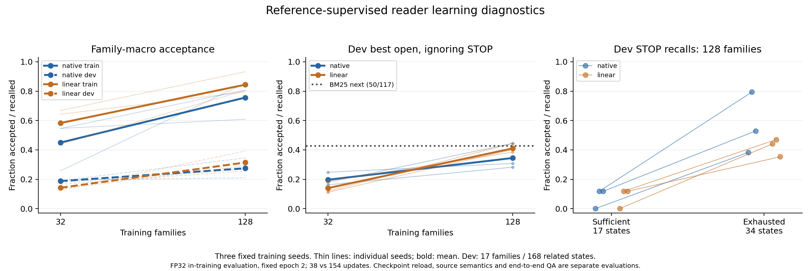

# MiLAi 全局训练分析与泛化执行原则

2026-10-17。用户明确要求：训练须从全局分析，保证通用性与泛化性，不能围绕单一问题反复调试。本文件调整后续执行；原始训练审查及全部失败记录继续保留。

当前任务是学习能迁移的记忆决策能力。单题改对、固定前缀分数提高、某次训练loss下降，都不能替代这个目标。泛化结论只按实际通过的任务、来源家族和分布变化范围表述，不作“任意场景都有效”的承诺。

## 已经执行的调整

- 已收尾正在运行的固定置换对照，保留全部首次结果，不为改善数字重跑。
- 7个已暴露问题/22个标注前缀降为诊断与回归材料，不再作为后续模型选择的主要开发集。
- 原155状态短材料拟合实验在派发前撤出队列，`semantic-fit-v1` 标为 `SUPERSEDED_BEFORE_DISPATCH`。其数据只是待审训练材料，不是下一轮完整训练方案。
- 核对两个当前Jev工作树的全部39,876行来源元数据：行号、问题ID、家族对应一致，但划分不同。新训练先采用两边共同训练且共同保留的行，不沿用任意单一工作树的局部train标签。
- 已从这个一致训练总体按2/3/4跳家族分层，各随机选择8个家族，共24家族/44条来源；880个段落位置的首批来源审阅现已完成。选择早于阅读正文，不依据当前模型错题。

其他工作树仍按用户要求暂停；本工作树继续全局分析和数据准备。禁用SHA与替代内容指纹校验，沿用原账本，不增加模型服务、部署或产品默认行为。

## 全局证据说明了什么

| 层面 | 当前证据 | 对后续设计的约束 |
|---|---|---|
| 数据覆盖 | 原始MuSiQue镜像39,876行/896家族；实际审阅标签训练只有17来源行/9家族/86状态 | 下载规模、前缀数与独立样本量分开；不能把局部拟合当作广泛学习 |
| 划分一致性 | 两边共同可用训练为17,975行/444家族；一致训练家族按最大跳数为374个2跳、61个3跳、9个4跳 | 不能靠重复4跳前缀制造新的4跳家族；家族权重和分层结果必须公开 |
| 历史接触 | 两树所有采样划分加预览涉及270家族；test保护并集内有63家族不在这些已登记采样/预览中 | 63是候选总体，不是已认证盲测；仍须核查额外历史接触及来源重叠 |
| 局部数据冲突 | 155状态材料的8个家族中，`musique-family-000577`在另一树为test | 该家族不得进入新全局训练；不能通过重命名划分消除过去接触 |
| 监督语义 | 原参考证明有不成立的实体连接、缺失前提、替代证明和非唯一答案 | 审阅整个来源与任务含义；不能机械把原support标记当唯一真值 |
| 读端学习 | 换集合损失有小的开发前缀增量，但未形成整体净收益；置换减弱首位置倾向，却出现大量错误耗尽 | 共同分析任务效用、状态分布和类别行为，不继续盲调单个loss/阈值 |
| 实际策略 | 同一模型的固定前缀表现与自身读取轨迹表现不一致；固定4与自适应差异很大 | 必须评价策略实际访问的状态以及最终回答，不能只有teacher-prefix分类 |
| 写端学习 | Impact的总体正确率可由other支配；必要root召回仍弱，preserve正例极少 | 不能扩大保持策略或把较高总体正确率当语义维护成功；强D0继续保留 |
| Reader/Writer | 好材料、合法范围和合法JSON都不保证答案/真实状态正确 | 组件指标、提交结果、来源忠实、业务状态分别记录，不能合成一个MiLAi准确率 |
| 外部评价 | LME旧500题有开发接触；V2两档全部与已分配small历史相交 | 只能标为已暴露回归；未认证来源隔离前不使用“新盲测”称谓 |

以上来自[全局总体盘点](../data/manifests/milai-global-training-population-v1.json)、[审查执行记录](MILAI_AUDIT_EXECUTION_20261017.md)和其中的原始结果链接，不是架构或理论上的推测。

## 要学习的通用能力与训练单元

训练围绕可复用能力组织，不围绕题号、人物、项目名或当前答案编写逻辑。

| 能力 | 要覆盖的变化 | 评价结果 |
|---|---|---|
| 证据识别与互补 | 同名不同主体、属性和时间不同、缺一前提、冗余/替代证明、无关材料、不同候选排序 | 必要材料召回、互补命中、错选、最终来源充分性 |
| 状态条件化 | 同一问题下不同已读材料、完整/部分来源、旧状态和新证据、支持失效与替代支持 | 应改变动作时改变；无关呈现改变时保留语义动作 |
| 停止与预算 | 已充分、池内不足、尚有互补材料、物理预算耗尽 | 两种语义STOP分别评价；预算耗尽不冒充语义判断 |
| 修改范围与保持 | 必要修改根、仍有效的继承项、无关内容、多来源与部分撤回 | root召回、错误保持/删除、真实提交后状态、独立无前提查询 |
| Reader任务执行 | 推导、归属、时间、限定词、证据不足与输出契约 | 事实/来源忠实与格式错误分开，不用一个数字掩盖 |

最小数据单元是来源家族中的语义任务及其状态变化。一个任务的改写、语言变体、别名、顺序和读取前缀都继承原家族。训练按家族、再按语义任务分配权重，避免某个问题因前缀更多而控制目标；`training_event`仅用于离线权重，绝不进入模型输入。

不强行把读端和写端塞进同一个新架构。先保持各自清楚的任务合同、来源和基线，确认共享能力及迁移证据，再决定是否共享训练。读端数据不能凭名称相似冒充Writer必要修改根数据。

## 数据与验证的全局边界

1. 新训练从两套声明均为train、且行级来源排除都保留的交集构建。目前为444家族/17,975行。所有旧实验保持原身份，不回写成“无泄漏”实验。
2. 任一树声明为test的家族继续受保护。开发与校准也不能因另一树标作train而混入新梯度训练。当前划分冲突不靠重新随机切分解决。
3. 已暴露小集仅作回归。全局开发集与最终保留集的来源、家族和使用次数在训练前固定；最终保留集不参与Prompt、超参、epoch或种子选择。
4. 现有家族划分隔离了已标注目标与单跳连接，但仍共享非目标百科背景，语义重复也未穷尽核查。因此“家族未见”与“任何背景/预训练知识都未见”严格区分。
5. 外部回归、同域保留家族、跨来源/领域迁移分别出表。MEME的多个故事共享生成DAG，MemConflict的多个问题共享persona历史，不能按题号数冒充独立来源数。

当前已完成首批来源质量审阅，结果用于确定全局数据/监督方案，不能直接当作新训练集。首批[24家族分层审阅](../data/manifests/milai-global-training-source-audit-v1-selection.json)覆盖8个2跳、8个3跳、8个4跳家族，共44来源行；这是按难度分层的审阅样本，不是总体噪声率的无偏估计。要记录真实支持、替代证明、歧义、任务类型和可见范围；当前失败题不会被指定补进此样本。

## 训练和比较方式

先完成上述总体和标签质量分析，再固定下一版完整训练协议。训练规模按独立家族数形成预声明学习曲线，不能看到某题失败便追加该题、延长epoch或更换开发集。数据与算力预算未核实前不承诺一个看似很大的样本数。

普通CE是必要基线。集合目标、选项/候选/别名增强、显式剩余预算或任务效用分别作为可解释因素；不把数据清洗、增加步骤、换目标、改Reader同时合并后宣称某一因素有效。当前集合损失和置换结果作为机制证据保留，不自动决定全局训练的赢家。

控制随机性时固定数据、初始权重、优化器更新和模型调用预算；主要结论覆盖至少3个预声明种子，报告每个种子与家族分布，不挑最好的一次。checkpoint选择只用预声明开发规则；所有中途失败和实际成本保留。

读取状态应来自多种通用策略与来源条件，而不只来自一种BM25前缀或gold证明顺序。策略自身访问的状态属于单独评价层。若研究剩余预算，应显式表示预算并以能完成任务的证据路径评价；这与重新分配现有标签概率不同。

## 泛化验收与退出条件

泛化证据包含四层：未参与梯度的家族、来源/领域迁移、语义保持/语义改变的成对干预、真实状态与端到端任务收益。至少同时报告家族宏平均、关键类别召回/错误、最弱分层、种子差异和实际成本。

首选动作一致率必须与动作正确性一起看。始终停止既可能很一致，也可能完全失去互补选择能力。总正确率必须同时列出constant-stop、constant-other和first-open控制。

强基线继续保留：Writer D0、BM25/普通dense固定预算、全池Reader、普通动作头。只在QA/状态质量与完整控制成本一起支持时采用学习组件；没有稳定净收益时保留简单方法，不以案例规则、置信度clip、重试或额外平台补出“成功”。

原7题上的新正信号也不能作为全局路线确认。它只能提出机制假设，必须在冻结的更广家族与分布上得到支持。下一次总体报告将明确已验证范围、失败范围与尚无证据的范围。

## 设计依据与解释范围

Shortcut Learning讨论了标准测试中有效的捷径为何可能无法迁移。本项目的选项位置结果是本地实测；论文并不证明MiLAi的具体失败原因。[Geirhos等，论文版本v5](https://arxiv.org/abs/2004.07780v5)。

WILDS把自然分布变化纳入评测，说明同分布表现不能替代跨环境评价；这里借用其评价思路，不声称其任何算法已适合MiLAi。[Koh等，ICML 2021](https://proceedings.mlr.press/v139/koh21a.html)。

Underspecification指出相似的原分布成绩可能对应差异很大的部署行为；因此本项目同时看多种子、分层和干预，不只看一个开发总分。[D’Amour等，JMLR 2022](https://jmlr.org/papers/v23/20-1335.html)。本轮核查的是这些论文的官方摘要/记录页，不冒充完整复现或全文研究综述。

当前全局训练尚未开始。首批来源审阅已完成；完整监督方案、全局开发/保留集资格及训练预算仍待落实，完整目标未完成。

## 首批全局来源审阅结果

24个家族/44条来源/880个段落位置全部先读正文，再对照原答案与支持标签。字面重复
跨配对连接到已读正文，共563种标题正文。44个完整source对象与保存的下载镜像逐项
相同；不代表镜像与作者原件已证实等价。完整初始20段输入最大7825tokens，8192/head512
审计零截断，本批问题不能归因于窗口没接通。

| 最大跳数分层 | 来源行 | 请求属性有来源支持 | 当前池不足 | 问题/范围歧义遮罩 |
|---|---:|---:|---:|---:|
| 2 | 15 | 4 | 7 | 4 |
| 3 | 15 | 2 | 6 | 7 |
| 4 | 14 | 2 | 8 | 4 |
| 合计 | 44 | 8 | 21 | 15 |

原标签中21行answerable、23行unanswerable。原21个阳性对应8个支持、4个在当前审阅
解释下缺少完整链、9个歧义；不能把它们称为13个确定错答案。部分判断存在普通语言
解释空间，已逐项保留审阅不确定性和条件性来源事实，原始盲于参考标签的审阅快照也
保留。作者助手审阅不是独立双人标注，不是全语料噪声率估计。

八个有支持的请求属性中，最短记录路径长度为1段×2、2段×4、3段×1、4段×1。
这说明元数据的分解步数不等于实际必需证据数。直接命名对象的属性可以有短证明，但
不能声称未核实的附加描述也得到证明。词义/角色、当前和历史所有权、地点与行政范围、
计划与实际事件都需要在全局监督合同中处理，而不是添加单题关键词补丁。

另有不完整证据的替代路径。不能把所有“可用部分证据”简单并成一个必须全读的集合，
否则会把冗余材料标成必要open，或延迟耗尽判断。当前审阅文件只是质量审计，尚不是
可直接投入训练的完整gold集合；原生参考指标和来源语义指标继续分开。

[逐来源记录](../data/manifests/milai-global-training-source-audit-v1-annotations.json) ·
[总体结果与范围](../data/manifests/milai-global-training-source-audit-v1-summary.json)。
仅机械对象/长度核对5.552秒墙钟/5.556秒CPU记入原账本；人工式阅读推理未完整计时，
不记为零。本轮新模型调用0，无SHA/内容指纹校验。

作者[官方仓库](https://github.com/StonyBrookNLP/musique)提供的完整归档及raw-train入口
本次均返回配额超限HTML，未获得作者文件。另需遵守作者提醒：跨数据集使用其组合所依赖
的单跳来源时，不能假定这些种子的原train划分与MuSiQue dev/test无交集。此点是全局来源
隔离要求，不是增加运行时检查链。[官方来源核查](../data/manifests/milai-global-training-source-audit-v1-official-source.json)。

## 补查评估难度覆盖

现有共同dev的23家族按最大分解步数为16个2步、6个3步、1个4步；63个未见于已登记采样/
预览的test保护候选为59个2步、4个3步，**没有4步家族**。不能用这个面板声称覆盖未见的
4步推理家族。

因此另作公开MuSiQue-Full v1.0 dev镜像的元数据候选接入，原始文件只保存于ignored目录。
仅访问题号、分解种子ID和步数，没有展示题目、答案、段落正文或进行模型推理。
4834行/2417题，按共享种子连接为544组，其中30组包含4步分解；题号和单跳种子ID与当前
完整TRAIN镜像的交集均为0。它还不是通过来源隔离验收的保留集：正文重叠、语义重复、
全部项目历史接触、作者原件等价性仍未证明，种子连通组也不是完整来源家族。
[候选接入与使用限制](../data/manifests/milai-global-heldout-intake-v1-summary.json)。
此数据不得用于梯度训练或为方法调参查看新题；后续按全局协议独立完成资格判断。

## 联合划分的字面来源可行性检查

元数据题号/种子隔离之后，又用一个私有本地程序作直接字符串相等性比较：原TRAIN
候选总体的全部段落及原标注目标、631条已登记采样/预览/来源审阅输入，与新候选的
段落、目标和问题字符串作双向比对。程序只输出计数和ID，不输出题目/答案/段落正文，
不调用模型，也不计算内容指纹；候选答案字段没有用于比对。

合并共同种子和相同目标段落后，新候选为528组。若保持原17,975行训练候选总体不变，
字面边界无冲突的候选有143组/233题，其中2/3/4步分别138/4/1。这个结果仍不能支持
广泛的4步未见来源验证；“ID没有交集”确实不能代替来源检查。

进一步做一次预声明的联合划分可行性检查：只从没有已登记历史冲突的组中，用固定
seed20261017按2/3/4步选择28/14/7组，不重抽种子。先保存49组选择，再在训练、开发、
校准三侧移除与其发生目标↔候选池字面冲突的整个家族。两次角色范围核对使用完全相同
的49组选择，未根据模型表现挑数据。

| 角色 | 联合划分后数量 |
|---|---:|
| 训练候选 | 371家族 / 5454来源行 |
| 开发候选 | 17家族 / 119来源行 |
| 校准候选 | 16家族 / 229来源行 |
| 保留来源组 | 49组，含28个2步、14个3步、7个4步组 |
| 保留来源组的全量成员 | 349题 / 698来源行 |

保留的是整个来源组；未来实际推理抽样和计算预算尚未据模型结果决定。训练候选自身
最大步数家族为317个2步、52个3步、2个4步，复杂度分布差异也必须在训练/评价报告中
显式呈现，不能靠复制长链样本增加独立家族数。

这证明当前资源下存在可用的**字面来源边界方案**，不代表语义重复、全部历史接触、
基础模型预训练接触或原件等价性已经证明。未来研究可分别考察新问题组合与更严格的
来源迁移，不能把这些不同维度都写成“完全未见”。本次没有向助手/模型展示新保留集
正文，没有训练，也没有产出模型成绩。

[字面来源比对](../data/manifests/milai-global-heldout-literal-overlap-v1.json) ·
[联合划分可行性](../data/manifests/milai-global-joint-partition-v1-feasibility.json)。
四次只读比较共7.324秒墙钟/CPU，另单列全TRAIN39876行与候选4834行的ID绑定核对；
均进入原账本，旧结果未重计。下一步据此落实完整训练协议和监督含义，不能直接把
本次44行审阅或原155状态拟合计划当作全局训练。

## 冻结广家族弱监督学习曲线

下一轮 `global-reader-reference-v1` 已冻结并完成准备。采用联合隔离后TRAIN内的候选；
将本项目三批逐题来源审阅涉及的全部41个问题ID及其变体保留为诊断，按同一规则排除，
不依据审阅结论选择性补标签。这不是清除全部项目历史接触。剩余365个训练候选家族，
按最大分解步数为315/49/1。此前两个4步候选家族中，一个只含已审阅歧义问题，不能为了
维持4步数量把它重新塞入梯度训练。

按固定data seed20261017从每个家族随机选一个最大步数问题，保留所有已准入来源变体。
两档家族集合嵌套；不是按当前模型错题抽样。32档为24/7/1个2/3/4步家族，128档为95/32/1。
对应304和1223个训练状态，来源行57和229；不是128个独立语义机制或1223个独立任务。
开发共17家族/17题/31来源行/168状态，含14个2步、3个3步家族，无4步家族。

模型可见字段仍只有问题和原始候选/已读正文。每个来源行使用一次固定随机候选排列及
相应别名，各已读状态共享该映射。状态覆盖empty、BM25前2、随机2、参考证据缺一项、
参考证据全齐、非参考材料2；相同已读集合合并，不靠复制前缀扩大样本量。每epoch另
随机选项位置并同步目标；两种头共享相同输入、排列和随机种子。这是新的完整数据配方，
不能把相对旧实验的差异归因于某一个增强因素。

**监督仍是原生参考标记派生的弱监督，不是来源语义真值。** 不声称未审题的原答案可靠，
也不把程序生成的完整参考状态当作已证实来源充分。这个实验回答广家族学习/状态条件化
是否出现，而不是直接宣布语义能力或部署收益；后续来源审阅和自身轨迹QA不可省略。

原生Laya与共享encoder的普通线性动作头分别使用seed0/1/2，两个规模共12个串行任务。
两轮训练固定终点，每任务分别38/154个优化器更新，保持BASE初始化、普通soft-CE、
同族同问题权重、相同优化器与更新预算。头的初始权重不同：原生头预训练，普通头随机。
较大数据档同时增加更新数，所以这条曲线不能解释为等算力样本效率。训练集仅在最终
epoch完整测一次，dev保留epoch0/1/2曲线；不后看测试挑种子或checkpoint。

训练数据最大4512tokens、dev最大4515tokens，8192/head512审计无截断，无长度排除或补抽。
全部目标与可见动作一致、家族loss质量相等、两档小集逐对象包含于大集、dev输入完全相同。
这些软件/数据检查不是模型泛化验证。新准备首次在导入时缺rank-bm25，0模型调用；用本地
uv缓存安装项目已固定0.2.2后完成一次准备，无模型工作重跑。该失败单独保留。

验证仍分别报告参考分项、best-open、两类错误STOP、家族/步数/状态分层、三个种子与
完整计算。实际策略保留BM25/dense固定4、全20Reader，并用同一最终模型分别评价fixed4与
adaptive上限4。保护的49组继续不进梯度或开发提示；候选正文/答案不在本次准备输入中。
Writer D0独立保留，读端监督不冒充写端根修改训练。训练与后续QA失败均保留，不自动重试。

[冻结协议](../data/manifests/milai-global-reader-reference-v1-protocol.json) ·
[准备与完整输入检查](../data/manifests/milai-global-reader-reference-v1-preparation.json)。
运行产物位于 `artifacts/jev-reader/global-reader-reference-v1`，沿用原账本与GPU2/3，
不恢复其他工作树、不新增服务、不做SHA/内容指纹校验、不改变Product/API/权限/Canonical。

## 新开发集的来源语义审阅

训练已按源码2346bb57启动，12个任务由单一coordinator串行执行。其他工作树未恢复。
在不查看模型预测的前提下，17个开发家族/31条来源全部620段位置、360种字面正文已读；
先保存来源判断，再比对原答案/support。结果为6条请求属性有支持、19条在严格来源合同下
证据不足、6条歧义遮罩。原17个answerable对应6/8/3。这不是11个已证实错误答案，
也不是全语料噪声率或独立人工gold。

区别包括：同名县跨州连接、剧院毁于二战不能证明某人参加一战、演出地点不能证明出生地、
博物馆所在地不能证明死亡地；另有共同父母能否推出婚姻、地理常识是否允许、历史WorldCup
时点、冠军认定口径等解释边界，逐项保留条件。Grieg题有两条替代身份材料，不能把两条
并成必须同时读取的目标。审阅仅作评价解释层，不更改冻结训练输入/标签，不根据失败补题。
模型仍按原协议训练，不改变epoch/种子/队列。机械验证单列原账本，助手审阅未完整计时。

[开发来源逐条注释](../data/manifests/milai-global-reader-reference-v1-dev-source-annotations.json) ·
[数量与解释范围](../data/manifests/milai-global-reader-reference-v1-dev-source-summary.json)。

## 冻结实际策略和呈现探针评估

已准备 `global-reader-policy-qa-v1`，须等12个训练任务全部闭合及实际PID退出后派发。
31来源/17家族×27臂=837个Reader位置：12个模型各fixed4/adaptive，加BM25fixed4、
同池BGE-M3 dense4和全20段。所有最终epoch2模型均保留，不根据早期分数挑大小档、头或种子。
Reader仍为原7860、原source-only指令与8192输出上限，相同messages/schema复用首次回执，
不补跑已确认失败或unknown。上限837次首次请求，不意味着将实际调用837次。

同一随机呈现顺序用于所有方法；BM25对照还原真实词面排序后映射到当前别名，不能错误地
把前4个随机展示项当BM25。所有620段与原来源逐项相同，31个空前缀payload逐对象等于
训练期间dev输入，两档dev完全相同。Dense共377种字面输入，BGE tokenizer最大379tokens、
总42325tokens，batch16预计24请求；此处只是容量检查，尚无embedding调用。

呈现探针覆盖12模型×168状态×4变化=8064次新forward：别名、候选顺序、选项顺序和中性
标题前缀。original视图复用同模型保存的finaldev2预测，原训练账本不重复收费。普通线性头
现可走同一探针和fixed4延伸入口；没有为它另加昂贵的每动作全文编码。排序与STOP、动作
变化与成对正确性一起评价；一致但始终停止不会记为学会状态条件化。

新增离线分析区分参考标签接受、best-open、真实BM25-next、两类错误STOP、家族/分解步数/
状态来源、已读证据转换、正负来源配对，以及有来源完整证明的子集。池内不足/歧义不被
自动变成一套未经审定的唯一open标签。首两任务的原账本差额已逐项核对相等，仅分析CPU
成本新增记账；中间表是INTERIM，不是完整12任务结果。

[策略/探针协议](../data/manifests/milai-global-reader-policy-qa-v1-protocol.json) ·
[输入、映射和容量检查](../data/manifests/milai-global-reader-policy-qa-v1-input-review.json)。
14项相关测试（包含实际已下载MuSiQue官方scorer的缺失分母测试）、Ruff/mypy、包DAG和
工具边界通过。测试不证明模型质量，也没有启动额外服务或改变训练代码。

## 保留来源切片：元数据先固定

现有49组保留总体中，用seed20261017固定选择6/4/4个含最大2/3/4步分解的组，每组随机取
一个最大步数问题，保留正负两行，共14组/28来源。整个49组仍受保护；本次不是删除其余
组或把它们转成训练。选择时未展示新问题/答案/段落，没有根据任何保留集模型结果选择。

计划仍对全部12个模型与三个简单控制作同样的fixed4/adaptive比较，最多756Reader位置。
先完成来源ID与当前数据的字面边界核对，冻结方法后才查看这28条来源作评价审阅，训练
全部闭合后才推理。分解步数不等于实际必要证据数，需要来源审阅单列。本样本用于困难
分层的来源迁移检查，不代表自然分布准确率、官方test、全部历史或预训练未见认证。
作者镜像等价、语义近重复与未登记历史接触仍未证明。不给LongMemEval v1/V2重新发盲测身份。

[保留来源元数据冻结协议](../data/manifests/milai-global-reserved-source-v1-protocol.json)。

保留切片已完成当前边界复核：28行与全部联合保留train5454/dev119/calibration229及已登记/
当前使用864行比较，双向目标↔候选池和字面问题冲突均0；ID/分解步数绑定全部一致。
仅计数输出的核对1.259秒记原账本。这是上述有限范围内的评价准入，不替代未证明的条件。

已导出独立test元数据的28来源/158参考前缀，未写train/dev梯度文件；完整560段位置、
349种字面正文的审阅视图已准备，**尚未阅读正文或原答案、尚无保留集模型推理**。
完整输入最大3848tokens，无截断。源文字没有被摘要或删短。下一轮先按视图顺序审阅所有
14家族，再比对参考答案，不能依据模型输出标注。

保留策略配置独立冻结：同12模型原始前缀158×12=1896次本地forward；28来源×27臂=756个
Reader位置，同BM25/dense4/full20控制。全部560段与来源逐项相同、空前缀payload一致；
Dense363种输入最大442tokens、总45834tokens、batch16预计23请求，仍只是容量审计。
须训练与前一dev评估闭合、保留来源审阅完成后才派发。原trained方法、提示与模型选择不变。

[保留边界核对](../data/manifests/milai-global-reserved-source-v1-admission.json) ·
[保留数据导出](../data/manifests/milai-global-reserved-source-v1-preparation.json) ·
[保留策略协议](../data/manifests/milai-global-reserved-policy-qa-v1-protocol.json) ·
[保留输入核对](../data/manifests/milai-global-reserved-policy-qa-v1-input-review.json)。

## 保留来源的完整审阅闭合

14家族/28来源/560段位置/349字面正文已全部在参考答案与保留集模型预测之前审阅。
先保存来源判断快照，再对照原标签；结果为10条有支持、15条池内不足、3条歧义遮罩。
原14阳性对应9有支持/3不足/2遮罩；原14阴性对应1有支持/12不足/1遮罩。有支持计数包含
下述解释限定，不是独立人工gold，不把这些差异全部计为数据错误或无偏噪声率。

| 最大分解步数分层 | 来源行 | 有支持 | 池内不足 | 歧义 |
|---|---:|---:|---:|---:|
| 2 | 12 | 5 | 4 | 3 |
| 3 | 8 | 3 | 5 | 0 |
| 4 | 8 | 2 | 6 | 0 |

三个重点区别影响全局评价，而非只修改单题：

- 证据允许推导，不能仅拷贝数字。国家人口题的来源把600万明确限定为占75.4%的子群体；
  先于参考答案的审阅已算出约796万，即约800万。原生参考却为600万。按原生F1与按来源
  回答目标属性可能给出相反评价；两者均保留，不修改模型输入或事后替换参考指标。
- 不把一个目标标记当作所有证明。孩子问题未限定唯一子女，阴性变体也保留多个有效孩子；
  首任总督题的阴性池提供1788–1795程序期间，但题意可区分正式起诉、审理与整个程序，
  阳性池还出现1786/1788审理时点冲突。因此仅在已声明的程序期间解释下记来源支持，
  不声称已经证实一条无条件的“阴性标签错误”。
- 分解步数、推理关系数与最少读取段落数不同。记录的最短证明为1段×3、2段×3、3段×4；
  一个段落可同时提供邻接城市和河流关系，不能因此把四个关系说成仅三步，也不能把四步
  元数据自动写成必须读四段。RX350被直接命名时可用直接属性段；宗教改革题存在语境推断
  的较短路径，显式四段佐证路径也保留。

作者身份、程序阶段、facelift/车型代际、品牌母公司/原型车实际制造者、Wittenberg地名
共指等解释限定逐项列出。没有利用保留集补训练题、改变种子/epoch、换提示或挑模型。
所有原生答案、支持标记和来源原文保留；完整实际策略评估尚未执行，泛化尚未证明。

[保留来源逐条审阅](../data/manifests/milai-global-reserved-source-v1-annotations.json) ·
[数量、推导和范围](../data/manifests/milai-global-reserved-source-v1-summary.json)。

### 派发前修正：重载精度与呈现基准

上文原计划复用finaldev2作original视图，现明确撤销。代码及实际safetensors头核对确认：
原生与普通头都把权重保存为FP16；训练内评价使用保存前FP32权重，重载只是把已舍入的
FP16值转回FP32，不能保证与原值相同。直接复用会把舍入差异混入呈现扰动效果。

在任何posttrain模型调用之前，协议改为每个重载checkpoint完整测original及四个变体，
共12×168×5=10080次新forward（比原计划增加2016），新增Reader请求0。旧finaldev2继续
保存，仅作“训练内FP32与保存重载”的独立诊断；原训练成本不重复记账。两种头同样处理。
这不是根据保留集成绩改变方法：保留集尚无预测，训练、选checkpoint、选项/候选映射和
Reader提示/设置全不变。原协议另存快照，修正理由与头部dtype观察可追溯。

[重载基准修正](../data/manifests/milai-global-reader-checkpoint-baseline-correction-v1.json)。

## 训练中间诊断与Writer证据分立

保存的 `analysis-progress-2` 只覆盖当时闭合的7项，属于INTERIM。32家族的三个种子
native训练接受157/162/70（分母304），dev33/32/34（分母168）；linear训练193/126/203，
dev30/24/23。所有六项dev参考已充分均0/17，best-open分别29/19/21与22/13/14（分母117）。
真实BM25-next为50/117，不能用随机展示首项22/117代替这个更强控制。

首个128家族native/seed0训练971/1223（互补704/838、耗尽238/266、充分29/119），dev38/168
（互补25/117、耗尽13/34、充分0/17），best-open36/117。拟合提高并未自动带来充分停止或
超过简单检索的证据；剩余预声明种子/普通头不改，最终以完整矩阵与自身轨迹QA判断。
所有7项原账本差额逐项匹配，未重记模型成本；这些是保存前FP32学习诊断，部署checkpoint
重载结果会按上述修正另外测量。

Writer侧再次只读核对原D0–D4三家族18组before/after：与原真实before相同，4个原种子
记录和25个实际已提交记录的SQLite当前值均与快照一致。三个before分别5/11/10个单元，
存储关系数均0；既有来源审阅没有已证实preserve_successor正例。缺少显式关系不证明所有
文本语义依赖不存在，但不能凭多数other得分制造保持类学习结论。

遗忘例中，D3保留原搬运存储事件，追加“应从记忆中删除”的指令，原无前提state-only探针
也仍能读出事件。D0/D1/D4删除目标时同时删除独立酒吧偏好；全部当前单元文本已复读，
该偏好并未换名存到新单元中。D2-CE遗忘和D4职级/分辨率失败的bank值完全未变。物理
旧单元不改写并不必然失败（新增清晰时间转变可以正确），所以不以单元ID差异替代语义。

这是旧三家族结果的当前实物核对，不是新泛化实验、银行修补或重跑。保留D0和来源状态
评价，不把Reader训练当作Writer训练，也不在无必要根/保持正例支持时扩大Impact。
[Writer实际状态核对](../data/manifests/milai-global-writer-evidence-audit-v1.json)。

再次只读查询远端公开ref：main仍518aee41、旧研究分支仍e832e2d；本轮audit研究分支尚未
发布。相对研究基点无Product路径改动。Git提交身份仅作provenance，没有执行SHA/内容
指纹校验；未推送、合并、部署或把本地软件检查称为远端CI。

## 12项全局训练闭合结果

固定epoch2全部完成，合计1152次优化器更新。每个seed/同backend两规模的初始168个dev
logits完全一致；六个同规模同seed的原生/普通头对照，数据、权重、长度和每epoch选项顺序
逐对象相同。encoder/head参数变化均实测非零。所有12项原账本差额精确匹配。

| 训练家族 | 头 | train接受，seed0/1/2 | dev接受 /168 | best-open /117 | dev充分 /17 |
|---|---|---|---|---|---|
| 32 | native | 157/162/70，分母304 | 33/32/34 | 29/19/21 | 0/0/0 |
| 32 | linear | 193/126/203，分母304 | 30/24/23 | 22/13/14 | 0/0/0 |
| 128 | native | 971/725/1035，分母1223 | 38/46/58 | 36/33/52 | 0/2/2 |
| 128 | linear | 961/978/1134，分母1223 | 43/51/65 | 45/47/52 | 0/2/2 |

BM25-next为50/117。规模扩大同时增加更新数，因此不作等算力样本效率的因果结论。
原生头没有稳定超过普通线性头；个别seed超过BM25的2个best-open命中不能作为稳定优势。
较大档6个来源审阅已充分状态命中native0/1/0、linear0/2/0，停止语义仍不可靠。
这些是保存前FP32训练诊断，不能当作保存重载模型的自身轨迹QA成绩。

[完整训练表与成本](../data/manifests/milai-global-reader-reference-v1-summary.json) ·
[闭合和配对核对](../data/manifests/milai-global-reader-reference-v1-closure-validation.json) ·
[可导出PDF](figures/milai-global-reader-learning-20261017.pdf)。
总训练输入52321548tokens，dev评价17872488tokens、train评价26160774tokens；均为本地
encoder输入工作，不是生成请求或独立样本数。总计7172.844秒墙钟、10188.318秒进程CPU。
训练器batchforward4584次、deviceforward9168次，dev/train评价分别6048/9162次。
这些原始工作已入原账本，汇总不重计。

源码8ce5d09b的posttrain流程已实际派发：协调器3610392、exec56592。先完整矩阵汇总，
再12模型五视图、同池策略与Reader。末次观察仍在呈现probe，不能把运行中当完成。
其他工作树没有恢复，训练没有重跑，也没有因部分结果改变模型选择。

首次问答结果审阅协议也已冻结：先隐藏方法名并按固定seed20261019打乱展示顺序，阅读
每个实际唯一响应与其真正交付的材料，再映射到方法位置。证据交付、正确答案、引用、
不足时空答案契约和原生指标分开。作者审阅仍非独立人工评判；事后发现的新证明只可单列
补充，不能覆盖预先审阅标签或只奖励某个方法。未知用量保留，不以0充当免费调用。
[结果审阅与成本协议](../data/manifests/milai-global-reader-response-review-v1-protocol.json)。
