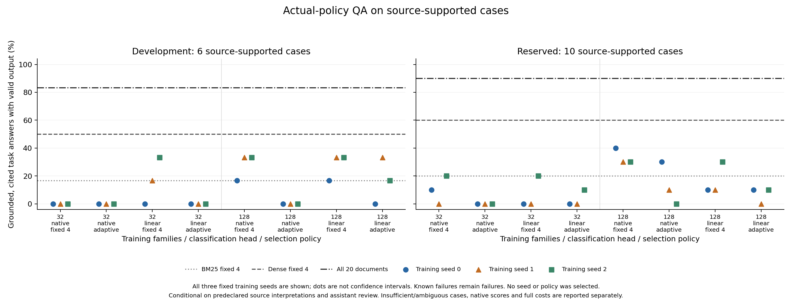

# MiLAi 全局训练与实际问答结果（2026-10-17）

本轮12组全局训练、开发集和保留集的全部首次问答及来源审阅已完成。较大训练规模带来
部分选材改善，原生头在保留集优于普通头的部分结果值得保留；整体仍未证明超过dense
固定4段的稳定净收益。自动停止仍频繁丢失本可回答的任务，不切换产品默认策略。

所有数字来自冻结方法的首次结果。保留集没有用于挑seed、checkpoint、Prompt或阈值；
其他工作树未恢复。逐要求执行审计已完成，见完成清单；未通过的是泛化净收益验收，不是任务执行状态。

## 设计与证据边界

- 32/128训练家族、304/1223状态，原生/普通线性头，3个种子，共12任务，固定epoch2，合计1152更新。两种头使用相同底座、输入、采样和选项顺序；参数确实更新，原账本逐项相符。
- 训练监督为明确披露的原生参考弱标签。较大档同时从38增到154更新，不是等算力数据量因果对照。近期41个已审问题整体排除，不将当前失败题补回训练。
- 开发集31案例/17家族；保留集28案例/14家族，原分解步数按2/3/4分层选6/4/4家族。来源审阅先于参考比较和模型结果；模型权重不使用保留集。
- 来源判分由同一开发助手完成，非独立人工金标准。开发来源分类6支持/19不足/6含糊；保留集10支持/15不足/3含糊。每项支持与不足均附具体解释和限定，不能当作普遍世界知识准确率。
- 目标证据对池双向字面隔离、问题与分解ID隔离已核对。实际32/128训练与保留池仍共享1/6个背景段落，均非双方原目标支持或保留审阅完整证明。未认证全部语义近重复、未登记历史、预训练接触或作者归档全文等价。
- 共1593个方法位置：开发837、保留756；共1074次实际首次请求和519次相同输入复用。两批全部59案例/1074份唯一响应在方法映射打开前逐份审阅；文档数量可能暴露部分策略类型，不能称完整盲评。

## 自身策略问答

数字以seed0/1/2顺序列出。来源支持成功要求核心答案、实际材料中的必要关系、引用和
声明的输出契约均成立。原生F1仍按原参考，不覆盖来源判分；保留集原生可答分母为14。
有依据的非唯一答案单列，不通过“总数减无保留通过数”推算错误。

| 方法 | 开发来源支持成功 /6 | 保留来源支持成功 /10 | 保留不足正确拒答 /15 | 保留原生F1 | 保留Reader千tokens |
|---|---|---|---|---|---|
| bm25_k4 | 1 | 2 | 12 | 0.488 | 72.2 |
| dense_k4 | 3 | 6 | 12 | 0.609 | 67.7 |
| full20 | 5 | 9 | 8 | 0.831 | 133.5 |
| 32家族 native k4 | 0/0/0 | 1/0/2 | 14/12/14 | 0.250/0.318/0.292 | 58.8/62.5/61.6 |
| 32家族 native adaptive | 0/0/0 | 0/0/0 | 14/14/14 | 0.000/0.000/0.000 | 22.5/32.5/17.6 |
| 32家族 linear k4 | 0/1/2 | 0/0/2 | 13/14/13 | 0.175/0.321/0.246 | 64.1/69.0/59.4 |
| 32家族 linear adaptive | 0/0/0 | 0/0/1 | 14/14/15 | 0.000/0.071/0.071 | 33.2/23.5/33.0 |
| 128家族 native k4 | 1/2/2 | 4/3/3 | 13/13/12 | 0.362/0.308/0.364 | 61.6/61.9/63.0 |
| 128家族 native adaptive | 0/0/0 | 3/1/0 | 14/15/14 | 0.214/0.071/0.175 | 44.9/34.5/46.2 |
| 128家族 linear k4 | 1/2/2 | 1/1/3 | 13/13/13 | 0.286/0.250/0.249 | 61.8/66.5/65.2 |
| 128家族 linear adaptive | 0/2/1 | 1/0/1 | 14/14/14 | 0.097/0.071/0.071 | 39.0/32.5/47.0 |

[可导出PDF](figures/milai-global-reader-transfer-20261017.pdf)。点表示训练种子，不是置信区间。
“输出契约”在此指JSON可解析及不足时空答案规则；正答案中夹带元数据等非最简表达另有
标记，并保留原始F1影响，不将回答文本清洗后重新计分。

128家族原生固定4在保留集为4/3/3，高于BM25的2，也高于普通头的1/1/3；但仍低于dense
的6。开发集原生固定4为1/2/2，亦低于dense的3。原生自适应保留集3/1/0、开发集0/0/0，
不能把少读或低Reader开销视为成功；32/native/seed2在两批都不打开任何材料。

全文在支持类的覆盖最好，但保留不足类仅8/15，低于dense的12/15，也消耗更多Reader
tokens。它是完整上下文控制，不是所有类别上的无条件赢家。

## 分层而非只看总分

开发集6个来源支持案例全部来自原2步问题，没有该口径下的3/4步成功率可估。保留来源
支持案例按2/3/4步分别5/3/2；下表为128档的全部种子。原分解步数不等于最短来源证明
长度，也不是控制了其他因素的难度实验。

| 方法 | 2步成功 /5 | 3步成功 /3 | 4步成功 /2 |
|---|---|---|---|
| bm25_k4 | 1 | 1 | 0 |
| dense_k4 | 5 | 1 | 0 |
| full20 | 5 | 2 | 2 |
| 128家族 native k4 | 3/2/2 | 0/0/0 | 1/1/1 |
| 128家族 native adaptive | 2/0/0 | 0/0/0 | 1/1/0 |
| 128家族 linear k4 | 1/0/3 | 0/1/0 | 0/0/0 |
| 128家族 linear adaptive | 1/0/1 | 0/0/0 | 0/0/0 |

原生128固定4的三个种子在仅2个4步标记案例中均通过1个，而dense为0；这一局部正信号
集中于一个问题，不能等同广泛多跳迁移。该头对3个3步支持案例全为0。所有家族和32档
同样保留在机器可读分层表中，空分层使用null而非零准确率。

保留集128原生固定4相对dense的原生F1均值差为-0.247/-0.301/-0.245，三个条件家族
bootstrap的95%区间均跨零。普通头也未优于dense；其中seed1/2区间全负，但这些仍是
小样本、多比较下的描述性区间，不是自然总体或重复生成不确定性的认证。

## 学习、来源与Reader分别反映什么

- 原生128保留参考前缀接受51/42/70，普通头25/20/51；原生best-open47/63/69对照BM25的49/126。但来源缺失互补口径的best-open为12/21/19，对照BM25的21/49，充分STOP仅1/2/2（分母10）。前缀参考提高没有自动转成实际问答净收益。
- 12模型的10080次开发呈现探针已完成，候选顺序仍影响选择；恒定停止可以高度一致却答不出支持类任务。保存前FP32与F16保存重载的差异在派发前已分离，保留集1896次original视图不冒充不变性实验。
- 来源审阅允许有效的短证明和推导。RX350直接日期、1788–1795程序区间按预先限定解释计分；国家总人口可由600万/75.4%推得约796万，600万只是子群体。完整材料下该人口案例仍被Reader拒答，说明并非所有损失都来自选材。
- 完整身份链缺失时猜中参考值、把演出地当出生地、把军队人数当国民人数，分别记录为来源或量的范围错误。共同育儿、婚姻、兄弟姻亲、不同历史阶段和非唯一子女问题保留不确定性，未改成统一无条件金标准。
- 两批各1次length失败保留原回执且无重试；开发4、保留6个唯一响应违反非空拒答规则。另有正答案夹带元数据，作为表达问题单列。模型首响不修复、不替换。

## 完整控制与Reader工作

下面是本轮全局12模型及其两个cohort的实际新增工作，已计入原连续账本；汇总未重复
计费。前期双种子损失对照、中断和其他诊断费用仍在原各阶段记录中，不在此抹去或
冒充免费。不同tokenizer与模型的token不是等价FLOPs。

| 阶段 | 实际工作 |
|---|---|
| 12组训练 | 1152更新；18324序列、52321548输入tokens；4584 batch forwards/9168 device forwards |
| 训练内dev评价 | 6048 forwards、17872488输入tokens |
| 最终train拟合评价 | 9162 forwards、26160774输入tokens |
| 两批前缀/呈现probe | 11976 forwards、35772492输入tokens |
| 自身选择+固定4新增扩展 | 2832 forwards、8541610输入tokens |
| 开发Reader | 570实际请求、390105输入+848375输出=1238480tokens |
| 保留Reader | 504实际请求、378817输入+788759输出=1167576tokens |
| Dense | 开发24请求/42325tokens；保留23请求/45834tokens |

合计Reader2406056tokens，两个cohort均无新增未知用量，回执与账本请求/用量差额为0；
各本地阶段差额也一致。训练7172.844秒墙钟/10188.318秒进程CPU；两批probe1920.116/
2927.100秒，选择与扩展721.532/1004.078秒。初始化、预处理和共享检索的具体记录另存
于完整成本清单，不用暖组件之和声称生产共驻端到端时延。

保留集每个学习型固定4策略自身还需112次控制决策、约346013–346139输入tokens；
上表的Reader千tokens未将这些隐去。每方法独立成本包含该方法内可复用的首次输入，
另存不复用的gross-position计数。训练/探针为研究工作，不能直接乘到每次生产查询，
也不能从研究比较中省略。开发助手审阅与绘图子进程CPU未完整计量；绘图墙钟和协调器
CPU单列，不称零成本。

## 与原审查及项目状态的对应

已执行同86来源审阅状态、同初始化/24更新、2种子的soft-CE/集合损失对照，保留此前
中断记录和用户授权重启记录。局部前缀变化未被当作任务净收益，也未把小集结果用于全局挑选。按用户
全局分析要求，155状态微拟合在派发前撤销，改为上述跨规模/头/种子的完整实验。

Writer独立核对18组真实before/after、4个原种子记录和25个当前SQLite值，与旧快照相符；
必要root与保持类的广泛覆盖仍未建立。保持D0，不把Reader权重或合法提案当作Writer
状态维护收益。显式剩余预算效用仍属未验证的独立研究因素，不将它混称为集合损失收益。

旧LongMemEval500及V2共享历史的开发接触身份已澄清，不重置为盲测；MEME/MemConflict
保留已暴露回归身份。本保留集为同域public DEV镜像的目标隔离家族，不能替代跨领域
自然总体或预训练隔离证明。

最终只读远端查询仍为main518aee41、旧研究分支e832e2d；本审计分支未发布。改动在Lab
的训练工具、测试、数据清单和报告内，Lab运行时src及Product路径无变更；无新服务、
推送、合并或默认采用。工作流未执行SHA或替代内容指纹校验，Git提交ID仅作来源身份。

## 可核对材料

- [全局训练与原账本核对](../data/manifests/milai-global-reader-reference-v1-summary.json)
- [开发全部方法与成本](../data/manifests/milai-global-reader-policy-qa-v1-summary.json)
- [保留全部方法与成本](../data/manifests/milai-global-reserved-policy-qa-v1-summary.json)
- [54个方法/数据集组合的家族/步数分层](../data/manifests/milai-global-reader-transfer-v1-summary.json)
- [开发首次回答注释](../data/manifests/milai-global-reader-response-review-v1-annotations.json) / [保留首次回答注释](../data/manifests/milai-global-reserved-reader-response-review-v1-annotations.json)
- [实际训练与保留材料边界](../data/manifests/milai-global-reserved-actual-training-boundary-v1.json)
- [Writer真实状态核对](../data/manifests/milai-global-writer-evidence-audit-v1.json)
- [逐要求完成清单](../data/manifests/milai-development-audit-requirements-20261017.json)
- [完整执行历史](MILAI_AUDIT_EXECUTION_20261017.md) / [全局设计与过程](MILAI_GLOBAL_TRAINING_GENERALIZATION_20261017.md)
