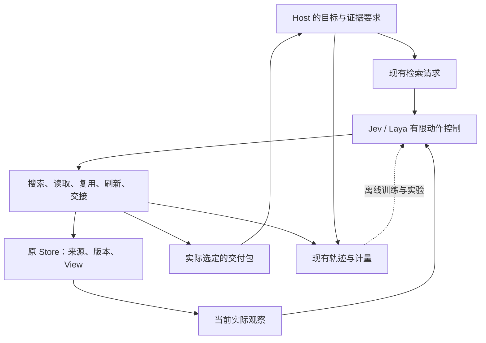

# MiLAi 开发与实验规划 v4：请求条件下的证据复用与取证控制

**日期：2026-10-20**  
**文档状态：待执行的开发与实验规划；本次完成文档，没有启动训练、运行评测、修改仓库或操作服务。**  
**接续对象：现有 Host 意图检索 v3、T1/T2、E1–E5；本文件调整开发优先级并细化创新假设，不重置既有实现与实验历史。**

## 1. 本轮决策

**先把 View 变成 Host 真正能连续使用的证据工具，再训练 Jev 学会何时复用、补读、刷新和交接。**

下一开发批次集中交付三项功能：

1. 控制器能够看到当前可见 View 中的事实、条件和未决项。
2. Host 收到 View 后，能够在后续调用中引用它，并沿真实来源绑定补读原文。
3. 在正常 `milai_retrieve` 路径中完成一条包含请求变化与来源变化的短流，由原 Host 消费实际返回材料并完成任务。

这三项完成后，立即看少量真实运行。若读过原文后无法选择压缩 View 作为最终交付包，继续补齐有限的交付选择；若已出现有解释力的策略分歧，直接进入小批真实分支采集与训练。两者可以按实际瓶颈交错推进。

科研主线收敛为：

> **在当前 Host 请求、已知证据和资源上限下，学习判断一个派生 View 是否足以替代进一步回源；当它不足时，选择有效的补读或刷新，并用实际证据交付、Host 结果和连续请求成本检验该选择。**

这是待验证的研究假设。视图、来源绑定、增量更新、有限动作模型本身都不自动构成创新。

### 1.1 开发原则

沿用原 Store、来源版本、权限、模型池、工具调用、快照和计量。功能直接进入现有执行链，产生可复核的真实请求、操作、返回包与 Host 结果。

每批只解决当前妨碍使用或解释结果的具体问题。首片不等待全部 T1 seeds、原生 E0、外部全量成绩或完整消融矩阵；已有 JSON-action 执行路径先用于开发反馈。原生工具调用兼容性另行完成，不把服务 parser 变更变成这一主线的前置。

不新增审核 Agent、第二数据库或账本、通用重试框架、SHA／内容指纹门禁。来源语义审阅留在现有离线实验流程；不会作为每次工具返回前的新判官。测试只验证新增功能的真实边界，不用测试数量替代材料语义和 Host 使用效果。

### 1.2 允许得到的结论

Jev、主配方、View 和图结构都可以输。若固定回源、简单缓存规则或互补集合选择足够好，就采用较简单的方法，并把论文主张收缩到有证据的适用条件。

一个可用的工具、一批能解释错误的真实结果，比同时准备更多尚未形成成绩的数据集更优先。

## 2. 规划基线：已完成、未闭合与新增工作

### 2.1 本次核对的 GitHub 状态

本次重新读取研究分支，最新发布提交仍为：

| 项目 | 已核对内容 |
|---|---|
| 仓库 | https://github.com/minguselandy/MiLAi |
| 分支 | `feat/host-intent-retrieval-20261019` |
| 提交 | `21756ba1c77f7cb9c06af4c88aebed0ea8210273` |
| 提交时间 | 2026-10-20 17:18:11，新加坡时间／UTC+08 |
| 发布运行快照 | 2026-10-20 17:17:51，UTC+08 |
| T1 seed0 | 主配方与操作数据对照均完成 524 更新及落盘验证 |
| 其余 seeds | 发布快照中主配方 seed1 为 100/524，其余尚未全部完成 |
| T1 真实 Host 结果 | 该发布快照尚无对应的新 T1 完整结果 |

以上是 GitHub 中的历史发布状态，不是开发机实时进程。后续执行时继续读取真实分支和实际产物，不按文档中的旧进程信息恢复作业。[M1] [M2] [M3]

### 2.2 当前训练结果能说明什么

| 指标 | T1 主配方 seed0 | 操作数据对照 seed0 |
|---|---:|---:|
| 操作 dev 偏好符合数 | 446/616 | 472/616 |
| 来源组宏平均 | 75.39% | 78.77% |
| FollowIR dev | 316/349 | 200/349 |
| 操作训练抽样 | 5,527 | 8,384 |
| 总训练抽样 | 8,384 | 8,384 |
| 训练 tokens | 28,392,562 | 41,804,889 |
| 更新数 | 524 | 524 |
| 偏好外 HANDOFF | 39 | 40 |
| 其中互补证据任务 | 36 | 37 |

这些结果表明两配方存在操作偏好与适用性分类之间的取舍。操作对照有约 51.7% 更多操作抽样、约 47.2% 更多训练 tokens；同更新数不等于等操作暴露或等 FLOPs，不能据此判定辅助任务负迁移。[M3]

在已标注的 616 个操作 dev 状态中，两臂均未选出 USE_VIEW／REFRESH_VIEW。这是该已标注子集的选择分布，不能推广成“所有训练状态都没有视图能力”。另有 masked 状态，也不能把未审阅动作当成已证实错误。

旧 T0 E1 的强固定上下文为 46/64，规则与 T0 Laya 均为 38/64。它提醒我们保留强简单基线，但不代表 T1 的真实 Host 表现。[M1] [M2]

### 2.3 直接复用的能力

| 能力 | 当前状态 | 本轮处理 |
|---|---|---|
| Host 主动调用、rich／query-only 请求 | 已实现 | 使用现有接口，保留 Host 原目标 |
| 用途、证据类型、对象／时间、known refs、资源上限 | 已实现 | 用正常请求产生行为差异 |
| 五类操作及参数绑定、补搜、历史版本读取 | 已实现 | 仅补真实缺失的候选或材料流 |
| View 构建、增量刷新、来源绑定 | 已实现 | 初期冻结生成器与结构语义 |
| 完整返回包额度与实际引用 | 已实现 | 同一条返回链上完善材料选择 |
| 模型池、显式设备和原计量 | 已实现 | 不搭新训练／服务平台 |
| E2 同请求同 before 与条件 Host readout | 入口已实现，关键效果未闭合 | 增加少量合法首动作干预和短续跑 |
| E3 等信息请求文本投影 | 已实现，文本臂尚未正式重训 | 选定配方后再做匹配重训 |
| T2 自身轨迹选择、导出、审阅聚合入口 | 已准备，真实新轨迹与拟合未闭合 | 从既定训练来源的小批状态开始 |
| E5 连续缓存实验 | 原规划已定义，发布记录未运行 | 复用持久 View 与连续 bank，补齐短流和成本汇总 |
| InstructIR、LongMemEval-V2、Mem2Act 资产 | 已准备部分或完整选定配置，缺全量真实成绩 | 沿用资产，不重新下载准备作为新成果 |

“入口实现”“数据准备”“测试通过”和“效果完成”分别记账，不互相代替。[M1] [M2] [M4]

## 3. 全局架构与创新位置

### 3.1 责任边界

Host 表达“需要什么”，Jev/Laya 决定“怎样取证”。View 保存可复用的中间事实、关系、条件和未决项；Host 负责最终任务推理与业务执行。

图中的反馈不增设运行时审核角色。新实验标签从真实执行、现有来源审阅和 Host 结果中形成。

### 3.2 需要明确区分的三个材料集合

用三个分析概念解释操作，不要求新建三套持久化系统：

| 符号 | 含义 | 典型例子 |
|---|---|---|
| `K` | Host 已经实际得到、并能用真实 ref 指定的已知材料 | 上一次返回的原文或 View |
| `O` | 本次控制器实际观察到的内容 | 来源页、候选片段、打开的 View |
| `D` | 本次工具实际向 Host 返回的材料 | 原文包、View，或二者的必要组合 |

`O` 增加不等于 `D` 增加；来源绑定存在不等于 Host 已得到原文；`K` 中只有派生 View，也不等于有原话见证。判断充分性时看 `K` 与 `D` 的实际内容，而不是只数本次返回项。

这一划分解释了为什么某次 READ 暂时不提高最终正确率，却可能帮助后续选择；也解释了为什么控制器读了很多材料，Host 最终仍可能证据不足。

### 3.3 首要假设：请求条件下的 View 可替代性

同一个 View 对“当前应该如何处理”可能够用，对“请给出最初保存版本里的原话”可能不够。判断应依赖实际内容和已知材料，不机械规定某个 evidence 类别必选 READ 或禁用 View。

建议检验以下条件响应：

| 变化 | 保持相同的条件 | 希望检验的能力 |
|---|---|---|
| 改变证据要求 | query 主题、来源、可用 View | 为具体要求交付足够材料 |
| 新增无关来源 | 原请求、已有有效证据 | 保持质量，避免无收益刷新 |
| 新增相关独立来源 | 原 View 旧绑定仍有效 | 发现旧绑定之外的新例外或补充条件 |
| 改变对象或时点 | 来源事实与版本可追溯 | 选择适用于当前范围的证据 |
| 已知原文与已知 View 互换 | 新请求目标相同 | 识别尚欠缺的见证，不重复无用读取 |
| 降低可用预算 | Host 任务不变 | 在资源内交付尽可能有用且如实的材料 |

其中最有辨识力的是：**旧来源依赖没有变化，新的独立来源却改变了当前请求所需的结论或证据。** 仅检查旧绑定是否失效，并不能充分回答这个问题。这是研究设计上的推断，需要实际比较来确认增量价值；不是对其他开源系统能力的先验否定。

### 3.4 次要假设与创新边界

**短程真实反馈。** 从同一个 before 比较实际操作及短续跑，可以检验“看到了新信息”如何转化成“交付了有效证据”。有限动作偏好学习可以先做；是否需要 value head 或长程 RL，由真实错误决定。

**连续请求效用。** View 可能第一次构建很贵，后续复用才有收益。E5 因此必须测整条请求流的质量和成本。这是必要的评价维度，不能单独包装成“首次提出缓存摊销”。

**结构作用。** 节点、规则和依赖关系可以支持条件表达，但图结构是否必要仍待验证。既有 E3 只比较请求的结构化／等信息文本表示，不能替代 View 图结构本身的消融。

开源近邻已经覆盖多个宽泛想法：Coalent 有源绑定缓存、复用、失效与修复；GAM 有请求时研究并向下游返回整合记忆；OpenViking 有分层内容与刷新；agent-memory 有物化视图维护；MemPursuit 有互补集合选择。因此论文应检验更窄的请求条件决策，而不是宣称“有 View／能刷新／Host 与记忆分离”本身新颖。[O1] [O2] [O3] [O4] [O5]

## 4. 功能开发工作包

所有源码路径均以 `MiLAi-Lab/` 为根。下表中的新增项是规划，不是已合入能力。

### W1：使 View 的实际语义进入控制器输入

**现有事实。** `EvidenceOperations.view_observation()` 已打开 View，但 `state.views` 当前主要包含 scope、built_for、revision、visibility、bindings、pending_events 等元数据，没有传入 `structure.nodes/rules/unresolved`。因此不能假定 Jev 在选择 USE_VIEW 前已经看过完整 View 语义。[M5] [M8] [M9]

**实施内容。**

先支持单个正常大小的、当前机械可见的 View。把其真实事实、条件、规则和未决项纳入决策观察，保留派生解释标识。沿用现有 literal/shared 投影；不再调用模型制造一个“给控制器看的摘要”。

View 内容进入输入后，实际输入 tokens、模型时延和来源打开成本照常计算。控制器看到 View，不表示 Host 已收到它；仍由 USE_VIEW／最终交付选择决定 `D`。对大 View 使用现有上下文与观察额度，先报告实际长度问题，只有发生真实需要才扩大分页能力。

**源码落点。**

- `src/milai_lab/methods/evidence_control.py`：`view_observation()`。
- `src/milai_lab/methods/laya_memory_policy.py`：`operation_payload()`、`project_operation_payload()`。
- `src/milai_lab/memory/literal_projection.py`：沿用共享投影，确保新增内容进入训练和在线相同表示。

**可用成果。** 一次真实决策记录中，生成式有限选项控制器能看到 View 的具体条件和未决项，并在 USE／READ／REFRESH 之间自由选择。当前 T1 权重可同时观察，但输入变化后的行为不能冒充原冻结版本成绩。

**必要检查。** 用一个含条件例外的真实 Store/View 检查最终模型输入，而不只检查 Python 中间对象。顺便查看实际动作参数是否完整可辨；只有真实绑定被截断时才局部修正选项长度。现有 Laya 选项长度上限是需要留意的具体输入问题，不是已证明的 READ 错误原因，也不扩成通用输入审计平台。[O9]

### W2：View 的来源可补读，真实引用可跨调用使用

**现有事实。** `_known_materials()` 已按真实 snapshot/item 引用重开之前实际交付的材料。无需新设计 known refs 协议。但 `project_packs()` 会把未与 View 同包交付的来源绑定投影为 `support_not_opened`；单独返回或重开 View 时，控制器需要的可打开定位可能不再保留。当前 READ 候选主要来自实际搜索材料和已观察来源页，不能假设每个可见 View 的绑定都有直接可选的补读动作。[M6] [M7] [M5]

**实施内容。**

保留“这只是来源定位、原文尚未交付”的语义，同时让控制器能沿原 Store 的来源引用选中有限 READ 候选。优先复用已有观察来源 READ 参数和读取路径；对当前不可见或不可打开的来源继续沿原行为处理。引用本身不提供原文内容。

正常 Host 第二次调用时，使用第一次 wire result 中真正返回的 `ref`。已知完整原文可省重复读取；已知 View 仍允许按新要求补读支持原文。当前持久 View 与早先返回快照不能混成同一版本。

**源码落点。**

- `src/milai_lab/methods/intent_retrieval.py`：`_known_materials()`、`known_evidence` 投影。
- `src/milai_lab/methods/evidence_reading.py`：`project_pack()`、`project_packs()`。
- `src/milai_lab/methods/evidence_control.py`：`actions()`、来源候选与 READ 分支。

**可用成果。** Host 先收到真实 View，再引用它要求一个具体条件的原文，工具读出绑定来源，并返回实际原文证据。直接来源定位减少不必要的重新搜索，同时保留普通 SEARCH 路径。

**必要检查。** 检查跨调用 ref 来自真实返回位置、补读内容来自原 Store、原文尚未交付与来源不可用两种状态没有被混淆。用这条完整轨迹即可开始，不先建立覆盖所有历史边界的矩阵。

### W3：完成首条正常 Host 短流

**W1、W2 后立即做；W4、训练和全量基准不作为前置。**

使用现有 JSON-action Host、`IntentRetrievalMemory`、模型池和连续 bank。初始可用 `GenerativeMemoryPolicy` 产生自由选择；规则与 T1 后续加入相同机会的比较。

一条开发短流包含以下真实情境，顺序由来源历史决定，不把情境变成题目规则：

| 请求位置 | 情境 | 观察重点 |
|---|---|---|
| 首次任务 | 多份来源支持当前目标 | 是否取得材料并形成可用 View；允许直接原文更合适 |
| 相邻请求 | 等义改写或证据要求变化 | 能否复用；需要原话时能否补读 |
| 无关来源到达后 | 原需求仍有效 | 是否出现无收益刷新 |
| 相关例外到达后 | 新来源位于旧绑定之外 | 是否补入必要证据、正确刷新或合理回源 |

不要规定每个位置必须多调用，也不把“发生 REFRESH”当作成功。若自由策略没有触发某条新功能，可用少量脚本化合法动作检查接线，再把该记录明确标为功能检查；不能计入模型成绩。

**建议起步规模：**2 个现有训练来源组，各 1 条 4 请求短流，约 8 个请求位置。先用一种能工作的控制器完成，随即阅读实际返回和 Host 答案。这是开发预算建议，可按实际历史调整。

**源码与入口。**

- `src/milai_lab/methods/intent_retrieval.py`。
- `src/milai_lab/runners/retrieval_histories.py`、`runners/functional.py`。
- `tools/run_host_intent_retrieval.py`；沿用 `--transport json_action` 和现有调用捕获能力。
- 现有 `continuous` 历史与 bank 机制；不新增演示专用工具入口。[M16]

**本批交付。** 一份可重复执行的来源／请求配置、实际 Host 调用、操作与参数、完整材料包、最终结果和成本，以及一页“下一处真实瓶颈”。成功路径和失败路径均保留。

### W4：有限选择“原文／View／View 加必要原文”

**触发条件。** W3 确认需要压缩交付或读取中间材料，现有追加式返回妨碍了功能。W4 不应挡住首条复用短流。

**现有事实。** `EvidenceOperations.opened` 当前同时承担已打开材料和当前交付集合。READ 后 USE／REFRESH 通常把 View 追加进该集合，不能自动用压缩 View 替换原文；完整返回包额度本身已统一实现。[M5] [M6]

**实施内容。**

在现有请求局部状态中区分“已实际观察”与“本次选定交付”。先支持三种有限候选：保留当前包、选一个已存在 View、选 View 加少量当前请求需要的已读原文。绑定只引用实际已获得材料，不用标签或答案挑包。

继续使用五种操作。交付选择优先绑定到现有 USE_VIEW／HANDOFF 等操作的有限参数；具体名称在实现时按现有结构确定，不扩为任意自然语言计划。保留原默认交付行为，让材料替换成为明确选择。

若确需“先读较多原文，再生成短 View”，还需允许少量 READ 作为控制器观察而暂不加入最终包。该路径必须受现有控制步数、模型输入和资源额度约束；最终包仍经同一个 `retrieval_packet()` 测量。只拆开请求内材料角色，不新增存储系统。

材料角色分开后，刷新候选与来源绑定仍要取得已实际读取的原文；完整返回额度、snapshot 的 delivered indices 和后续 known refs 则只依据选定交付集合。同步调整 `source_refs()`、`refresh_refs()` 与 READ 候选去重，避免已观察材料因尚未交付而无法参与后续刷新，也避免为了交付已读材料而重复读取。

**源码落点。**

- `evidence_control.py`：`opened`、`_deliver()`、`fits_delivery()`、执行分支和 `reader_evidence()`。
- `intent_retrieval.py`：最终材料索引、snapshot、`retrieval_packet()` 与完整包额度。

**可用成果。** 已经实际读取的材料，可以明确交付为原文、View 或混合包；后续 known refs 仍准确指向真正返回的内容。

**必要检查。** 用一个“原文全包装不下，View／混合包装得下”的真实例子验证完整 wire 包、引用位置和 Host 使用。读取与生成费用不能因最终少返回而消失，也不能默默删材料制造节省。

### W5：自身状态上的小批真实反馈训练

在 W3 的真实分歧状态上复用 E2 与 T2。先比较当前合法 USE、READ、REFRESH、HANDOFF 及少量短续跑，再训练有限选项模型。优先学习 View 是否够用、还缺哪份证据、继续取证是否值得。

初期冻结 `build_query_structure()` 的生成器、结构语义和模型配置。该模块已经接受完整请求、旧节点／规则、新来源、时间信息，并支持 incremental／rebuild／version_cache；不重新实现这些能力。[M9]

若实际 View 生成内容错误，单独归因到生成器，并根据错误做最小通用修正。更新 Writer 后用新版本运行，不把回源补救成功记作“旧 View 已被修复”。

具体数据、训练臂与标签见第 6 节。

### W6：从短流扩展到 E5 和一个外部执行基准

每个策略拥有自己的 View 演化，统一初始来源、来源到达顺序与资源上限。复用现有连续 bank 与成本记录，补齐请求流编排和冷暖累计汇总；公开快照尚不能证明专用 E5 runner 已完整实现。[M2] [M4] [M16]

先在少量来源组、一个返回工作点比较，再增加预算、种子和外部任务。E5 负责本架构的机制解释；STATE-Bench 单领域负责更接近真实工具执行的外部验证。已有 LongMemEval-V2 等资产继续使用，不因新增主线全部重做。

## 5. 分批交付顺序与资源投入

以下是建议起始规模，不是统计功效承诺、固定门槛或已运行数量。每批结束要有功能或真实结果，不以文档数量验收。

| 批次 | 主要工作 | 建议起始规模 | 交付与下一步依据 |
|---|---|---:|---|
| A：首个功能片 | W1、W2、W3 | 2 训练来源组 × 4 请求，约 8 位置；先一种控制器 | View 可见、引用补读、Host 连续使用；决定是否先做 W4 |
| B：形成自身轨迹 | 扩展正常短流，加入简单对照与两臂冻结 T1 | 4 训练来源组 × 2 短流 × 4 请求，32 位置／臂 | 真实候选、View 行为、材料交付分歧 |
| C：少量真实分支 | W5 的 E2 干预与短续跑 | 8 训练来源组、约 48 个 before；每状态 2–3 分支 | 约 100–150 个实际终点；只标已执行且可审阅的比较 |
| D：一轮训练与 E5 开发 | 共同起点的训练对照；自身缓存短流 | 单 seed；8 dev 来源组 × 2 短流 × 4 请求，64 位置／臂 | 比较交付、Host、成本；根据结果选择少数候选 |
| E：确认与外部任务 | 新确认组、额外 seeds、选定 E3、STATE 单领域 | 由 D 的方差、失败分布与实际成本确定 | 形成论文可支持范围；不同时扩成全因子矩阵 |

训练侧小批优先从既定 T2 的 32 个 train 来源组中取，不重抽或重命名整套既有 T2 数据。新的请求、同源改写、续跑和分支跟随原来源组划分。

2048 返回 tokens、最多 8 次内部决策沿用 v3 作为工程起点；它们不是请求 schema 的硬默认值。简单请求应提前交接。512／4096 在选定少数候选后检查敏感性；多 View 容量同样先保留原配置，不立即扫描所有容量。[M4] [M10]

批次 A、B 不要求 Jev 获胜。只要正常路径可用、差异可以解释，就能推进；若根本没有合法可用 View 或原文路径，先补具体功能，再讨论学习好坏。

## 6. 训练设计：让监督对齐真实取证

### 6.1 当前问题的工作诊断

| 观察或实现事实 | 对训练的影响 | 本轮动作 |
|---|---|---|
| 主／对照操作暴露和 tokens 不等 | 无法直接归因为辅助任务负迁移 | 保留原结果，新比较记录实际暴露与成本 |
| 偏好外 HANDOFF 多集中于互补任务 | 可能缺少“再读一步形成联合证据”的监督；尚非因果结论 | 对同 before 做短程实际分支 |
| 当前静态偏好与 Host 结果未闭合 | 偏好分数提升未必改善交付 | 以实际包和固定 Host／完整 Host 两种结果检验 |
| View 语义在初始观察中不完整 | 决策输入可能不足以支持可替代性判断 | 先做 W1，再收新状态 |
| 来源有绑定但未必有直接 READ 候选 | 学习无法补救不存在的操作机会 | 做 W2，单列候选不可达 |
| `opened` 与交付集合耦合 | 部分读—压缩—交接策略无法表达 | 由 W3 反馈推动 W4 |
| 现有可接受集合 CE 对集合外选择给予负向压力 | 未审阅的备选行为可能被混作不接受 | 新分支保留 unknown，只对实际有效比较训练 |
| 训练／线上请求投影已有统一入口 | 可以低成本保持同语义输入 | 新内容沿用该入口，不建另一套训练 prompt |

最后两项不意味着全盘否定现有 CE。当前任务需要先补可观察、可操作、可比较的状态；只改损失名称，不能修复候选、标签和真实目标的缺口。[M8] [M12]

### 6.2 E2 分支采集方式

从训练来源的真实 Host 调用中保存原请求、before、合法动作及参数。每个 before 选 2–3 个有实际差异的合法首动作：

1. 执行该首动作。
2. 立即正常 HANDOFF，或由同一个冻结续跑策略再走最多 1–2 步。
3. 保持原剩余额度和实际可用操作，形成真实返回包。
4. 将它送入现有固定 Host readout；记录新的调用成本和结果。

“强制合法首动作＋短续跑”是对 E2 的拟增能力，不应写成已有完成结果。未执行分支不自动标负；未在短时限内完成也不证明更长路径无价值。优先用真实轨迹中的分歧状态，同时保留普通可复用、无关更新和合理交接状态，避免训练只看到失败难题。[M13] [M14] [M17]

E2 的 Host readout 是替换原完整工具批次中的目标回执后得到的条件结果。同批其他输入保留，它用于比较本次取证贡献；完整自主任务效果仍由 E1／E5 的原 Host 连续运行给出。

### 6.3 标签来源与可接受结果

对每个真实分支，使用既有离线来源审阅和执行记录回答：

- 返回包加已知材料是否支持当前需要的内容？
- 指定的原文、保存历史、时间、版本、对象或范围见证是否实际可得？
- 所需见证是否进入 Host 看到的材料，而不只停留在控制器观察中？
- 固定 Host 后续结果怎样？完整任务另记。
- 该分支实际消耗了什么？

多条分支可以同时有效。合法 HANDOFF 可以是预算内最佳选择，同时仍留下缺失证据。部分交付不能自动等同最终失败；证据不足也不证明当前一定有更优合法路径。

View 类型、节点数、来源数量、刷新 API 成功、教师选择和标准动作 ID 都不能直接充当语义标签。原文兜底成功与 View 自身合格分别记录。

### 6.4 初始训练对照

默认从现有 T2 主配方配置对应的 **T1 主配方 seed0** 作为共同初始化，便于接续；这不预设它更好。操作对照 seed0 保留为冻结评测臂。先固定一个共同起点，不让各新训练臂从不同配方或 seed 开始。

| 实验臂 | 训练资料与反馈 | 要回答的问题 |
|---|---|---|
| 冻结 T1 主配方 | 不新增训练 | 当前起点的行为 |
| 冻结 T1 操作对照 | 不新增训练 | 简单操作暴露路线的现有能力 |
| continued-CE | 同一共同起点，继续旧操作监督 | 额外操作训练本身能解释多少收益 |
| answer-only feedback | 同批真实新分支，仅用内容答案／任务结果与成本构造偏好 | 下游答案反馈是否已足够 |
| delivery feedback | 同一批状态、分支和优化设置，加入请求条件的实际交付依据 | 证据语义监督是否有额外价值 |

优先完成 continued-CE 与两种反馈训练的一个 seed。正式比较不按中点挑最佳权重；开发阶段可以调试，但候选选择数据与最终确认数据分开。

continued-CE 与新反馈训练匹配额外操作抽样预算、更新预算，并尽量匹配输入长度；实际 tokens、时间和显存另报。它使用旧状态，因此差异包含自身状态覆盖与监督变化，不能声称是纯损失效应。若结果需要进一步归因，再从同批新状态中取得可用旧式标签做补充对照，不把这一步前置成大工程。

answer-only 与 delivery 是核心匹配对照：同起点、同状态、同分支、同优化器与损失形式，主要区别在偏好构造依据。若现有 Host 官方评分已完整包含证据要求，就直接复用；不为制造差异而发明重复评分。只有明确的内容答案子指标才用于 answer-only 命名。

两臂共享可审阅分支与候选配对池，保持相同状态抽样预算。答案相当的配对保留 tie 标记，不因缺少方向信号而删除整个状态；同时报告各臂实际有方向监督的配对数。unknown 的覆盖范围一并披露，不能把不同审阅覆盖造成的差异归给训练目标。

### 6.5 首选训练方法

继续使用 Laya 对有限操作及绑定参数打分。它在本项目中是联合编码状态与选项的决策模型；不把它描述成 JEPA 世界模型，也不假定可独立缓存一个不随选项变化的状态塔。[M8] [O9]

第一版可在实际比较过的选项间使用成对偏好损失：

$$
\mathcal{L}_{\mathrm{pair}}
=
-\sum_{s}\sum_{(a^+,a^-)\in P_s}
w_s \log \sigma\!\left(z_\theta(s,a^+)-z_\theta(s,a^-)\right)
+\alpha \mathcal{L}_{\mathrm{replay}}.
$$

`P_s` 只含有实际分支支持的偏好；相当、未知或存在未约定质量—成本取舍的配对不硬排优劣。`w_s` 防止一个状态因生成较多分支而淹没其他来源；旧操作回放比例在两种反馈臂保持一致。也可以在实际比较过的动作子集上计算可接受集合损失；未比较动作不进入该状态的归一化与负例集合。直接复用全选项 CE，不能宣称已消除 unknown 动作的负向压力。

这只是起始实现建议，不主张新损失。MemSifter、MemPilot 等公开工作已经研究下游结果与过程收益反馈；MiLAi 需要证明的是当前请求条件下的实际证据交付增量。[O7] [O8]

只有真实错误需要更长续跑、且短程偏好已提供有效信号时，才增加长程策略优化。只有单 seed 的结果值得进一步估计训练波动时，再增加两个 seeds；扩种子用于估计稳定性，不选最高分。

## 7. 实验体系：E5 为机制中心，保留 E1–E4 的职责

### 7.1 各实验回答不同问题

| 实验 | 主要比较 | 能支持的结论 | 不能替代的证据 |
|---|---|---|---|
| E1：完整 Host | 强固定上下文／规则／冻结 T1／选定新策略 | Host 是否实际调用并完成任务 | 不能仅用静态动作准确率代替 |
| E2：同请求同 before | 合法首动作、不同策略、短续跑 | 本次取证的条件贡献与局部因果诊断 | 固定 readout 不是完整自主闭环 |
| E3：信息与表示 | rich 与 query-only；等信息请求文本重训；必要时反馈消融 | 额外信息、表示与真实反馈各贡献多少 | 既有请求文本实验不能证明 View 图结构必要 |
| E4：外部资产 | 官方指标及明确标注的研究变体 | 跨数据、跨任务的适用范围 | QA／调用意图不能自动升级成业务任务成功 |
| E5：连续请求与来源变化 | 每臂自己的 View、不同取证策略与预算 | 复用、刷新、补读的质量—完整成本关系 | 免费预热或只算命中时成本不足以支持效率主张 |

E1 的 T1 运行应明确登记为新结果，沿旧开发口径用于诊断，再到未参与选择的确认组。冻结模型进入 W1/W2 修正后的新观察环境时，也注明执行版本变化；不把新接口收益回填到 T1 历史成绩。

### 7.2 E5 的七类既有工作负载

沿用 v3 的七类，不再另起一套同义基准：

| 既有类别 | 在本轮主线中的重点 | 有效结果不限定为某个动作 |
|---|---|---|
| 重复相同需求 | 已有 View 能否省去重复取证 | 复用或已有证据直接交接 |
| 等义改写 | 同一证据语义下的稳定行为 | 不要求动作 ID 完全相同 |
| 切换主题 | 旧 View 与新用途的适配边界 | 新检索、原文或另一个合适 View |
| 相关变更 | 新条件、例外、旧绑定之外的独立来源 | 补读或刷新均可能正确 |
| 无关变更 | 更新频繁时避免无收益维护 | 保持有效证据，允许成本较低的读取 |
| 迟到来源 | 接收时间与事件／生效时间不同 | 依据当前请求确定是否需要纳入 |
| 生效时间越界 | 来源没修改但适用时点变了 | 正确使用对应时间证据 |

证据要求改变、对象改变和 known refs 是跨类别的请求因素，不强行与七类、所有预算和所有模型做笛卡尔积。[M4]

**机制示意。** 已有来源规定常规周报周五提交；新的客户约定使某个项目改为周四。旧规则的原文与版本都没变化，旧 View 可能仍能回答一般规定，却不能独自支持该项目的当前安排。若请求只要求引用原常规规定，更新后的例外也未必需要全部返回。这个例子只解释设计，正式样本取自可核查来源，不将固定措辞编码成动作规则。

### 7.3 E5 的基本运行方式

每条流向各策略提供相同初始来源、事件到达和任务语义，但各策略拥有自己的缓存与实际 Host 历史：

- 冷启动从该臂的实际状态开始，计入首次生成、失败生成、索引与嵌入。
- 该臂没有形成 View 时，保留没有 View 的结果。
- 后续请求只使用该臂真实生成或已得到的材料。
- 后续成本包括补读、重新打开引用、控制器观察、搜索和刷新。
- 未来请求不会提前进入当前控制器，也不能以将来可能复用为理由扩张当前 Host 目标。
- 正常端到端任务允许 Host 生成自己的工具请求；精确同请求比较交给 E2。二者分别报告。

使用相同初始预算，不强制相同实际调用数。若需要共享一个已存在 View 来隔离选择能力，可以在 E2 做诊断；这类共享预热不计入 E5 的真实缓存效率。

**首轮工作点：**2048 返回 tokens。先比较强简单策略与一个当前候选，再扩大到训练对照。只有这个工作点能解释主要行为后，才对选定两项候选增加 512 与 4096。控制器观察本身也有真实成本：当前未分页来源观察可能携带正文，不能把它当免费检索。各臂采用一致的来源观察配置，沿现有分页能力扩大到更长历史。

### 7.4 E3 的两种必要区分

**更多请求信息与更好的表示。** rich 对 query-only 衡量提供用途、时间或已知证据的价值；结构化请求对等信息文本衡量表示作用。等信息文本臂应重新训练，训练数据、标签、初始化、更新和线上投影匹配，实际 tokens 单列。临时删除字段或给已训练模型换格式只能作为敏感性诊断。[M2] [M8] [M11]

**请求结构与 View 结构。** 若后续要声称节点／规则图有价值，再增加一个可选 View 文本对照：保留相同事实、来源、时间、AND／OR 条件和 unknown，只改变表达形式；生成、长度与读取成本分别记录。若文本臂删掉关系或多给原文，就不属于等信息比较。该消融不挡住首轮功能与训练。

## 8. 开源方法基线：少量强对照，优先可接入部分

### 8.1 首轮方法集合

| 基线 | 最小实现范围 | 在 MiLAi 中回答什么 | 排期 |
|---|---|---|---|
| 现有强固定上下文 | 复用已有策略和完整预算 | 动态控制是否优于充分的简单上下文 | 首轮真实比较保留 |
| 现有规则／通用回源 | 沿原候选、请求与动作 | 学习路由是否必要 | 首轮保留 |
| 简单 View 策略 | 原 Store 上比较可见 View 优先、变化触发刷新、补读原文 | Jev 是否超过基本缓存策略 | W3 可运行后接入 |
| MemPursuit 独立选择器 | 使用原候选和已有 embeddings 做互补集合选择 | READ／互补问题是否主要是集合选择问题 | 首个外部策略适配 |
| Coalent 相关机制 | 跨请求复用、来源失效后的按需刷新、覆盖不足回源 | MiLAi 超过最接近缓存思想的具体增量 | 机制分歧出现后 |
| GAM 类生成式研究器，择一 | 实际 research 接口，或明确的 MiLAi 操作适配 | 有限动作选择相对生成式取证的质量与成本 | 确认阶段，按成本选择 |

MemPursuit 提供独立 NumPy／Numba 选择实现，不必为该基线同时引入它的 Mem0 服务栈。若只适配选择器，报告应称“MemPursuit 选择器适配”，而非整套论文复现。候选选择诊断使用同等候选信息；实际工具实验另算候选获取、embedding 和读取成本。[O1]

简单 View 策略只依据通用请求与已有变化信息。可从源绑定是否变化、请求与 View 范围相似度、已有来源变化量开始；具体阈值只在训练／开发侧选择。它不借用离线语义标签，也不匹配题号、固定短语或某次失败。

### 8.2 正视最接近的已有工作

Coalent 已经有源绑定的 claims、跨请求复用、来源变更失效、按需修复和不足时回源。因此本研究不把这些一般能力作为独占贡献。其公开代码也可能在新查询中取得独立新来源；“旧绑定外更新”只是需要认真测试的差异条件，不预先宣布对方失败。[O2]

GAM 把研究过程封装为返回整合记忆的接口，Host／Memory 分工不是 MiLAi 独有。OpenViking、agent-memory、LightMem 也提供分层、物化维护或维护成本方面的先例；保留这些思路作为对照，不为第一轮结果替换整个存储和服务栈。[O3] [O4] [O5] [O6]

MemSifter／MemPilot 用于核对训练目标是否已有先例，不要求同时接入两套训练框架。能用现有 Laya 和正常工具轨迹验证的问题，就先在当前系统里完成。[O7] [O8]

## 9. 数据与 benchmark：机制、QA、实际行动各有定位

仅纳入已公开代码或数据、能够实际取得的项目与资产。未开源工作、只宣称即将发布的组件和私有测试集不进入执行依赖。

| 资产 | 已公开／本项目状态 | 本轮用途 | 结果边界与优先级 |
|---|---|---|---|
| 既有操作来源与 T2 来源组 | 128 个主要 train 来源组中已选定 32 组作为 T2 准备 | 自身状态、短流、真实分支与训练 | 第一优先，沿原分组与暴露记录 |
| LongMemEval-V2 | 官方 451 问、1,870 轨迹；Small／Medium 为规模档位；MiLAi 已准备 Small 选定资产 | 检查跨来源、长历史与多模态材料交付 | 沿已有准备推进；固定 Reader QA 不等于业务执行，已有暴露不是新盲测 |
| STATE-Bench Agent Learning | 三领域合计 300 train／150 test；单领域 100／50 | 首个外部 Host 工具执行检验 | 功能可用后做单领域薄适配，再正式确认 |
| JointCoreBench | 公开生成器与 6,912 个确定条件 | 小规模解释联合必要、充分集合、冗余 | 可选机制诊断；不能代替多步实际任务 |
| Mem2Act-small GivenTool | MiLAi 已准备 400 题、429 会话和调用意图桥接 | 检查记忆对参数与调用选择的影响 | 沿现有入口；不冒充 SelectTool 或真实业务成功 |
| InstructIR | 已准备 9,906 请求／16,072 文档 | 请求敏感检索与辅助诊断 | 项目已有接触；不重新包装为未知独立测试 |
| SERBench 公开 Cal500 | 公开状态与候选、残余证据诊断 | 如需代码任务证据组合，再小范围使用 | 只使用公开部分，不依赖未公开 Test500 |
| 其他已准备资产与 MemoryArena 等 | 接入范围和执行成本不同 | 后续扩展外部有效性 | 暂缓，先完成一个外部闭环 |

数据规模来自各公开项目及 MiLAi 发布记录，不能跨版本拼成同一结果分母。[M1] [M2] [B1] [B2] [B3] [B4] [B5] [B6]

### 9.1 STATE 的具体接入边界

先用一个领域的训练侧任务检查：检索 hook 收到请求、MiLAi 返回被 Host 消费、后续沙箱工具实际执行、费用被记录。领域选择根据当前任务匹配与集成成本，在测试侧评价前固定。

官方学习赛道要求每题 5 次运行、检索最多 3 个返回项，并使用指定 GPT-5.4 simulator／judge。代码与任务公开不等于评估完全本地开源。接入时复用公开 hook 和现有 Host，实际模型可用性与调用成本按环境确认；不把未运行的官方配置记为结果。[B1]

官方 hook 与 MiLAi rich request 不完全相同。若为研究用途增加用途字段、改变返回额度或更换评测器，明确标为研究变体；三条返回项也不代表可以绕过既定 token 预算塞无限内容。

在官方测试任务上不再选择阈值、训练偏好或 View 生成策略。先完成一个领域，比同时扩大到全三域以及更多 QA 榜单更有解释力。

### 9.2 数据使用与确认集

新的请求改写、同一来源的版本、连续短流和 E2 分支全部跟随来源组划分，不随机拆行制造独立泛化。沿用原来源身份和暴露记录，不增加内容指纹系统。

建议保留两类组合确认：

1. 见过某类证据需求、也见过某类来源变化，但训练中没见过两者的组合。
2. 新来源组或外部保留任务上的完整 Host 行为。

第一轮 64 个 dev 请求位置用于调试与选择，不称盲测。若当前没有足够未暴露来源组，明确把内部结果限定为开发诊断，使用公开 benchmark 的保留测试承担独立确认。不能通过改名、换措辞或重分 seed 消除已有暴露。

## 10. 指标与完整成本

### 10.1 保留六层结果

| 层次 | 核心记录 | 解释 |
|---|---|---|
| 训练拟合 | 训练损失、train／dev 偏好、实际输入与操作暴露 | 说明优化与泛化到静态状态，不能直接说明任务成功 |
| 候选可达性 | 所需来源是否可发现、可读；预算内是否有已证实可行路径 | 区分检索缺失与错误选择 |
| 实际证据交付 | `K∪D` 是否满足内容与指定见证；充分／部分／未知 | 主线最直接的中间结果 |
| View 自身质量 | View 是否表达必要事实和条件；是否依赖回源补救 | 防止原文救回任务掩盖 View 错误 |
| Host 最终结果 | 完整任务成功及官方任务指标；E2 条件 readout 单列 | 产品与论文的最终有效性 |
| 资源与可用性 | 操作、返回量、模型成本、端到端时延、失败与部分结果 | 判断复杂策略的实际代价 |

主表至少同时给出 **Host 完整成功、请求条件的证据交付、整条流成本**。不合成一个掩盖取舍的“统一记忆分数”。若原完整任务指标已覆盖证据要求，可以共用判定来源，并将分项用于解释。

### 10.2 请求条件的响应指标

原始分子与分母先列清楚，再报告比例：

- 同一 View 在请求条件改变后，两侧是否都满足各自需求。
- 相关更新出现后，是否纳入实际必要的新证据。
- 无关更新出现后，是否在保持质量的同时避免额外维护。
- 已知原文与已知 View 情况下，实际剩余证据是否被补齐。
- 多份联合证据是否实际交付，而非仅命中其中一份。
- 有合法可行补救路径时的过早 HANDOFF，与无可行路径时的合理停止分别计数。

其中“可行路径”只按实际执行或明确来源见证的范围声称。有限分支没有找到更好路径，不等于已穷尽全部策略。

“无收益刷新”的判定来自实际 before／after 内容与任务结果：刷新后必要证据没有增加、质量没有改善却增加成本，才列为该类事件。不能简单把“有更新时刷新”或“刷新后的文本有变化”当标签。

### 10.3 成本口径

每条请求流分别记录可加的成本分项：

$$
C_{\mathrm{stream}}
=
C_{\mathrm{ingest/index}}
+
\sum_{t=1}^{T}
\left(
C_{\mathrm{retrieve},t}
+
C_{\mathrm{control},t}
+
C_{\mathrm{view},t}
+
C_{\mathrm{Host},t}
\right).
$$

这里的等式按同一种可加计量维度分别使用；不同模型的 tokens 不直接等于 FLOPs，嵌套 wall time 也不能直接相加当端到端时延。

| 分项 | 需要包含的真实工作 |
|---|---|
| 初始摄取与索引 | 来源读取、embedding、索引、初始 View |
| 取证与观察 | SEARCH、READ、来源枚举／分页、known ref 重开、View 打开 |
| 控制器 | 完整输入／输出、选项编码、实际调用和计算 |
| View 构建／刷新 | 所有生成与失败生成、原文重读和必要更新 |
| Host | 发出请求、消费工具结果、继续任务、完整结果 |
| 返回 | 原统一 wire 包中的 evidence、ref、usage 与包装实际 tokens |
| 研发一次性成本 | E2 分支、离线 readout、来源审阅、训练与验证，单列 |

冷启动与暖调用都报告；只在首次构建费用计入后讨论摊销。共享初始来源准备可以分列共同成本，但不能当作免费消失。W1 增加 View 内容输入、W4 减少最终返回都只按实际记录解释。

整条流的节省可以写为 `C_source(n) - C_method(n)`，同时展示前 `n` 次任务质量。若在观察窗口内尚未覆盖构建费用，就报告未达到摊销点；不要外推一个没有实际请求支撑的巨大复用次数。

研发采集和训练不混入单次线上查询时延；同时给出一次性成本，避免把昂贵教师／分支采集隐藏在“便宜小模型”之后。未测量的人工作业标为未知，不补零。所有真实费用继续使用原计量和账本。

### 10.4 统计与比较

按来源组或完整任务组配对。一个来源的多个改写、多个 before、多个分支、同一条流中的请求不是独立样本。

开发批先给分组差异、原始轨迹和不确定性，不因小样本出现正数就宣称胜出。确认阶段再给来源组聚合／重采样区间、训练 seeds 和固定评测器的波动；任务官方要求的多次运行另行遵守。

比较少数事先选定的方法与工作点。质量—成本存在取舍时给配对结果和曲线，尤其保留关键证据类别的退化；平均分不能掩盖该类要求被系统性漏交。

## 11. 错误归因与简化决策

### 11.1 先按实际链路定位

| 实际现象 | 先归因到哪里 | 下一次最小行动 |
|---|---|---|
| 必要来源没有进入合法可读范围 | 检索／候选可达性 | 调整通用来源入口或绑定，重跑受影响新位置 |
| View 有内容，但最终模型输入缺失 | 观察／投影 | 修 W1 输入链，保留旧结果 |
| 控制器看见来源，却没有可选补读 | 操作候选 | 修 W2，不先加训练轮数 |
| 读到了材料，却因交付集合耦合无法返回合适包 | 交付表达能力 | 做 W4 的有限选择 |
| 可行材料与操作已在，仍过早交接 | 控制与监督 | 同 before 比较短续跑，补真实偏好 |
| 刷新成功，但内容仍漏条件或误解时间 | View 生成 | 具体来源审阅与生成器局部改进 |
| View 不合格，原文补读后 Host 成功 | 补读补救成功 | 计任务成功，View 缺陷继续保留 |
| 证据已充分交付，Host 仍答错或行动错 | Host 消费与任务推理 | 检查材料表达与 Host 使用，再考虑额外 Host |
| 偏好不匹配，但交付与任务均有效 | 偏好覆盖不足或多解 | 调整新标签依据，原静态结果不回填 |
| 未完成操作或未取得结果 | 实际执行／服务状态 | 保留失败与已发生费用，按原机制处理 |

错误表用于确定改哪里，不扩成每次调用都运行的审阅平台。

### 11.2 用结果决定保留哪种复杂度

| 观察到的结果 | 采用的路线 |
|---|---|
| 强固定上下文／规则与 Jev 相当或更好 | 优先采用简单路由；不声称学习控制必要 |
| 固定回源＋MemPursuit 已解决互补交付 | 使用该组合，View 限于确能复用和摊销的场景 |
| 简单 View／来源变化规则达到相同质量—成本 | 使用规则缓存，研究结论转向适用条件 |
| delivery feedback 胜过 answer-only，且实际 Host／交付改善 | 扩 seeds、确认组合与一个外部执行领域 |
| 两种反馈等效 | 检查原任务评分是否已充分覆盖证据；不强造差异 |
| 只提高离线交付标注，实际材料或 Host 没改善 | 检查标签和真实返回链，暂停扩大训练 |
| Jev 收益来自更多可见正文或更长预算 | 把改善归因于信息／预算，补同信息比较 |
| 刷新费用长期超过复用节省 | 减少刷新，保留复用与按需原文读取 |
| 图结构与等信息文本无差别 | 采用更简单表示，保留必要来源和时间语义 |
| 跨 Host 收益消失 | 限定适用 Host，检查接口与任务分布，不先扩通用 Agent |
| 新来源关系难以获得可靠审阅 | 先用明确可核查的子集，并披露覆盖范围 |
| 提升只出现在已经反复调过的来源 | 收缩开发结论，转到新确认组，不继续堆同源样本 |

不因 Jev 暂时未胜出就放弃工具功能；也不因工具终于可用就默认复杂策略值得扩大。

## 12. 论文主张与必要证据

### 12.1 主张按证据逐层增加

| 可考虑的主张 | 需要完成的证据 |
|---|---|
| MiLAi 能提供请求条件的可复用证据工具 | W1–W4 的正常 Host 轨迹与实际材料；描述可用功能 |
| 学习策略改善证据可替代性决策 | 与规则、强固定、MemPursuit／缓存基线的同机会比较 |
| 实际交付反馈超过答案反馈 | 同状态、同分支、同初始化的核心训练对照 |
| 对旧绑定外的新来源有有效响应 | 相关／无关更新与请求要求的配对条件，并报告双方 |
| 复用在实际使用中节省成本 | 每臂自身缓存的冷暖 E5，包含构建与失败费用 |
| 方法可跨任务／Host 使用 | 至少一个外部执行基准；若声称跨 Host，再完成额外固定 Host |
| 图关系是必要机制 | 另行完成等信息 View 文本消融；既有 E3 不足以支持 |

对某一项证据不足时，就不写该项主张。项目不需要一次性完成所有可能方向才能形成有价值的成果。

### 12.2 建议论文主线

若结果支持，可围绕以下链条组织：

**现有记忆表示是否可用，取决于当前任务要求的证据；同样正确的内容答案可能掩盖证据差异。MiLAi 在原有来源与 View 体系中，用有限操作获取可交付见证，并从真实操作结果学习如何选择。在来源变化和连续请求中，检验这种选择的收益与成本。**

暂定贡献只列三项：

1. 一个明确的问题与可运行架构：请求条件的 View 复用、补读与刷新。
2. 一个可实现的训练方案：自身真实状态、有限分支、实际交付与 Host 反馈。
3. 一组能推翻自身假设的实验：强简单基线、同信息／同暴露比较、更新配对、完整流成本和外部任务。

这些是论文组织候选，不是当前已证明的贡献。若学习部分不成立，也可保留架构、数据协议与负结果／适用边界；不把方法名称当作成果。

## 13. 实施交接与产物边界

### 13.1 下一条开发任务

在获得后续开发执行授权后，下一条任务应具体落在 **W1＋W2＋W3**：

> 接续真实研究分支，先使单个可见 View 的事实、条件、规则与 unresolved 进入现有控制器投影；保留可补读的来源定位，并让 Host 在第二次正常调用中用第一次真实返回 ref 取得绑定原文。然后用约 8 个请求位置跑通正常 Host 短流，提交实际材料、任务结果和费用。生成式有限动作策略可以先跑；现有 T1 权重随后作为冻结观察臂。根据这批结果决定先补交付选择还是采集训练分支。

如果后续仓库已经实现其中某项，直接验证并接续下一缺口，不再重复开发。

### 13.2 按现有目录保存成果

| 产物 | 建议放置方式 |
|---|---|
| 正常短流配置与来源选择 | 沿现有 fixtures／configs 与来源组引用 |
| 实际 before、调用、材料、View 演化 | 沿 `artifacts/host-intent-retrieval-v3/` 的新运行子目录 |
| 真实分支与审阅结果 | 沿原导出和 T2 聚合产物，保留原状态与来源关系 |
| 权重与训练配置 | 沿原训练目录和保存入口 |
| 可发布结果索引与完成范围 | 沿 `data/manifests/`，记录真实版本、分母与产物位置 |
| 人可读结果 | 现有状态／执行文档中的新运行记录，附新增研究结论 |

文件版本与运行配置用于复核；不新增防篡改账本或指纹门禁。真实原始材料与权重按既有仓库忽略和归档方式处理。

### 13.3 本规划的完成定义

本次文档已经给出方向、功能落点、依赖次序、训练对照、实验职责、开源基线、数据用途、成本口径和失败后的简化路线。

后续研发每批只需要回答三个问题：

1. 哪项功能现在能在正常 Host 路径上使用？
2. 实际材料、任务结果和成本说明了什么？
3. 下一处值得改的具体问题是什么？

当功能可用且结果已足以选择下一步时，就推进；只有新的实际风险或必需评测协议，才增加针对性验证。

## 14. 依据与可复核来源

以下 MiLAi 源码与状态链接固定到本次核对的 `21756ba1`。外部项目链接指向公开代码、官方说明或数据卡；接入执行时沿原配置记录实际使用版本。本文不引用未开源工作作为执行依赖。

### 14.1 MiLAi 状态、实现与入口

| 编号 | 来源 | 对应内容 |
|---|---|---|
| M1 | [2026-10-20 状态][M1] | T1 最后快照、已有与未完成范围 |
| M2 | [执行记录][M2] | E1–E5、T2、外部资产及历史结果边界 |
| M3 | [T1 seed0 最终配对][M3] | 两配方静态 dev、抽样与训练成本 |
| M4 | [v3 开发实验规划][M4] | 现有研究框架、E5 七类与预算工作点 |
| M5 | [evidence_control.py][M5] | View 观察、候选、READ、交付集合 |
| M6 | [intent_retrieval.py][M6] | 工具、known refs、完整返回包、实际记录 |
| M7 | [evidence_reading.py][M7] | 材料投影与 support_not_opened |
| M8 | [laya_memory_policy.py][M8] | 有限选项与训练／在线投影 |
| M9 | [query_structure.py][M9] | View 结构、来源绑定与刷新 |
| M10 | [retrieval_request.py][M10] | 既有 Host 请求字段与资源上限 |
| M11 | [literal_projection.py][M11] | 共享观察表示 |
| M12 | [retrieval_supervision.py][M12] | 现有状态审阅与操作监督 |
| M13 | [frozen_retrieval.py][M13] | 同请求、同 before 的捕获与重放 |
| M14 | [frozen_host_readout.py][M14] | 条件 Host 读出 |
| M15 | [prepare_host_intent_t2.py][M15] | T2 来源选择和聚合 |
| M16 | [run_host_intent_retrieval.py][M16] | 正常 Host 运行、接口与连续 bank |
| M17 | [run_frozen_retrieval_calls.py][M17] | E2 命令入口 |
| M18 | [train_laya_matched.py][M18] | 现有匹配训练入口 |

### 14.2 开源方法与数据

| 编号 | 公开来源 | 本文采用的角色 |
|---|---|---|
| O1 | [MemPursuit][O1] | 互补集合选择与停止基线 |
| O2 | [Coalent][O2]；[核读缓存实现][O2C] | 最接近的源绑定复用与维护机制 |
| O3 | [GAM research][O3] | 生成式研究器与下游整合记忆接口 |
| O4 | [OpenViking 分层说明][O4] | 分层读取／维护近邻 |
| O5 | [agent-memory][O5] | 物化视图维护近邻 |
| O6 | [LightMem][O6] | 维护与成本近邻 |
| O7 | [MemSifter][O7]；[论文][O7P] | 下游反馈训练先例 |
| O8 | [MemPilot][O8]；[论文][O8P] | 多步记忆控制与过程反馈先例 |
| O9 | [Laya 开源实现][O9]；[multilingual 权重][O9W] | 本项目实际决策模型与输入机制 |
| B1 | [STATE-Bench 官方学习赛道][B1] | 首个外部执行确认候选 |
| B2 | [LongMemEval-V2 官方数据卡][B2] | 长历史／多模态 Reader 评价 |
| B3 | [Mem2ActBench][B3] | 记忆到工具调用意图 |
| B4 | [InstructIR][B4] | 请求敏感检索 |
| B5 | [JointCoreBench][B5] | 联合证据机制诊断 |
| B6 | [SERBench 公开仓库][B6] | 可选残余证据诊断 |

[M1]: https://github.com/minguselandy/MiLAi/blob/21756ba1c77f7cb9c06af4c88aebed0ea8210273/MiLAi-Lab/docs/HOST_INTENT_RETRIEVAL_STATUS_20261020.md
[M2]: https://github.com/minguselandy/MiLAi/blob/21756ba1c77f7cb9c06af4c88aebed0ea8210273/MiLAi-Lab/docs/HOST_INTENT_RETRIEVAL_EXECUTION.md
[M3]: https://github.com/minguselandy/MiLAi/blob/21756ba1c77f7cb9c06af4c88aebed0ea8210273/MiLAi-Lab/data/manifests/host-intent-retrieval-v3-t1-seed0-final-pair-v1.json
[M4]: https://github.com/minguselandy/MiLAi/blob/21756ba1c77f7cb9c06af4c88aebed0ea8210273/MiLAi-Lab/docs/MILAI_HOST_INTENT_RETRIEVAL_DEVELOPMENT_EXPERIMENT_PLAN_20261019_v3.md
[M5]: https://github.com/minguselandy/MiLAi/blob/21756ba1c77f7cb9c06af4c88aebed0ea8210273/MiLAi-Lab/src/milai_lab/methods/evidence_control.py
[M6]: https://github.com/minguselandy/MiLAi/blob/21756ba1c77f7cb9c06af4c88aebed0ea8210273/MiLAi-Lab/src/milai_lab/methods/intent_retrieval.py
[M7]: https://github.com/minguselandy/MiLAi/blob/21756ba1c77f7cb9c06af4c88aebed0ea8210273/MiLAi-Lab/src/milai_lab/methods/evidence_reading.py
[M8]: https://github.com/minguselandy/MiLAi/blob/21756ba1c77f7cb9c06af4c88aebed0ea8210273/MiLAi-Lab/src/milai_lab/methods/laya_memory_policy.py
[M9]: https://github.com/minguselandy/MiLAi/blob/21756ba1c77f7cb9c06af4c88aebed0ea8210273/MiLAi-Lab/src/milai_lab/methods/query_structure.py
[M10]: https://github.com/minguselandy/MiLAi/blob/21756ba1c77f7cb9c06af4c88aebed0ea8210273/MiLAi-Lab/src/milai_lab/memory/retrieval_request.py
[M11]: https://github.com/minguselandy/MiLAi/blob/21756ba1c77f7cb9c06af4c88aebed0ea8210273/MiLAi-Lab/src/milai_lab/memory/literal_projection.py
[M12]: https://github.com/minguselandy/MiLAi/blob/21756ba1c77f7cb9c06af4c88aebed0ea8210273/MiLAi-Lab/src/milai_lab/methods/retrieval_supervision.py
[M13]: https://github.com/minguselandy/MiLAi/blob/21756ba1c77f7cb9c06af4c88aebed0ea8210273/MiLAi-Lab/src/milai_lab/runners/frozen_retrieval.py
[M14]: https://github.com/minguselandy/MiLAi/blob/21756ba1c77f7cb9c06af4c88aebed0ea8210273/MiLAi-Lab/src/milai_lab/runners/frozen_host_readout.py
[M15]: https://github.com/minguselandy/MiLAi/blob/21756ba1c77f7cb9c06af4c88aebed0ea8210273/MiLAi-Lab/tools/prepare_host_intent_t2.py
[M16]: https://github.com/minguselandy/MiLAi/blob/21756ba1c77f7cb9c06af4c88aebed0ea8210273/MiLAi-Lab/tools/run_host_intent_retrieval.py
[M17]: https://github.com/minguselandy/MiLAi/blob/21756ba1c77f7cb9c06af4c88aebed0ea8210273/MiLAi-Lab/tools/run_frozen_retrieval_calls.py
[M18]: https://github.com/minguselandy/MiLAi/blob/21756ba1c77f7cb9c06af4c88aebed0ea8210273/MiLAi-Lab/tools/train_laya_matched.py
[O1]: https://github.com/FengQi-HITSZ/MemPursuit
[O2]: https://github.com/Vectorlink-Labs/coalent
[O2C]: https://github.com/Vectorlink-Labs/coalent/blob/7edc7ee2debb4e6bc8fecebf5275a57cb1c935e7/src/coalent/semantic/cache.py
[O3]: https://github.com/VectorSpaceLab/general-agentic-memory/blob/main/research/README.md
[O4]: https://github.com/volcengine/OpenViking/blob/main/docs/en/concepts/03-context-layers.md
[O5]: https://github.com/SleepyLGod/agent-memory
[O6]: https://github.com/zjunlp/LightMem
[O7]: https://github.com/plageon/MemSifter
[O7P]: https://arxiv.org/html/2603.03379v1
[O8]: https://github.com/ViktorAxelsen/MemPilot
[O8P]: https://arxiv.org/html/2610.06830v1
[O9]: https://github.com/NandhaKishorM/laya/blob/ffc142012af63d015fa19f05f29f9c5ff329a2cc/laya/common.py
[O9W]: https://huggingface.co/convaiinnovations/laya-multilingual
[B1]: https://github.com/microsoft/STATE-Bench/blob/5644b1838d96bc4483da29642d058ecaa6f80f7f/docs/AGENT_LEARNING_TRACK.md
[B2]: https://huggingface.co/datasets/xiaowu0162/longmemeval-v2/blob/main/README.md
[B3]: https://github.com/Cantaloupe-M/Mem2ActBench
[B4]: https://github.com/kaistAI/InstructIR
[B5]: https://github.com/dr-pandit-69/jointcore-neurips
[B6]: https://github.com/LordTARN1SHED/SERBench

