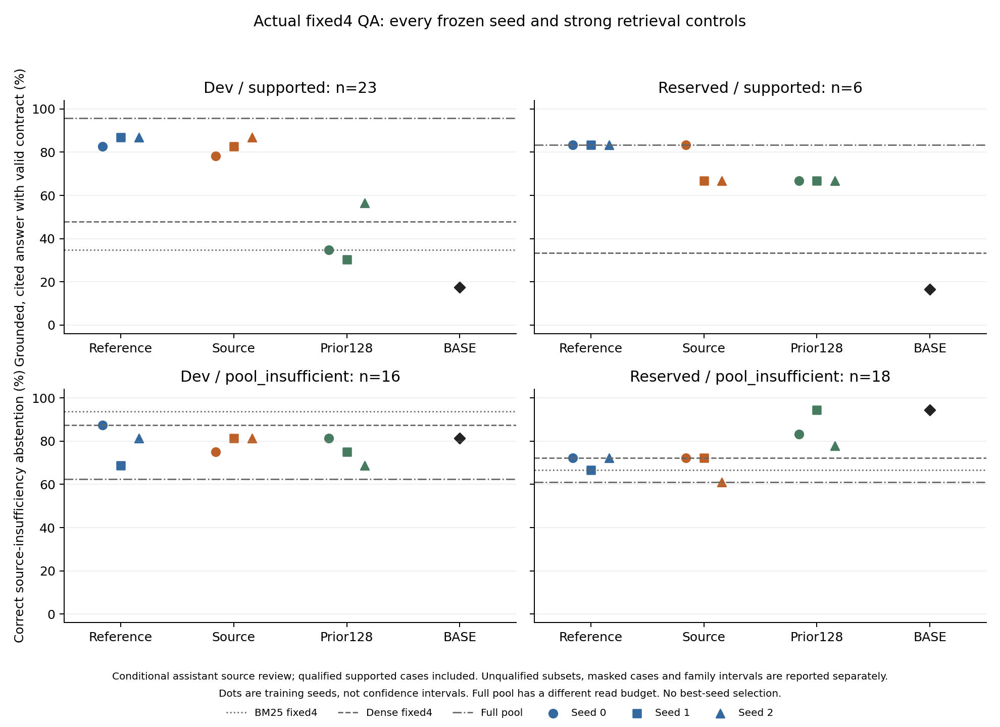

# 来源监督与固定四段选材：本轮结果

六项训练、十二项重载探针、二十项模型选材及两批实际QA均已完成。71案例、923方法
位置对应731份不同首次响应，全部在方法映射展开前逐条审阅并封存。**新固定四段配方
出现超过BM25/dense的局部QA正信号；来源监督相对同预算参考监督的新增优势没有建立，
已读前提变化的机制指标反而三个种子都较低。** 不能沿用上轮“完全未超过dense”的
结论覆盖本轮进展，也不能据小样本点估计宣称普遍泛化或质量—成本净收益。执行来源为
[2026-10-17评审](MILAI_LATEST_DOCS_TRAINING_REVIEW_20261017_46351b5f.md)，过程、历史失败及
逐要求进度见[执行记录](MILAI_SOURCE_SELECTION_EXECUTION_20261017.md)。

## 问题、数据与比较范围

本轮验证完整来源关系监督能否在相同四次读取预算下，比原参考标签更稳定地选全必要
证据，并改善真实Reader问答。训练仅预测尚需补充的open动作，未训练或采用新的STOP
规则；沿用原有限动作头与OR-of-AND证明表示，没有为某个错误添加新服务、路由或阈值。

新准入128训练家族185行，来自MuSiQue与2Wiki作者TRAIN各64家族；开发30家族43行。
全部228行的正文、关系、替代证明和限定先于原参考展开审阅并封存。主状态包含1877训练
前缀、428开发前缀；source有1228条有效训练标签、实际拟合116家族，reference为1495条、
127家族。未因无标签而把原128家族准入规模改小，双方1226条交集仅作诊断。

来源合同允许明确前提下的关系合成、指代、日期/数值比较，不允许世界知识补齐缺失身份、
地点、时间和属性关系。歧义屏蔽与限定解释保留；来源不足不等于世界中没有答案。审阅者
是同一开发助手，部分信息可由题型得知，不能宣称独立人工金标准或完全盲审。

训练中87个支持家族的最短证明按1/2/3/4段为5/47/12/23，含限定解释。23个四段家族
主要是平行关系分支后的比较，并非23条四边串行推理链；只有两个原三步MuSiQue训练
行具有来源内支持，长串行链覆盖仍有限。原分解步数、关系数量、最少读取段落数分开。

另14个新保留家族28行在方法训练前登记保护，来源审阅在方法冻结后、原答案和响应
展开前完成。冻结判定为6支持（其中3限定）、18不足、4屏蔽；支持来自5家族，最短
1/2/3段证明各2行，没有明确四段证明。没有因分布不利而重抽样。实际28输入与train/dev
的目标正文、标题、问题及背景正文的声明字面交叠为0；受保护全家族96行中的未选变体
4318与dev16仍有标题例外，不能声称该更宽指标也通过。这里只证明已登记字面边界，
不认证所有语义近重复、全部历史或预训练未见。

## 训练和重载机制结果

source/reference各三个种子，共用预训练BASE/native头、soft-CE与选项置换，每项188次
更新、3008个训练实例，仅采用最终188步checkpoint。没有选最佳中途点、最佳种子，
也没有重跑旧12项训练。共同输入状态包含自然BM25/随机前缀与两种专家证明前缀；因此
reference是共同来源感知状态构造中的原参考标签对照，不是从未接触来源审阅的流程。
标签掩码、拟合家族和实际tokens不同，同更新数不等于同FLOPs或纯标签因果实验。

| 保存前FP32结果，seed0/1/2 | reference | source |
|---|---|---|
| 自身训练接受 | 1494/1495、1495/1495、1492/1495 | 1228/1228、1228/1228、1227/1228 |
| 共同来源开发标签 /255 | 171 / 192 / 185 | 195 / 192 / 201 |
| 原参考开发标签 /354 | 251 / 276 / 244 | 256 / 257 / 260 |
| 来源支持池前缀 /185 | 141 / 154 / 142 | 147 / 143 / 153 |
| 来源不足池部分证据前缀 /70 | 30 / 38 / 43 | 48 / 49 / 48 |

共同BASE来源标签为43/255，BM25-next为150/255。source相对reference的净增40个
重复种子状态位置中，34来自不足池的部分证据选择，支持池仅净增6；不是40个独立案例，
不能由此推出真实可答任务收益。六任务encoder/head参数抽查均发生变化，模型近乎拟合
自身训练标签，但拟合充分并不解释迁移能力。

保存FP16后按冻结协议重载FP32，reference原视图接受为171/191/185，source为
195/192/201。reference种子1有一项canonical选择与保存前不同（427/428一致），另五项
428/428一致；这是实际预测一致性观察，没有权重SHA校验，也不能只归因于量化。
全部训练诊断及计量见[学习结果](../data/manifests/milai-source-selection-v2-learning-results.json)。

| 原视图与变换视图均可接受，seed0/1/2 | reference | source |
|---|---|---|
| 标识符替换 /255 | 164 / 172 / 179 | 184 / 186 / 189 |
| 候选正文反序 /255 | 160 / 169 / 174 | 182 / 180 / 188 |
| 动作选项反序 /255 | 167 / 180 / 174 | 190 / 190 / 199 |
| 中性标题框架 /255 | 157 / 174 / 177 | 184 / 187 / 192 |
| 已读证据反序，实际变化的有标签输入 /132 | 85 / 95 / 90 | 98 / 97 / 101 |
| 改变已读前提后，双侧正确且必要换选 /31对 | 10 / 12 / 12 | 7 / 5 / 10 |

最后一行是明确的负面机制发现：source三个种子均更低。44个人工上下文中42个有标签，
单上下文接受为reference24/26/25、source22/22/27；换选但未双侧正确为5/12/8与
8/12/11，不能只用动作变化率评价。该探针固定问题、候选与动作，改变已读前提副本，
不是自然反事实分布或实际策略鲁棒认证。排序/排除可能比前提条件化学得更好只是待验证
解释，当前证据不能确证原因；本轮没有因该结果修改配方、重训或扩矩阵。

较高原始接受数本身会提高双视图接受，不能宣称所有条件保持率均改善。证据反序仅
252/428个输入实际改变，其中132有标签；空或单证据前缀不是有效扰动。候选正文反序
的canonical一致数reference254/269/275、source291/305/298（/428），多合法open间
切换不自动算错，也不等于普遍呈现不变性。
完整重载分母、各视图与配对结果见[探针结果](../data/manifests/milai-source-selection-v2-probe-results.json)。

## 实际问答：选材配方有进展，来源监督没有新增优势

两批共13方法×71案例=923方法位置：六个新模型、BASE、三个旧128/native模型、
BM25固定4、dense固定4及全池。实际候选池为10/19/20段。旧模型按原STOP输入任务
运行fixed4并在选择时忽略STOP，新模型/BASE使用open-only输入；两类流程并不相同。
全池读取预算不同，仅作覆盖参照。Reader端点、提示与解码保持；仅完全相同渲染输入
复用首次响应，首次失败保留，不重试、不修复回答字符串。

原生答案及评分保持。2Wiki使用适配MuSiQue的EM/F1归一化，不能冒称官方2Wiki
榜单结果；MuSiQue自然正负配对另用原官方评分。来源任务需正确核心值、实际交付材料
完整关系、充分引用及输出合同同时满足。子集不足上的正确拒答是Reader局部正确，
但若全池有充分证明则仍是选材后的任务损失。限定回答与歧义屏蔽不按主成功的补集
一律叫错误。来源限定与原生评分是不同问题，均保留。

数字顺序均为seed0/1/2。开发为23支持、16不足、4屏蔽；保留为6支持、18不足、4屏蔽。
支持类包含预登记的限定解释，下方另列无显式限定子集。

| 方法 | 开发支持成功 /23 | 开发不足正确拒答 /16 | 保留支持成功 /6 | 保留不足正确拒答 /18 |
|---|---|---|---|---|
| 新reference固定4 | 19 / 20 / 20 | 14 / 11 / 13 | 5 / 5 / 5 | 13 / 12 / 13 |
| 新source固定4 | 18 / 19 / 20 | 12 / 13 / 13 | 5 / 4 / 4 | 13 / 13 / 11 |
| 旧128/native固定4 | 8 / 7 / 13 | 13 / 12 / 11 | 4 / 4 / 4 | 15 / 17 / 14 |
| BASE | 4 | 13 | 1 | 17 |
| BM25固定4 | 8 | 15 | 2 | 12 |
| dense固定4 | 11 | 14 | 2 | 13 |
| 全池 | 22 | 10 | 5 | 11 |

新reference的来源证明交付数为开发20/20/20、保留5/5/5；source为18/20/21与5/4/4，
dense为13与2。证明已交付仍可能因答案或引用失败失分；全池分别交付23与6个已知证明，
最终成功22与5。保留水域题全池答了段落确有提及的“sea level”，没有答冻结解释要求的
English Channel，不能把材料出现的任一事实当作目标成功。

开发增益主要在2Wiki：其13个支持案例reference成功12/13/13、source12/12/13、dense5；
MuSiQue的10个支持案例为7/7/7、6/7/7、6。最短三段/四段的开发支持案例共4/2个，
六个新模型均成功4/4及2/2，dense均0；这些结果包含并行比较，不能称普遍长串行能力。
保留最短三段仅2例，reference为1/1/1、source1/0/0、dense0；无最短四段案例。
旧模型与新配方同时存在训练来源、目标及输入任务差异，不能将新旧差异纯归因于来源标签。

无显式来源限定的开发17例中，reference14/15/15、source13/14/16、dense6；限定6例
为5/5/5、5/5/4、5。保留无显式限定仅3例，新六模型均3/3、dense2/3；限定3例
reference2/2/2、source2/1/1、dense0。无显式限定仍是作者判断，不自动成为独立gold。
主任务之外的限定且有据、引用充分响应，开发全池3份、新六模型各1份；保留全池3份、
reference种子1为1份、其余新模型0。其余限定回答不能一律由主成功数相减后称为错误。

自然来源支持/不足配对的双侧成功：开发6对中reference4/4/4、source3/4/5、dense3；
保留4对中reference3/3/3、source3/2/2、dense0。原生正负身份不保证来源极性也翻转，
因此不能将所有原生配对都纳入该分母，也不能与人工已读前提探针合并。

### 原生评分与家族不确定性

| 方法 | 开发原可答29例F1，% | 保留原可答14例F1，% |
|---|---|---|
| 新reference | 65.20 / 73.82 / 65.35 | 49.11 / 70.00 / 49.52 |
| 新source | 63.82 / 63.86 / 64.24 | 48.57 / 44.60 / 49.52 |
| 旧128/native | 34.48 / 25.52 / 48.28 | 22.62 / 24.60 / 34.29 |
| BASE | 11.72 | 0.00 |
| BM25 | 29.50 | 17.46 |
| dense | 45.98 | 35.71 |
| 全池 | 82.76 | 77.94 |

所有首次失败按原流程计入，回答字符串未做抽取、修复或改写。原生MuSiQue自然配对的
官方分组指标及支持F1、answerability等保留在[回执与成本结果](../data/manifests/milai-source-selection-v2-qa-costs.json)。
完整来源分层、最短证明、原分解步数、逐家族及配对区间见
[QA结果](../data/manifests/milai-source-selection-v2-qa-results.json)。

按家族等权、10000次bootstrap的描述性95%区间，保留支持类只有5个家族。source相对
dense的家族成功差为+0.60、+0.40、+0.40，区间分别[0.20,1.00]、[0.00,0.80]、
[0.00,0.80]；开发21个支持家族的对应差为+0.333、+0.381、+0.452，区间分别
[0.095,0.571]、[0.143,0.619]、[0.190,0.714]。保留原生F1相对dense三个区间均跨零。

source相对匹配reference，保留支持类家族差为0、−0.20、−0.20；区间[0,0]、
[−0.60,0]、[−0.60,0]。第一个退化区间只表示这5家族的观测差都为零，不证明总体等效。
保留原生F1配对差为−0.0054、−0.2540、0；种子1区间[−0.4845,−0.0714]，其余
均含零。所有种子和比较保留，不从种子1或任一区间挑选赢家；区间条件于冻结小面板、
首次响应及作者解释，不覆盖重复生成、标注不确定性或自然总体，且存在多重比较。

### 首次失败与引用补充

开发433次首请求、126次相同输入复用；保留298次首请求、66次复用。两次长度上限
失败分别是dev198和reserved14，均未重试；后者保留不完整JSON与末尾空白。另两份
开发响应139/260在answerable=false时answer非空，按独立输出合同失败保留。失败与
复用次数不等于独立案例或语义错误数量。完整逐条判断见
[开发注释](../data/manifests/milai-source-selection-v2-dev-response-annotations.json)与
[保留注释](../data/manifests/milai-source-selection-v2-reserved-response-annotations.json)。

预测后、方法映射前登记的Alta地址层级引用路径，已对所有方法统一应用为探索性敏感性。
实际只对应旧prior128/seed1的dev16/response186：开发支持成功由主口径7/23变为
替代口径8/23。其余方法及保留集均不受影响；冻结证明、训练标签、主注释和原生分数
没有修改。不能隐去这个补充，也不能用它为新的source模型补分。

[QA图PDF](figures/source-selection-v2/actual-qa.pdf)；
[学习曲线PNG](figures/source-selection-v2/learning.png) / [PDF](figures/source-selection-v2/learning.pdf)。
图中点为训练种子，非置信区间；资格、分母和预算差异以正文与机器报告为准。

## 实际成本与计量范围

已完成的研究计算：六训练合计1128更新、18048实例、35,021,231训练输入tokens；
训练期间开发诊断17,013,708、最终训练集诊断15,871,626tokens另列。六训练进程本体
墙钟6183.947秒，12探针15672次前向、34,625,088tokens、1901.880秒。逐任务原账本
核对通过，学习分析2.989秒、探针分析8.116秒均只计一次。

| 实际工作 | 开发 | 保留 |
|---|---|---|
| Reader首请求 / 相同输入复用 | 433 / 126 | 298 / 66 |
| Reader输入 / 输出tokens | 350280 / 633866 | 258838 / 472438 |
| Reader总tokens | 984146 | 731276 |
| Reader进程本体墙钟，秒 | 4159.596 | 3101.528 |
| dense实际embedding tokens | 50077 | 42936 |
| dense编码和排序本体墙钟，秒 | 8.615 | 7.649 |
| 十模型选材前向 | 1720 | 1120 |
| 十模型选材输入tokens | 4006442 | 3205811 |
| 十模型选材进程本体墙钟，秒 | 288.617 | 251.648 |

总Reader用量1,715,422tokens、dense93,013tokens；20项选材合计2,840次前向、
7,212,253输入tokens。回执和账本增量逐项一致，本轮生成/embedding新增未知用量均0，
历史generation11/embedding1条未知记录不抹除。32项本地审计包含12探针与20选材，
审计引用已有费用，未再扣一次模型工作。

按单独运行每种方法还原全部输入复用后，source每种子控制器输入开发约399千、保留
约320千tokens；对应Reader开发88.3–91.1千、保留59.9–65.0千tokens。dense Reader
为87.8千、62.5千，另有上表跨案例共享编码开销。全池Reader为162.7千、130.5千，
但不足类拒答更差。不能仅用减少Reader材料声称整体加速，也不能把控制器与Reader
不同模型的tokens当成同价计算。研究训练和探针不重复摊入每个线上问题。

两批回执分析3.684/2.687秒、语义关联0.038/0.024秒、流式导出合计2.718秒，
最终分层汇总18.177秒、四份图表导出2.449秒，均仅记原账本一次。预览与原生评分四个
阶段仅有协调器进程墙钟，合计11.778秒，CPU未记录，单列补记而非重计模型费用。
不同模型tokenizer的tokens不是等价FLOPs，暖组件时间
不等于实际共驻生产时延；作者审阅、准备及协调开销未完整计时，不能当零成本。

## 边界与可复核性

训练源码封存`6ec3984b`，评价源码封存`215c84da`；这些提交ID仅记录来源，未执行
SHA、checksum或替代内容指纹校验。执行闭合后，用户明确要求提交GitHub；截至
`5c61fe0d`的24个新增研究提交已成功推送到`feat/lab-audit-objective-diagnosis-20261017`。
未合并main，没有远端CI通过声明。沿用原唯一连续账本，没有新服务、新账本或自动重试。
Product、公开Schema/API、默认策略、Writer及旧暂停工作树没有因本轮结果而升级采用。

相关定向测试、Ruff/mypy与包/工具依赖边界检查通过，未声称全仓或远端CI通过。
执行证据和能力限制分别见[逐要求审计](../data/manifests/milai-source-selection-v2-completion-audit.json)。
最终40项执行核对通过，不是40项语义能力成功；审计约0.076秒计原账本一次。首次审计
读取字段名写错，在记账前退出，修正后完成；没有重跑模型或已有分析，失败准备计时未保存。

本轮可保留的研究判断是：扩大并整理来源覆盖、匹配更新预算且专门学习open的两种配方，
都比旧方案呈现更强的选材信号；但当前比较不能拆出每项改动的独立贡献。来源监督的
前缀接受提升主要来自不足池部分证据，没有形成相对参考监督的稳定QA提升，尤其没有
改善已读前提改变时的互补选材。后续若继续研究，应围绕这一可被否定的机制问题提出
新假设，并重新登记保留家族；本轮保留面板在此冻结评估中的资格有效，今后已是暴露回归。
这些结果不构成自动STOP、Writer、产品默认策略或生产性能的采用依据。
